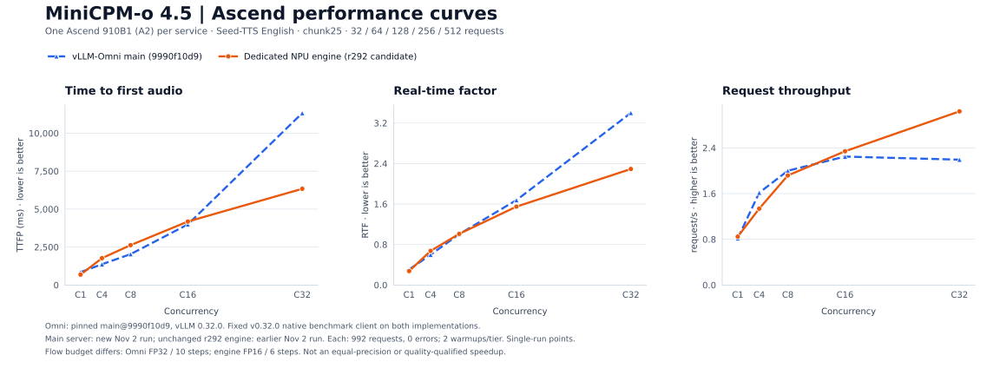
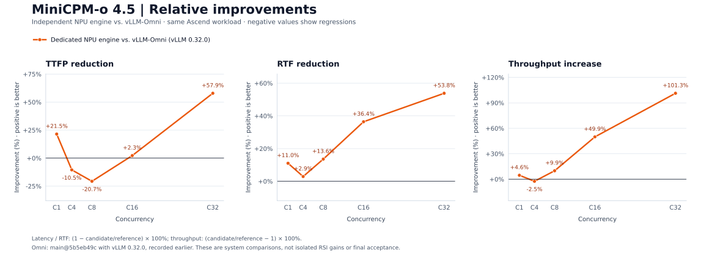

# MiniCPM-o 4.5 · Ascend 910B1

A standalone streaming speech engine for [MiniCPM-o 4.5](https://huggingface.co/openbmb/MiniCPM-o-4_5) on one
Ascend 910B1. Thinker and Talker use a native `torch-npu` paged-KV runtime; Token2Wav runs on the same NPU with
Ascend-safe HiFT and DiT attention. The server speaks the OpenAI-compatible `/v1/chat/completions` API with streamed
text and 24 kHz audio. It does not import or run vLLM-Omni at runtime.

Current status: both the official Omni v0.32.0 baseline and the unchanged r292 candidate were remeasured on
Ascend, 1,984 requests total, zero errors. Internal Flow precision/step budgets differ, and frozen statistical,
speech-quality and long-run stability acceptance is incomplete. See the [current report](docs/current-status-2026-11-02.md).

## Architecture


[Ascend NPU architecture](docs/architecture-npu.md) ·
[Ascend optimization map](docs/optimizations-npu.md) ·
[Current acceptance status](docs/current-status-2026-11-02.md) ·
[Ascend test status](docs/testing-npu.md)

## Why this engine can be faster

The advantage comes from controlling the speech pipeline as one workload instead of treating Thinker, Talker and
Code2Wav as unrelated generic stages. The design targets the dominant costs observed in the baseline traces:

| Bottleneck | Dedicated engine design | Expected effect |
|---|---|---|
| Host launch and graph overhead | Fixed-shape NPU graph buckets for Thinker/Talker/DiT/HiFT, plus K-step Talker graph blocks | Fewer Python launches and fewer shape/capture transitions per generated audio window |
| Cross-stage handoff | Thinker hidden states, Talker KV and sampler state stay in the same runtime; the Talker is updated in place | Less process/RPC/host serialization and less repeated tensor materialization |
| KV growth under concurrency | Paged KV pools with explicit lifetime commitments, page reuse and admission backpressure | Ragged concurrent requests do not require a full dense KV allocation or late eviction |
| Token2Wav launch pressure | Batched streaming windows, fixed `chunk25`, cached flow/HiFT shapes and device-side sampling where supported | More audio windows are processed per accelerator launch and the first playable window can start earlier |
| Scheduling interference | A dedicated engine owner, bounded prefill budgets, a first-chunk lane and fair graph-capture gating | Continuing streams retain playback slack while new work cannot starve a capture operation |
| CPU/device synchronization | Queued copies and ordered plan submission; no unnecessary scalar observation in the hot path | The host can enqueue the next stage while the NPU is executing the current stage |

The design targets launch-bound and queue-bound behavior in the Ascend serving path: graph-captured, batched
Token2Wav windows reduce per-window control work, while paged KV and a single runtime keep the Thinker-to-Talker
handoff local. These are architectural reasons for a potential gain, not a promise that every candidate revision wins
every tier.

Omni v0.32.0 also uses NPU graph paths and multi-frame Talker decoding. The observed system gap must not be
explained simply as “graphs versus eager”: the current engine also has a smaller Flow precision/step budget.
The new official-tag comparison is below; isolated optimization attribution requires controlled ablations.

## Precision, parity and speech quality

Performance changes are accepted only when they preserve the model contract. The repository checks or records:

- the pinned MiniCPM-o 4.5 revision, prompt construction and reference-audio identity;
- Thinker/Talker token and KV parity tests, sampler ordering, counter-based per-request RNG, EOS handling and graph
  fallback paths;
- recorded per-implementation precision and solver settings, `chunk25`, request IDs and native warmup semantics;
  the stock Omni and engine Flow budgets differ as shown below;
- streamed 24 kHz mono PCM output, with WER, speaker similarity, UTMOS, silence, repetition and truncation checks.

The engine is allowed to produce codec tokens that are not bit-for-bit identical to vLLM-Omni, but that is a quality
tradeoff subject to the frozen speech gates. The Ascend candidate keeps the pinned model revision, FP16 flow, six flow-
matching steps, native sampling configuration and `chunk25` workload. Thinker/Talker token and KV parity, sampler
ordering, counter-based RNG, EOS handling and eager graph fallbacks remain part of the contract. In the latest Ascend
r292 development screen, differences relative to the previous standalone engine stayed within the configured margins,
but the small 16-row screen did not satisfy every absolute WER/UTMOS floor and the final frozen speech gate was not run.
The existing FP16/6-step choice is explicit; quality equivalence to stock FP32/10-step Omni is not established.

## How RSI produced the optimizations

RSI is used as an evidence loop rather than as a list of unverified tricks:

1. Freeze the model revision, request IDs, sampling, chunk size and acceptance gates.
2. Measure the unmodified path with the repository-native benchmark and stage markers.
3. Profile the earliest demonstrated cause of a bubble: host waits, graph capture contention, copies, queueing or
   shape churn. InferRSI mechanisms are hypotheses; they are reimplemented for this engine and do not inherit an
   external speedup claim.
4. Change one mechanism at a time in an isolated engine tree, keep eager fallbacks, and run focused numerical and
   concurrency tests before serving traffic.
5. Re-run the same native workload, reverse-check promising candidates, then apply speech quality and statistical
   gates. A regression or a failed runtime is retained as evidence and rejected.

The latest ten-round profiling campaign illustrates the loop:

| RSI iteration | Hypothesis | Evidence-based decision |
|---|---|---|
| Fair capture gate | Stop new non-nested readers from starving a capture writer | Capture wait fell, but some wait moved to engine readers; retained for combination testing |
| HiFT startup warmup | Move one-time graph work out of the first request | Startup work was isolated, but served gain was not established |
| Euler startup warmup | Pre-capture common Euler shapes | CANN task-group failure and service crash; rejected |
| Dynamic task-update exclusion | Serialize a problematic update region | Host wait expanded to 13.8 s; clear regression; rejected |
| First-audio priority | Process `sample_offset==0` windows before continuation windows | Best preliminary candidate, but matched validation showed small gains and C8/C32 regressions |
| Dense page-index reuse | Cache immutable page-ID tensors | Avoided repeated constructions, but did not improve end-to-end service metrics |

This process is why the repository contains both accepted mechanisms and negative results: a faster microbenchmark,
shorter lock wait or fewer object constructions is not enough unless the unprofiled native server improves without
breaking parity or speech quality.

## Quickstart

Requires Linux, Python 3.12, CANN/torch-npu, and one Ascend 910B1. Run the complete server lifetime under the local
`npu run` scheduler so the reservation is not released while child processes are still active.

```bash
npu run --gpus 1 --timeout 8h --wait 30m --note minicpmo-ascend -- \
  bash -lc 'ASCEND_RT_VISIBLE_DEVICES=${ASCEND_RT_VISIBLE_DEVICES:?} \
  MODEL_PATH=/dataset/models/MiniCPM-o-4_5 \
  scripts/serve_engine.sh ascend_graph_v1 18080'
```

`scripts/serve_engine.sh <config> <port>` loads `configs/engine/<config>.json` and requires the scheduler-provided
`ASCEND_RT_VISIBLE_DEVICES`. The checkpoint is found at `MODEL_PATH` or the pinned Hugging Face snapshot.

From another terminal:

```bash
curl --fail http://127.0.0.1:18080/health
REF="${HF_HUB_CACHE:-$HOME/.cache/huggingface/hub}"/models--openbmb--MiniCPM-o-4_5/snapshots/503e754207c94da6bb26850b4469f367c9ea3582/assets/HT_ref_audio.wav
printf '{"model": "openbmb/MiniCPM-o-4_5", "stream": true, "modalities": ["text", "audio"],
 "messages": [{"role": "user", "content": "Please read the following text out loud in English: Hello from MiniCPM-o."}],
 "chat_template_kwargs": {"use_tts_template": true, "enable_thinking": false},
 "max_tokens": 256, "temperature": 0, "seed": 1, "ref_audio": "data:audio/wav;base64,%s"}' "$(base64 -w0 "$REF")" > body.json
curl --fail-with-body -N http://127.0.0.1:18080/v1/chat/completions \
  -H 'Content-Type: application/json' --data-binary @body.json
```

Text arrives as `{"modality": "text", "choices": [{"delta": {"content": ...}}]}` and audio as
`{"modality": "audio", "audio_offset_samples": o, "num_samples": n, "choices": [{"delta": {"content": <base64 WAV>}}]}`
(24 kHz, mono, 16-bit PCM). The default Talker sampling is the model card's (temperature 0.8, top-p 0.85, top-k 25,
repetition penalty 1.05 over 16 frames); `talker_sampling` overrides it per request. Image, audio and video inputs use
the usual `image_url`, `input_audio`/`audio_url` and `video_url` content parts. See [Ascend API and request flow](docs/architecture-npu.md).

## Ascend performance: dedicated engine vs. vLLM-Omni v0.32.0

The baseline is now **the official vLLM-Omni `v0.32.0` tag**, commit
[`5917730a`](https://github.com/vllm-project/vllm-omni/commit/5917730a4b02aedb44d374173cdc1b10484ccd52),
with vLLM runtime 0.32.0. The previous `main@5b5eb49c` measurement is preserved as history, not used for this table.
Both services were remeasured on November 2, 2026 with the same tagged benchmark client and input tiers on A2.



| C | Omni v0.32.0: TTFP ms / RTF / req/s | Dedicated engine: TTFP ms / RTF / req/s | Engine improvement: TTFP / RTF / throughput |
|---:|---:|---:|---:|
| 1 | 1077.51 / 0.39586 / 0.63074 | 684.39 / 0.27521 / 0.84623 | +36.48% / +30.48% / +34.16% |
| 4 | 2131.17 / 0.83511 / 1.17511 | 1768.02 / 0.67370 / 1.33647 | +17.04% / +19.33% / +13.73% |
| 8 | 3221.95 / 1.42215 / 1.43064 | 2626.48 / 1.01072 / 1.91735 | +18.48% / +28.93% / +34.02% |
| 16 | 5785.64 / 2.38115 / 1.60263 | 4181.12 / 1.54829 / 2.34131 | +27.73% / +34.98% / +46.09% |
| 32 | 15420.54 / 4.77496 / 1.55745 | 6338.58 / 2.29230 / 3.03962 | +58.90% / +51.99% / +95.17% |

Lower TTFP/RTF and higher request/s are better; positive percentages mean improvement over Omni.
The five tiers contain 32/64/128/256/512 measured requests with native two warmups per tier.
Each service completed 992/992 requests, zero errors. These are single-run point estimates, not frozen LCB results.
The A2-specific CI case covers C1/C4/C8; C16/C32 extend it using the tag's generic five-tier case.

**Compute differs:** stock Omni uses FP32 Flow with 10 steps; the unchanged r292 engine uses FP16 Flow with 6 steps.
Both use chunk25. This is a system configuration comparison, not proof of a lossless same-precision speedup.
The quality gate has not passed, so the candidate is not promoted to a released/default engine.



[Full settings, quality and version caveats](docs/current-status-2026-11-02.md) ·
[Data and source hashes](docs/data/ascend-v0320-comparison.json) ·
[Download PNG curves](docs/figures/npu-performance-curves.png) ·
[Download PNG improvements](docs/figures/npu-improvement-curves.png)

To regenerate with Python and Matplotlib:

```bash
python -m pip install matplotlib
python tools/plot_npu_performance.py
```

The [original frozen Ascend plan](evidence/20261022-ascend910b1/plan/acceptance.json) remains preserved for audit.
Its original baseline and K=10 protocol predate this run; these curves do not claim to complete frozen acceptance.

## References

- [MiniCPM-o 4.5](https://huggingface.co/openbmb/MiniCPM-o-4_5): checkpoint, processor, encoders and the
  `streaming_generate` reference ported here.
- [minicpmo-utils](https://pypi.org/project/minicpmo-utils/) (`stepaudio2`): the reference Token2Wav, CosyVoice2 flow and
  HiFT modules.
- [PyTorch](https://github.com/pytorch/pytorch) and `torch-npu`: accelerator operators and graph execution.
- [vLLM-Omni](https://github.com/vllm-project/vllm-omni) and [SGLang-Omni](https://github.com/sgl-project/sglang-omni):
  serving baselines and the speech evaluation tools (Seed-TTS WER, speaker similarity).
- [Seed-TTS eval](https://huggingface.co/datasets/zhaochenyang20/seed-tts-eval): the voice-cloning workload.
- [OmniRSI](https://github.com/ThinkFlowLab/OmniRSI): recorded optimization knowledge and evidence.

See [NOTICE](NOTICE) and the [Apache-2.0 license text](third_party_licenses/Apache-2.0.txt) of the reused code.
