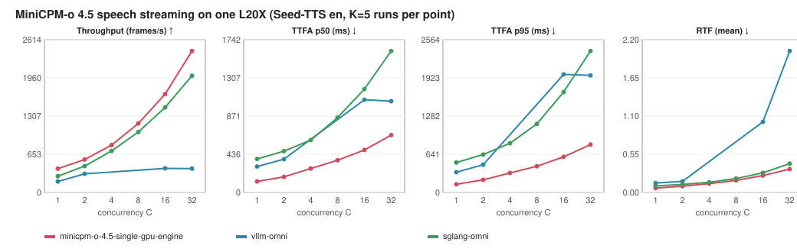

# MiniCPM-o 4.5 · Ascend 910B1

A standalone streaming speech engine for [MiniCPM-o 4.5](https://huggingface.co/openbmb/MiniCPM-o-4_5) on one
Ascend 910B1. Thinker and Talker use a native `torch-npu` paged-KV runtime; Token2Wav runs on the same NPU with
Ascend-safe HiFT and DiT attention. The server speaks the OpenAI-compatible `/v1/chat/completions` API with streamed
text and 24 kHz audio. It does not import or run vLLM-Omni at runtime.

Current status: the graph-enabled NPU engine is end-to-end runnable. The latest native Ascend campaign completed
1,984 requests with zero request errors, but its selected candidate is not a frozen release: C8/C32 regressions,
single-run point estimates, an incomplete final speech gate, and a profiling-path CANN task-group failure remain.
See [`docs/current-status-2026-10-30.md`](docs/current-status-2026-10-30.md) and the frozen acceptance plan under
`evidence/20261022-ascend910b1/plan/`.

## Architecture


[Module details and configurations](docs/architecture.md) ·
[Implemented optimizations and experiment results](docs/optimizations.md) ·
[Why the target is not met yet](docs/performance-gap.md) ·
[Test results](docs/testing.md)

## Why this engine can be faster

The advantage comes from controlling the speech pipeline as one workload instead of treating Thinker, Talker and
Code2Wav as unrelated generic stages. The design targets the dominant costs observed in the baseline traces:

| Bottleneck | Dedicated engine design | Expected effect |
|---|---|---|
| Host launch and graph overhead | Fixed-shape NPU graph buckets for Thinker/Talker/DiT/HiFT, plus K-step Talker graph blocks | Fewer Python launches and fewer shape/capture transitions per generated audio window |
| Cross-stage handoff | Thinker hidden states, Talker KV and sampler state stay in the same runtime; the Talker is updated in place | Less process/RPC/host serialization and less repeated tensor materialization |
| KV growth under concurrency | Paged KV pools with explicit lifetime commitments, page reuse and admission backpressure | Ragged concurrent requests do not require a full dense KV allocation or late eviction |
| Token2Wav launch pressure | Batched streaming windows, fixed `chunk25`, cached flow/HiFT shapes and device-side sampling where supported | More audio windows are processed per accelerator launch and the first playable window can start earlier |
| Scheduling interference | A dedicated engine owner, bounded prefill budgets, a first-chunk lane and fair graph-capture gating | Continuing streams retain playback slack while new work cannot starve a capture operation |
| CPU/device synchronization | Queued copies and ordered plan submission; no unnecessary scalar observation in the hot path | The host can enqueue the next stage while the NPU is executing the current stage |

The historical L20X trace explains why this architecture can beat vLLM-Omni at high concurrency: its generic eager
Code2Wav path plateaued around 330–425 audio frames/s, so RTF reached about 1 at C16 and 2 at C32. The dedicated
runtime uses graph-captured, batched Token2Wav windows and keeps the pipeline streaming. That is an architectural
explanation, not a promise that every candidate revision wins every tier.

The latest Ascend campaign is the honest qualification boundary. The selected r292 candidate improved the matched
r258 reference at C1, C4 and C16, but regressed at C8 and C32. Therefore the public snapshot documents the mechanisms
and evidence while keeping r258 as the engineering reference; it does not claim a uniformly faster released engine.

## Precision, parity and speech quality

Performance changes are accepted only when they preserve the model contract. The repository checks or records:

- the pinned MiniCPM-o 4.5 revision, prompt construction and reference-audio identity;
- Thinker/Talker token and KV parity tests, sampler ordering, counter-based per-request RNG, EOS handling and graph
  fallback paths;
- fixed precision, sampling, six flow-matching steps, `chunk25`, request IDs and native warmup semantics for a
  benchmark comparison;
- streamed 24 kHz mono PCM output, with WER, speaker similarity, UTMOS, silence, repetition and truncation checks.

The engine is allowed to produce codec tokens that are not bit-for-bit identical to vLLM-Omni, but that is a quality
tradeoff subject to the frozen speech gates. In the older GPU `track_s_fast_r16` profile, the stage-0 HiFT transpose
convolution was kept in FP32 because an all-TF32 variant exceeded the numerical error bound; the three-seed C1/C32
screen passed absolute floors, while the comparative UTMOS gate remained separate. In the latest Ascend r292
development screen, all comparative differences stayed within the configured margins, but the small 16-row screen did
not satisfy every absolute WER/UTMOS floor and the final frozen speech gate was not run. No precision reduction or
quality-threshold change is hidden behind the performance numbers.

## How RSI produced the optimizations

RSI is used as an evidence loop rather than as a list of unverified tricks:

1. Freeze the model revision, request IDs, sampling, chunk size and acceptance gates.
2. Measure the unmodified path with the repository-native benchmark and stage markers.
3. Profile the earliest demonstrated cause of a bubble: host waits, graph capture contention, copies, queueing or
   shape churn. InferRSI mechanisms are hypotheses; they are reimplemented for this engine and do not inherit an
   external speedup claim.
4. Change one mechanism at a time in an isolated engine tree, keep eager fallbacks, and run focused numerical and
   concurrency tests before serving traffic.
5. Re-run the same native workload, reverse-check promising candidates, then apply speech quality and statistical
   gates. A regression or a failed runtime is retained as evidence and rejected.

The latest ten-round profiling campaign illustrates the loop:

| RSI iteration | Hypothesis | Evidence-based decision |
|---|---|---|
| Fair capture gate | Stop new non-nested readers from starving a capture writer | Capture wait fell, but some wait moved to engine readers; retained for combination testing |
| HiFT startup warmup | Move one-time graph work out of the first request | Startup work was isolated, but served gain was not established |
| Euler startup warmup | Pre-capture common Euler shapes | CANN task-group failure and service crash; rejected |
| Dynamic task-update exclusion | Serialize a problematic update region | Host wait expanded to 13.8 s; clear regression; rejected |
| First-audio priority | Process `sample_offset==0` windows before continuation windows | Best preliminary candidate, but matched validation showed small gains and C8/C32 regressions |
| Dense page-index reuse | Cache immutable page-ID tensors | Avoided repeated constructions, but did not improve end-to-end service metrics |

This process is why the repository contains both accepted mechanisms and negative results: a faster microbenchmark,
shorter lock wait or fewer object constructions is not enough unless the unprofiled native server improves without
breaking parity or speech quality.

## Quickstart

Requires Linux, Python 3.12, CANN/torch-npu, and one Ascend 910B1. Run the complete server lifetime under the local
`npu run` scheduler so the reservation is not released while child processes are still active.

```bash
npu run --gpus 1 --timeout 8h --wait 30m --note minicpmo-ascend -- \
  bash -lc 'ASCEND_RT_VISIBLE_DEVICES=${ASCEND_RT_VISIBLE_DEVICES:?} \
  MODEL_PATH=/dataset/models/MiniCPM-o-4_5 \
  scripts/serve_engine.sh ascend_graph_v1 18080'
```

`scripts/serve_engine.sh <config> <port>` loads `configs/engine/<config>.json` and requires the scheduler-provided
`ASCEND_RT_VISIBLE_DEVICES`. The checkpoint is found at `MODEL_PATH` or the pinned Hugging Face snapshot.

From another terminal:

```bash
curl --fail http://127.0.0.1:18080/health
REF="${HF_HUB_CACHE:-$HOME/.cache/huggingface/hub}"/models--openbmb--MiniCPM-o-4_5/snapshots/503e754207c94da6bb26850b4469f367c9ea3582/assets/HT_ref_audio.wav
printf '{"model": "openbmb/MiniCPM-o-4_5", "stream": true, "modalities": ["text", "audio"],
 "messages": [{"role": "user", "content": "Please read the following text out loud in English: Hello from MiniCPM-o."}],
 "chat_template_kwargs": {"use_tts_template": true, "enable_thinking": false},
 "max_tokens": 256, "temperature": 0, "seed": 1, "ref_audio": "data:audio/wav;base64,%s"}' "$(base64 -w0 "$REF")" > body.json
curl --fail-with-body -N http://127.0.0.1:18080/v1/chat/completions \
  -H 'Content-Type: application/json' --data-binary @body.json
```

Text arrives as `{"modality": "text", "choices": [{"delta": {"content": ...}}]}` and audio as
`{"modality": "audio", "audio_offset_samples": o, "num_samples": n, "choices": [{"delta": {"content": <base64 WAV>}}]}`
(24 kHz, mono, 16-bit PCM). The default Talker sampling is the model card's (temperature 0.8, top-p 0.85, top-k 25,
repetition penalty 1.05 over 16 frames); `talker_sampling` overrides it per request. Image, audio and video inputs use
the usual `image_url`, `input_audio`/`audio_url` and `video_url` content parts. See [API and request flow](docs/architecture.md).

## Performance evidence

An earlier Ascend development signal used one 910B1, a shared reference voice, a 16-token Thinker cap and a
128-token Talker cap. Each engine row is the mean of five fresh-process runs; the vLLM-Omni comparator is one
successful development run and therefore does **not** satisfy the frozen statistical protocol. It is retained as
historical development evidence, separate from the latest r295 native C1–C32 comparison in
[`docs/current-status-2026-10-30.md`](docs/current-status-2026-10-30.md).

Latest r295 native matched comparison (single-run point estimates; positive values mean improvement over r258):

| C | TTFP ms | RTF | request/s | Change vs. r258: TTFP / RTF / throughput |
|---:|---:|---:|---:|---:|
| 1 | 675.38 | 0.27712 | 0.83926 | +2.11% / +0.26% / +0.37% |
| 4 | 1665.90 | 0.63760 | 1.43391 | +0.81% / +3.52% / +1.50% |
| 8 | 2627.45 | 1.01047 | 1.90201 | -3.53% / -1.75% / -3.35% |
| 16 | 3539.66 | 1.32953 | 2.71455 | +1.33% / +2.99% / +1.83% |
| 32 | 6315.01 | 2.27891 | 2.91337 | -1.64% / -0.38% / -6.07% |

The two fresh services processed 1,984 native requests with zero request errors. These numbers have no frozen
one-sided 95% LCB; C8/C32 regressions mean this candidate is not promoted as the default.

| C | Engine E2E P50 | vLLM-Omni E2E P50 | E2E reduction | Engine throughput | vLLM-Omni throughput | Throughput gain |
|---:|---:|---:|---:|---:|---:|---:|
| 1 | 1.688 s | 4.260 s | 60.4% | 2.229 audio-s/s | 1.089 audio-s/s | 104.7% |
| 16 | 5.119 s | 14.531 s | 64.8% | 11.639 audio-s/s | 3.646 audio-s/s | 219.2% |
| 32 | 7.082 s | 23.039 s | 69.3% | 16.239 audio-s/s | 4.046 audio-s/s | 301.3% |

All 15 candidate runs in this earlier screen completed with zero request failures. The selected profile uses FP16 flow, Thinker/Talker
NPUGraphs, threaded Token2Wav with a 10 ms bounded first-batch window, Euler/HiFT graphs, `first_chunk=25`, and six
flow-matching steps. Its 16-row Seed-TTS quality screen passed the absolute WER/SIM/UTMOS floors; the required
1088-row × three-seed quality gate is still outstanding.

> The table below is inherited CUDA/L20X reference evidence used to guide the NPU port. It is **not** an Ascend result
> and is not accepted by the frozen Ascend validator. Verified 910B1 C1/C16/C32 results will replace it only after the
> candidate and vLLM-Omni cells both pass artifact verification.

<!-- latest-performance:start -->
Recorded on **one L20X** (143 GB, driver 570.133.20) with the same Seed-TTS English voice-cloning requests at each
concurrency: 320 evaluation requests per run (640 at C=32), a warmup, a discarded first run, then **K=5 measured
runs** on a freshly started server each. Rows are means over the K runs. Versions:
MiniCPM-o 4.5 [`503e754`](https://huggingface.co/openbmb/MiniCPM-o-4_5/tree/503e754207c94da6bb26850b4469f367c9ea3582),
vLLM-Omni [`2ec5f26`](https://github.com/vllm-project/vllm-omni/commit/2ec5f265c69520cdd5e5f0a19db485d38885843e),
SGLang-Omni [`22d4ace`](https://github.com/sgl-project/sglang-omni/commit/22d4ace88f9547777b819a69d7691204bb9ce847).

| C | Framework | Config | Throughput (frames/s) | Throughput / SGLang | TTFA p50 (ms) | TTFA p95 (ms) | RTF (mean) |
|---:|---|---|---:|---:|---:|---:|---:|
| 1 | minicpm-o-4.5-single-gpu-engine | `track_s_fast_r16` | 406.01 | 1.46× | 125.8 | 137.6 | 0.0623 |
| 1 | vllm-omni | `minicpmo_4_5_turn_mps-mps-on` | 187.52 | 0.67× | 295.3 | 339.9 | 0.1354 |
| 1 | sglang-omni | `speech-mm32k` | 278.72 | 1.00× | 381.2 | 502.9 | 0.0931 |
| 2 | minicpm-o-4.5-single-gpu-engine | `track_s_fast_r16` | 562.93 | 1.25× | 177.3 | 212.2 | 0.0906 |
| 2 | vllm-omni | `minicpmo_4_5_turn_mps-mps-on` | 318.61 | 0.71× | 380.0 | 465.1 | 0.1596 |
| 2 | sglang-omni | `speech-mps-on` | 450.37 | 1.00× | 471.0 | 637.7 | 0.1152 |
| 4 | minicpm-o-4.5-single-gpu-engine | `track_s_fast_r16` | 810.38 | 1.14× | 272.7 | 326.7 | 0.1261 |
| 4 | vllm-omni | not evaluated at this C | — | — | — | — | — |
| 4 | sglang-omni | `speech-mps-on` | 709.73 | 1.00× | 597.6 | 825.6 | 0.1463 |
| 8 | minicpm-o-4.5-single-gpu-engine | `track_s_fast_r16` | 1180.65 | 1.14× | 367.2 | 439.6 | 0.1734 |
| 8 | vllm-omni | not evaluated at this C | — | — | — | — | — |
| 8 | sglang-omni | `speech-mps-on` | 1033.40 | 1.00× | 853.9 | 1150.4 | 0.2001 |
| 16 | minicpm-o-4.5-single-gpu-engine | `track_s_fast_r16` | 1682.74 | 1.16× | 484.6 | 597.5 | 0.2426 |
| 16 | vllm-omni | `minicpmo_4_5_turn_mrv2_h200_mps-mps-on` | 411.03 | 0.28× | 1057.2 | 1982.3 | 1.0148 |
| 16 | sglang-omni | `speech-mps-on` | 1455.39 | 1.00× | 1179.2 | 1686.0 | 0.2829 |
| 32 | minicpm-o-4.5-single-gpu-engine | `track_s_fast_r16` | 2419.94 | 1.21× | 654.1 | 804.2 | 0.3366 |
| 32 | vllm-omni | `minicpmo_4_5_turn_mrv2_h200_mps-mps-on` | 407.68 | 0.20× | 1041.1 | 1965.6 | 2.0344 |
| 32 | sglang-omni | `speech-mps-off` | 1996.67 | 1.00× | 1613.0 | 2374.3 | 0.4137 |



`C` is the number of concurrent requests. Throughput counts returned audio as 25 Hz codec frames
(25 × delivered seconds / wall time); TTFA is the time to the first audio sample; RTF is each request's time to its
last audio sample divided by its audio duration. Baseline configurations were chosen per concurrency on separate
tuning requests and then measured on the evaluation requests. Where two SGLang-Omni configurations were measured at
one C, the faster one is shown; the target ratios use the configuration selected on the tuning requests for each metric.

- **Missing vLLM-Omni rows.** Only tuning winners were carried into the evaluation. At C=4 and C=8 SGLang-Omni won every
  metric, so vLLM-Omni has no evaluation cell there. It was measured there on the tuning requests: 331–405 frames/s,
  TTFA p50 0.63–1.19 s ([all 42 tuning cells](docs/baselines.md#every-qualified-configuration-on-the-tuning-requests)).
- **vLLM-Omni stops at ~400 frames/s.** Every configuration plateaus from C=4 upward (about 16 s of audio per second), so
  RTF reaches 1 at C=16 and 2 at C=32 and streams stall. Its stage trace puts the limit in the eager, launch-bound
  Code2Wav stage ([analysis](docs/baselines.md#why-vllm-omni-stops-scaling-at-about-400-framess)).
- **SGLang-Omni does not stream audio.** It returns one waveform per request, so its TTFA is its end-to-end latency
  ([details](docs/baselines.md#sglang-omni-does-not-stream-audio)).

**Target status: not met.** The goal is 2× the better baseline on every metric at every C, with the one-sided 95%
bootstrap lower bound (LCB) at or above 2.0. TTFA reaches it in 11 of 12 cells (not TTFA p50 at C=32). Throughput and
RTF reach 1.14–1.49× (LCB 1.13–1.49).
The `track_s_fast_r16` profile passes the Token2Wav numerical bounds and the speech-quality absolute floors over three
seeds at C=1 and C=32 (UTMOS 4.166 / 4.167 against 4.163). Its UTMOS stays 0.13 below SGLang-Omni's, which does not
stream audio; that comparison is reported, not required.
[Ratios, streaming metrics, quality, run ranges and raw evidence](docs/current-results.md) ·
[Baseline selection and analysis](docs/baselines.md) · [Test results](docs/testing.md).
<!-- latest-performance:end -->

## References

- [MiniCPM-o 4.5](https://huggingface.co/openbmb/MiniCPM-o-4_5): checkpoint, processor, encoders and the
  `streaming_generate` reference ported here.
- [minicpmo-utils](https://pypi.org/project/minicpmo-utils/) (`stepaudio2`): the reference Token2Wav, CosyVoice2 flow and
  HiFT modules.
- [FlashInfer](https://github.com/flashinfer-ai/flashinfer), [Triton](https://github.com/triton-lang/triton) and
  [PyTorch](https://github.com/pytorch/pytorch): GPU operators and CUDA graphs.
- [vLLM-Omni](https://github.com/vllm-project/vllm-omni) and [SGLang-Omni](https://github.com/sgl-project/sglang-omni):
  serving baselines and the speech evaluation tools (Seed-TTS WER, speaker similarity).
- [Seed-TTS eval](https://huggingface.co/datasets/zhaochenyang20/seed-tts-eval): the voice-cloning workload.
- [OmniRSI](https://github.com/ThinkFlowLab/OmniRSI): recorded optimization knowledge and evidence.

See [NOTICE](NOTICE) and the [Apache-2.0 license text](third_party_licenses/Apache-2.0.txt) of the reused code.
