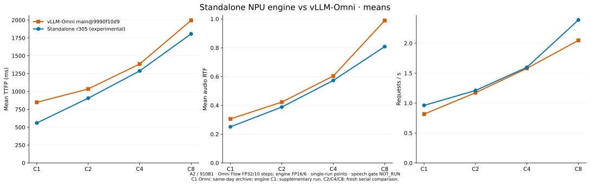
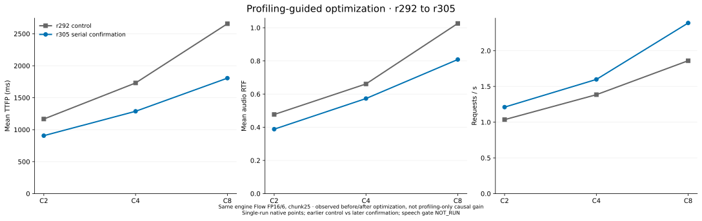

# MiniCPM-o 4.5 · Standalone Ascend NPU engine

A streaming speech engine for [MiniCPM-o 4.5](https://huggingface.co/openbmb/MiniCPM-o-4_5) on one
**Ascend 910B1 / A2**. A native `torch-npu` paged-KV runtime owns Thinker, Talker and Token2Wav;
the OpenAI-compatible API streams text and 24 kHz audio. Serving does **not** import vLLM, vLLM-Omni,
SGLang or InferRSI. vLLM-Omni is the external performance comparator.

**Latest measured candidate: r305, November 2, 2026.** Its mean TTFP, audio RTF and request/s improve over the
pinned Omni main at C1/C2/C4/C8. P99 still regresses at C2/C4/C8. This is experimental code, not a quality-qualified
release: Omni Flow uses FP32/10 steps while this engine uses FP16/6; the final speech gate remains NOT_RUN.

[中文：RSI 找到了什么、六层 profiling 后增加多少](docs/rsi-profiling-20261102.zh-CN.md) ·
[Measurements and provenance](docs/data/ascend-r305-20261102.json) ·
[Reproduction and evidence](evidence/20261102-r305/README.md)

## Mean performance vs. vLLM-Omni

Values are **Omni → r305**. Lower TTFP/RTF and higher request/s are better.
Omni server: [`main@9990f10d9`](https://github.com/vllm-project/vllm-omni/commit/9990f10d9e898c3d38b1fa640513d55f771b8685);
vLLM runtime: 0.32.0; both use the official client `5917730a`, Seed-TTS English and chunk25.

| C | Mean TTFP ms | Reduction | Mean RTF | Reduction | request/s | Increase |
|---|---|---|---|---|---|---|
| C1 | 848.21 → 559.57 | 34.03% | 0.3060 → 0.2509 | 17.99% | 0.8158 → 0.9619 | 17.90% |
| C2 | 1035.28 → 906.21 | 12.47% | 0.4229 → 0.3885 | 8.15% | 1.1730 → 1.2105 | 3.20% |
| C4 | 1384.52 → 1287.76 | 6.99% | 0.6038 → 0.5733 | 5.06% | 1.5805 → 1.5984 | 1.13% |
| C8 | 1994.96 → 1806.22 | 9.46% | 0.9890 → 0.8085 | 18.25% | 2.0471 → 2.3884 | 16.67% |



Each implementation completed 256 measured requests with zero request errors: 32/32/64/128 at C1/C2/C4/C8,
two warmups per tier. Omni C1 is the same-day same-SHA archive; r305 C1 is a new unchanged-candidate measurement.
C2/C4/C8 are the fresh serial comparison. These are single-run points, not confidence bounds.
Audio lengths differ, so RTF improvements also depend on its generated-duration denominator.
See the [full mean/P99 table](docs/rsi-profiling-20261102.zh-CN.md#完整均值与p99) and
[earlier r292 five-tier results](docs/current-status-2026-11-02-main.md) for their separate scope.

## What RSI found, and why r305 is faster

The profiling loop found that **waiting for the first Thinker text chunk**, rather than HTTP serialization,
was a major part of first-audio latency. At diagnostic C8, prefill-to-first-text fell from **1420.8 to 551.7 ms**;
emit-to-client was only about 2–4 ms. These host intervals include contention, not exclusive kernel time.

r305 uses **prompt-lookup proposals with original-model greedy verification**. It finds a continuation in this
request's prompt using already-generated 2–4-token suffixes, verifies the entire causal block with the original
Thinker, retains the matching prefix and target mismatch/bonus prediction, and truncates unused KV.
No dataset IDs, saved answers or extra draft model are used. Ordinary decoding and KV-capacity fallbacks remain.
The screen accepted 2223/3121 proposed tokens (71.23%; three tiers including warmups), reducing serial decode/host
round trips. r305 itself does not change Flow precision, step count or chunk size relative to r292.

Earlier NPU work supplies paged KV, fused decoder/CFM paths, K-step Talker graphs, batched Token2Wav and graph
capture scheduling. These mechanisms are shared foundations, not new r305 speedup percentages.
Omni also uses graphs and multi-frame Talker decoding; the comparison is not “graphs versus eager.”

## What six-layer profiling added

L0 freezes workload identity and measurement boundaries. **L1–L6 are six diagnostic layers**:
pipeline timing; graph/scheduling gaps; redundant work/layout; operators/counters; copies/ownership; component
assessment and validation. Device evidence uses NPUGraph/msprof/CANN, following the logic of
[PR #9236](https://github.com/vllm-project/vllm-omni/pull/9236).

The additional **profiling-guided optimization campaign**, from r292 to unchanged-r305 serial confirmation,
observed the following mean changes under the same engine FP16/6-step/chunk25 configuration:

| C | Mean TTFP ms | Reduction | Mean RTF | Reduction | request/s | Increase |
|---|---|---|---|---|---|---|
| C2 | 1166.64 → 906.21 | 22.32% | 0.4770 → 0.3885 | 18.57% | 1.0354 → 1.2105 | 16.92% |
| C4 | 1730.75 → 1287.76 | 25.60% | 0.6613 → 0.5733 | 13.30% | 1.3847 → 1.5984 | 15.43% |
| C8 | 2657.29 → 1806.22 | 32.03% | 1.0261 → 0.8085 | 21.21% | 1.8602 → 2.3884 | 28.39% |



This is the observed **before/after optimization delta**, not a measured speedup from enabling a profiler.
There is no isolated “RSI alone vs. RSI plus six layers” optimization study. Do not add these percentages to the
Omni gains, or add gains across layers/rounds. Both screening and confirmation points are retained.

The ten rounds also found negative results: larger Thinker graphs improved high-concurrency means but hurt P99;
small decode groups regressed; constant AdaLN hoisting and NPU pending-audio output had no stable end-to-end gain.
The [round-by-round Chinese account](docs/rsi-profiling-20261102.zh-CN.md#十轮实验包含无收益和失败方案)
records hypotheses, knowledge sources, raw results, failures and decisions.

## Architecture and quality


[Runtime architecture](docs/architecture-npu.md) · [NPU optimization map](docs/optimizations-npu.md)

In the 16-row C8 r305 development screen, Thinker text/tokens matched r292 on 16/16, but codec tokens matched on
0/16. This is not a speech-quality pass or proof of bitwise losslessness. Frozen WER/speaker-similarity/UTMOS gates
remain incomplete because the existing scoring service was unreachable. Request-error rate zero is a different check.
The pinned model and original acceptance plan are preserved. Unsupported graph paths retain correctness fallbacks.

The r305 runtime is included with **opt-in** `configs/engine/ascend_r305_experimental.json`; existing default configs
are unchanged. The public server retains its optional CPU-affinity API; all other engine files match measured r305.
The [source manifest](evidence/20261102-r305/source-manifest.json) records that publication difference and exact
measured-source reconstruction. The integrated publication tree is not represented as another timed NPU run.

## Quickstart

Requires Linux, Python 3.12, CANN/torch-npu, and one Ascend 910B1. Run the complete server lifetime under the local
`npu run` scheduler so the reservation is not released while child processes are still active.

```bash
npu run --gpus 1 --timeout 8h --wait 30m --note minicpmo-ascend -- \
  bash -lc 'ASCEND_RT_VISIBLE_DEVICES=${ASCEND_RT_VISIBLE_DEVICES:?} \
  MODEL_PATH=/dataset/models/MiniCPM-o-4_5 \
  scripts/serve_engine.sh ascend_graph_v1 18080'
```

`scripts/serve_engine.sh <config> <port>` loads `configs/engine/<config>.json` and requires the scheduler-provided
`ASCEND_RT_VISIBLE_DEVICES`. The checkpoint is found at `MODEL_PATH` or the pinned Hugging Face snapshot.

From another terminal:

```bash
curl --fail http://127.0.0.1:18080/health
REF="${HF_HUB_CACHE:-$HOME/.cache/huggingface/hub}"/models--openbmb--MiniCPM-o-4_5/snapshots/503e754207c94da6bb26850b4469f367c9ea3582/assets/HT_ref_audio.wav
printf '{"model": "openbmb/MiniCPM-o-4_5", "stream": true, "modalities": ["text", "audio"],
 "messages": [{"role": "user", "content": "Please read the following text out loud in English: Hello from MiniCPM-o."}],
 "chat_template_kwargs": {"use_tts_template": true, "enable_thinking": false},
 "max_tokens": 256, "temperature": 0, "seed": 1, "ref_audio": "data:audio/wav;base64,%s"}' "$(base64 -w0 "$REF")" > body.json
curl --fail-with-body -N http://127.0.0.1:18080/v1/chat/completions \
  -H 'Content-Type: application/json' --data-binary @body.json
```

Text arrives as `{"modality": "text", "choices": [{"delta": {"content": ...}}]}` and audio as
`{"modality": "audio", "audio_offset_samples": o, "num_samples": n, "choices": [{"delta": {"content": <base64 WAV>}}]}`
(24 kHz, mono, 16-bit PCM). The default Talker sampling is the model card's (temperature 0.8, top-p 0.85, top-k 25,
repetition penalty 1.05 over 16 frames); `talker_sampling` overrides it per request. Image, audio and video inputs use
the usual `image_url`, `input_audio`/`audio_url` and `video_url` content parts. See [Ascend API and request flow](docs/architecture-npu.md).


To select the measured experimental settings, use `ascend_r305_experimental` in the scheduler-wrapped command above.
`ascend_r292_control` is supplied for the same-config internal comparison; prompt lookup defaults to disabled.

## Reproduce figures and verify artifacts

```bash
python -m pip install matplotlib
python tools/plot_r305_performance.py
python tools/verify_r305_evidence.py
```

Raw native metric JSONs, workload commands, source/config hashes, receipts, ten-round patches and compact profiling
analyses are under [evidence/20261102-r305](evidence/20261102-r305/README.md). Audio/model weights and large raw traces
remain outside Git. The [original frozen plan](evidence/20261022-ascend910b1/plan/acceptance.json) is unchanged;
these points do not complete its K=10/LCB/final-quality protocol.

## References

- [MiniCPM-o 4.5](https://huggingface.co/openbmb/MiniCPM-o-4_5), minicpmo-utils/StepAudio2, PyTorch and torch-npu.
- [vLLM-Omni](https://github.com/vllm-project/vllm-omni): serving baseline and native benchmark/quality tools.
- [Seed-TTS eval](https://huggingface.co/datasets/zhaochenyang20/seed-tts-eval): English voice-cloning workload.
- [OmniRSI](https://github.com/ThinkFlowLab/OmniRSI): optimization knowledge used as testable hypotheses.

See [NOTICE](NOTICE) and [third-party licenses](third_party_licenses/Apache-2.0.txt).
