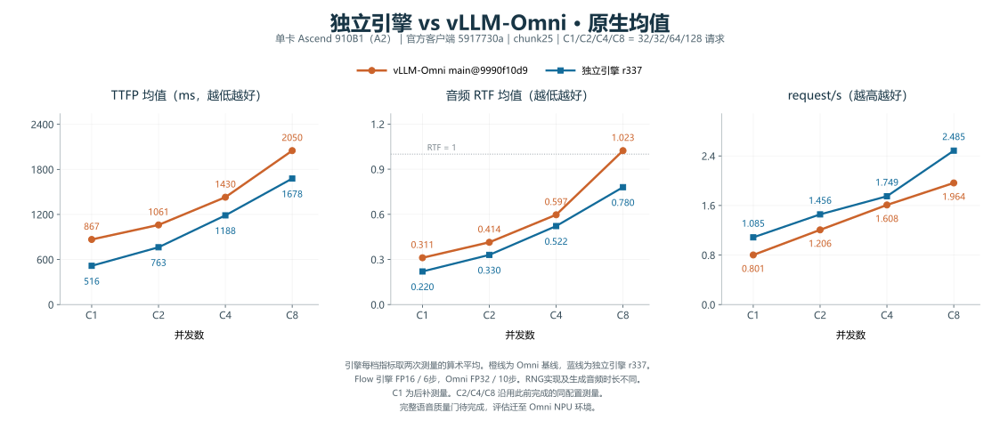
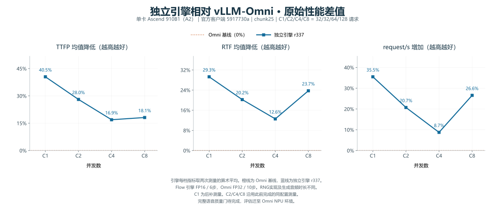
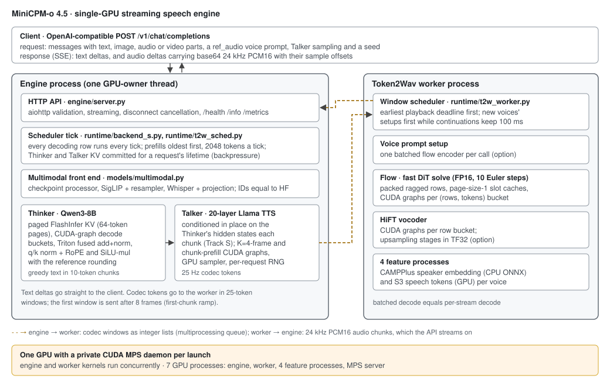

# MiniCPM-o 4.5 · Standalone Ascend NPU engine

A streaming speech engine for MiniCPM-o 4.5 on one **Ascend 910B1 / A2**. A native torch-npu paged-KV runtime
owns Thinker, Talker and Token2Wav. Its OpenAI-compatible API streams text and 24 kHz audio.
Runtime dependencies are isolated from the vLLM, vLLM-Omni, SGLang and InferRSI reference repositories.

**Latest measured experimental candidate — r337, November 3, 2026.** The comparison covers **C1/C2/C4/C8**
against pinned vLLM-Omni main `9990f10d9`, using the official client `5917730a` on vLLM 0.32.0.
The engine uses Flow FP16/6 steps and Omni uses FP32/10 steps. Final paired speech-quality acceptance is pending.

[C8完整演进曲线](docs/c8-optimization-journey.zh-CN.md) ·
[中文优化历程与最新结果](docs/rsi-r337-20261103.zh-CN.md) ·
[全部 NPU 实验账本](docs/optimization-ledger-npu.zh-CN.md) ·
[40轮逐项记录](evidence/20261103-r337/campaign/持续优化实验记录.md) ·
[Mean/P99 and provenance](docs/current-results.md) ·
[Reproduction and evidence](evidence/20261103-r337/README.md)

## Mean performance vs. vLLM-Omni

Values are **Omni → r337**. Each engine point is the arithmetic mean of its two recorded run-level values.
TTFP/RTF are lower-is-better and request/s is higher-is-better. Each chart shows one engine curve and one Omni curve.

| C | Mean TTFP ms | Reduction | Mean RTF | Reduction | request/s | Increase |
|---|---|---|---|---|---|---|
| C1 | 867.18 → 516.35 | 40.46% | 0.3114 → 0.2202 | 29.28% | 0.8012 → 1.0855 | 35.48% |
| C2 | 1060.66 → 763.15 | 28.05% | 0.4142 → 0.3304 | 20.23% | 1.2062 → 1.4562 | 20.72% |
| C4 | 1429.62 → 1187.96 | 16.90% | 0.5970 → 0.5220 | 12.56% | 1.6083 → 1.7489 | 8.74% |
| C8 | 2049.72 → 1678.15 | 18.13% | 1.0234 → 0.7805 | 23.74% | 1.9637 → 2.4851 | 26.55% |





The fixed workload is Seed-TTS English, chunk25, 32/32/64/128 timed requests at C1/C2/C4/C8 and two warmups per tier.
All displayed source runs completed with zero request errors. C1 was supplemented on November 3 with the same
source and configuration. C2/C4/C8 retain the preceding same-configuration measurements. Generated audio durations and RNG paths
differ between deployments and are recorded in the evidence.

The P99 chart uses the arithmetic mean of the two candidate run-level P99 values. Each source run has
32/32/64/128 requests per tier. Full raw values and the aggregation formula are available with the evidence.

[P99 chart](evidence/20261103-r337/campaign/独立引擎vs-vLLM-Omni-P99.svg) · [Machine-readable comparison](docs/data/ascend-r337-20261103.json)

## How RSI and profiling changed the engine


At C8, the engine's throughput progresses from **0.818× to 1.266×** the fixed current Omni reference.
Each x-axis stage names the accumulated optimization, and edge labels show the observed change from the preceding
stage. The three panels cover TTFP speed, inverse-RTF efficiency and request throughput. Negative stages remain visible.
The initial uniform-CLI point is r187, and the final point is the two-run r337 mean. These cross-date endpoints include
stage combinations and run variation. The accompanying account records each point's raw values and source hashes.

[C8 stage-by-stage account and data](docs/c8-optimization-journey.zh-CN.md)

The complete history covers NPU migration and evidence contracts, RSI knowledge adaptation, profiling-led original
strategies, six-layer diagnosis, r307–r309 follow-ups and **40 further algorithm attempts through r351**.
Of those 40 attempts, 33 jobs exited zero and seven were rejected by framework/operator constraints or crashes.
The archive retains successful, inconclusive and failed ideas, exact parent patches and fresh confirmations.

| Phase | Measured comparison | Mean TTFP reduction | Mean RTF reduction | request/s increase |
|---|---|---:|---:|---:|
| RSI knowledge adaptation | r187 → hybrid r239, C1/C4/C8 | 7.90%–11.61% | 7.95%–10.89% | 8.94%–10.62% |
| Profiling + AI-derived strategies | r239 → r292 measured in r295, C1/C4/C8 | 4.76%–7.34% | 4.62%–9.26% | 3.58%–9.26% |
| Six-layer-guided optimization | fresh r292 control → r305, C2/C4/C8 | 22.32%–32.03% | 13.30%–21.21% | 15.43%–28.39% |
| Follow-up profiling and resource/metadata changes | fresh r309 controls → r337, C2/C4/C8 | −1.82%–11.54% | 3.23%–11.33% | 1.23%–15.13% |

The first two rows are cross-date endpoint observations. Later rows use their own contemporary controls.
Each row has a distinct measurement scope and captures the changes of that stage. C4 TTFP in the final paired
comparison spans both improvement and regression. Per-tier results and negative experiments remain in the full account.

[Early r32–r306 history](docs/optimization-journey.zh-CN.md) ·
[r307–r309](evidence/20261103-r337/followup/六层profiling继续优化-r307-r309.md) ·
[r312–r351 and final comparisons](docs/rsi-r337-20261103.zh-CN.md)

## Why the measured engine is faster

| Area | Measured engine mechanisms | Evidence and scope |
|---|---|---|
| First Thinker text | Prompt-lookup drafts from the current request, original-model block verification and KV truncation | Reduces serial decode/host round trips on this read-aloud workload. The earlier C8 diagnostic prefill-to-first-text interval fell from 1420.8 to 551.7 ms. |
| Talker execution | K=10 device blocks with explicit sampler/history/EOS/KV ownership | The pinned Omni NPU deploy also has multi-frame decoding, with eight frames per step. |
| Media graph startup | Euler/HiFT shapes initialized on the actual audio worker and prompt stream before health readiness | r307/r309 target observed first-use captures and preserve scratch ownership. |
| Process resource use | r337 requests 12 Cube/24 Vector cores for its own process before model operators and graph capture | Fresh resource experiments inform this configuration. This is a process-local limit, with no demonstrated cross-process MPS mechanism. |
| Host metadata | Reuses validated cumulative query lengths created by the layout builder | Removes repeated device-to-host observations in this engine. Malformed or absent metadata uses the existing fallback. |
| Shared foundations | Paged KV, graph cohorts, batched Token2Wav, hybrid fused CFM and first-audio scheduling | The pinned Omni deploy also includes graphs, fusion and batching. The concrete routing and lifecycle differ. |
| Compute and numerical path | Engine Flow FP16/6 steps and counter RNG, Omni FP32/10 steps | These differences contribute to the product-level measurements. Their speech-quality acceptance remains pending. |

L0 freezes workload identity and timing boundaries. L1–L6 organize pipeline timing, graph/scheduling gaps,
redundant work/layout, operators/counters, copies/ownership, and component validation. Actual NPU evidence uses
NPUGraph, msprof and CANN. Knowledge entries supply mechanisms and preconditions, while local profiles and
source analysis determine the adaptations. The search also tested original ideas and retained their negative outcomes.

CPU/GIL evidence found a busy engine host thread and light HTTP work in the sampled C8 window. The published
candidate still uses Python. Its measured gains come from the execution changes above. Detailed CPU evidence
and the failed C++ dispatch experiment are included in the CPU analysis.

[Profiling reference](https://github.com/vllm-project/vllm-omni/pull/9236) ·
[Knowledge readset](evidence/20261103-r337/campaign/knowledge-readset.json) ·
[CPU and language analysis](evidence/20261103-r337/campaign/CPU瓶颈与语言选择.md)

## Architecture and speech quality



The r337 16-row development comparison against the engine control matched Thinker text/tokens on 16/16
and codec tokens on 0/16. The user authorized exploring these numerical paths subject to the speech gate.
Frozen WER, speaker-similarity, UTMOS and comparative speech thresholds remain applicable. Scoring preparation
has moved to the Omni NPU environment, where a new evaluator fingerprint and matched reference/candidate
scoring are required. The full current speech gate remains **NOT_RUN**.

The candidate is selectable through `configs/engine/ascend_r337_experimental.json`. Its runtime matches the
measured snapshot except for the public server's existing optional CPU-affinity API. The source manifest records
that integration difference and reconstructs the exact measured tree. The preserved historical artifacts also
reconstruct r305. Public default configurations retain their existing settings.

[Architecture](docs/architecture-npu.md) · [Source binding](evidence/20261103-r337/source-manifest.json) ·
[Current mean/P99 results](docs/current-results.md)

## Quickstart

Requires Linux, Python 3.12, CANN/torch-npu, and one Ascend 910B1. Run the complete server lifetime under the local
`npu run` scheduler so the reservation is not released while child processes are still active.

```bash
npu run --gpus 1 --timeout 8h --wait 30m --note minicpmo-ascend -- \
  bash -lc 'ASCEND_RT_VISIBLE_DEVICES=${ASCEND_RT_VISIBLE_DEVICES:?} \
  MODEL_PATH=/dataset/models/MiniCPM-o-4_5 \
  scripts/serve_engine.sh ascend_graph_v1 18080'
```

`scripts/serve_engine.sh <config> <port>` loads `configs/engine/<config>.json` and requires the scheduler-provided
`ASCEND_RT_VISIBLE_DEVICES`. The checkpoint is found at `MODEL_PATH` or the pinned Hugging Face snapshot.

From another terminal:

```bash
curl --fail http://127.0.0.1:18080/health
REF="${HF_HUB_CACHE:-$HOME/.cache/huggingface/hub}"/models--openbmb--MiniCPM-o-4_5/snapshots/503e754207c94da6bb26850b4469f367c9ea3582/assets/HT_ref_audio.wav
printf '{"model": "openbmb/MiniCPM-o-4_5", "stream": true, "modalities": ["text", "audio"],
 "messages": [{"role": "user", "content": "Please read the following text out loud in English: Hello from MiniCPM-o."}],
 "chat_template_kwargs": {"use_tts_template": true, "enable_thinking": false},
 "max_tokens": 256, "temperature": 0, "seed": 1, "ref_audio": "data:audio/wav;base64,%s"}' "$(base64 -w0 "$REF")" > body.json
curl --fail-with-body -N http://127.0.0.1:18080/v1/chat/completions \
  -H 'Content-Type: application/json' --data-binary @body.json
```

Text arrives as `{"modality": "text", "choices": [{"delta": {"content": ...}}]}` and audio as
`{"modality": "audio", "audio_offset_samples": o, "num_samples": n, "choices": [{"delta": {"content": <base64 WAV>}}]}`
(24 kHz, mono, 16-bit PCM). The default Talker sampling is the model card's (temperature 0.8, top-p 0.85, top-k 25,
repetition penalty 1.05 over 16 frames); `talker_sampling` overrides it per request. Image, audio and video inputs use
the usual `image_url`, `input_audio`/`audio_url` and `video_url` content parts. See [Ascend API and request flow](docs/architecture-npu.md).


To select the measured experimental settings, use `ascend_r337_experimental` in the scheduler-wrapped command above.
`ascend_r292_control` is supplied for the same-config internal comparison; prompt lookup defaults to disabled.

## Reproduce figures and verify artifacts

```bash
python -m pip install matplotlib
python tools/plot_r337_performance.py
python tools/plot_c8_optimization_journey.py
python tools/verify_r337_evidence.py
python tools/verify_r305_evidence.py
```

Chinese figure rendering requires a CJK font such as Microsoft YaHei or Noto Sans CJK SC.
The compact evidence contains native outputs, commands, configuration/source hashes, scheduler receipts,
all 40 parent patches, failure logs and derived profiling analyses. Large audio/model assets and device traces
remain in the original audit store. The frozen acceptance plan continues to define statistical and speech gates.

[Evidence index](evidence/20261103-r337/README.md) · [Frozen plan](evidence/20261022-ascend910b1/plan/acceptance.json)

## References

- [MiniCPM-o 4.5](https://huggingface.co/openbmb/MiniCPM-o-4_5), minicpmo-utils/StepAudio2, PyTorch and torch-npu.
- [vLLM-Omni](https://github.com/vllm-project/vllm-omni): serving baseline and native benchmark/quality tools.
- [Seed-TTS eval](https://huggingface.co/datasets/zhaochenyang20/seed-tts-eval): English voice-cloning workload.
- [OmniRSI](https://github.com/ThinkFlowLab/OmniRSI): optimization knowledge used as testable hypotheses.

See [NOTICE](NOTICE) and [third-party licenses](third_party_licenses/Apache-2.0.txt).
