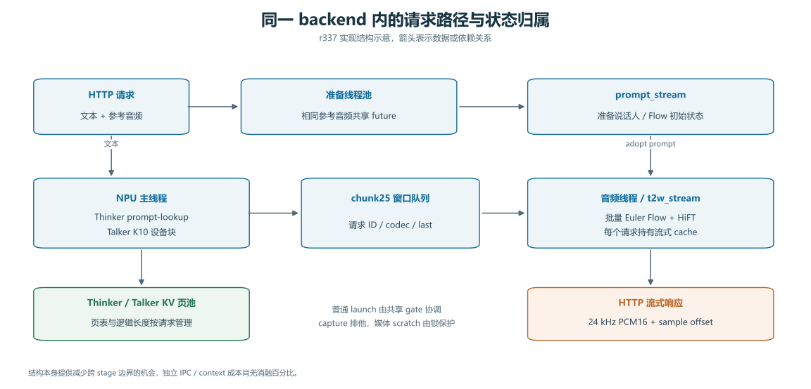
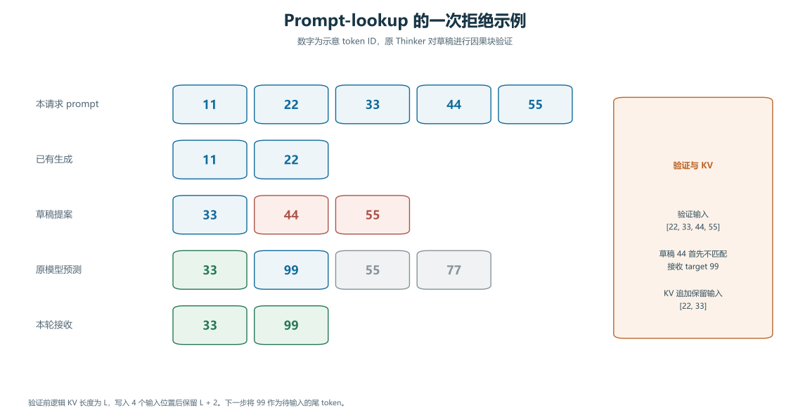
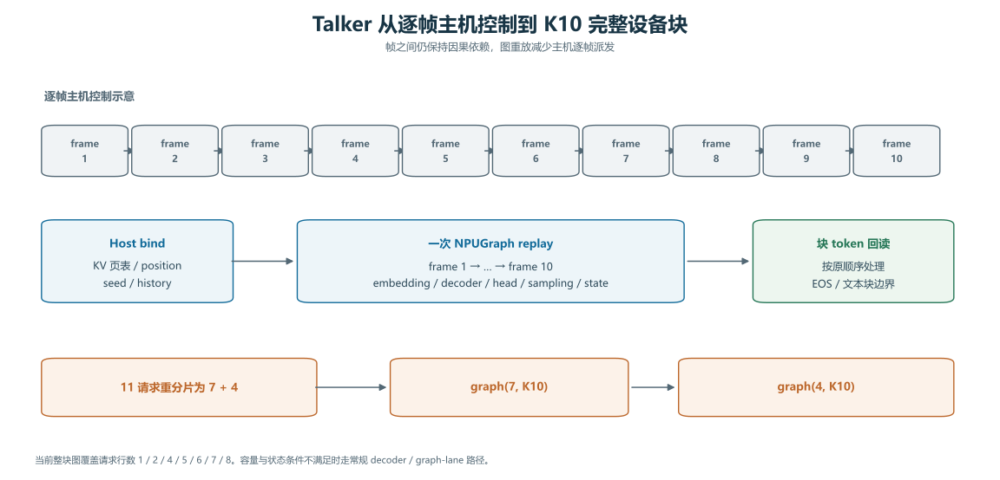
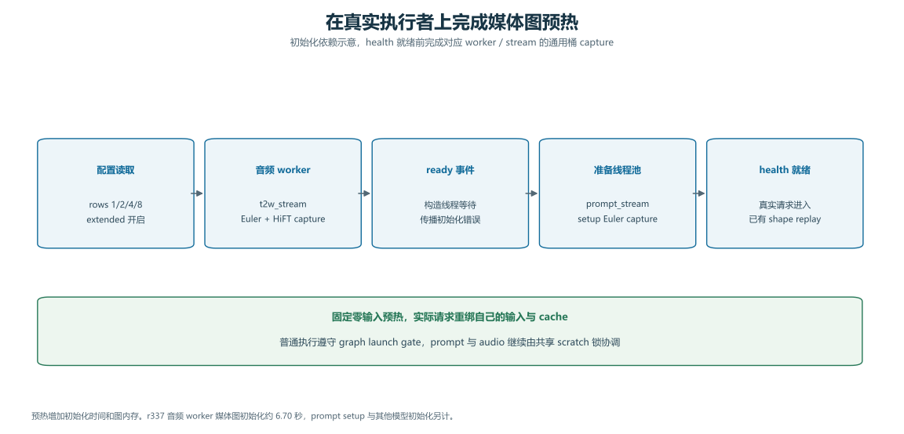
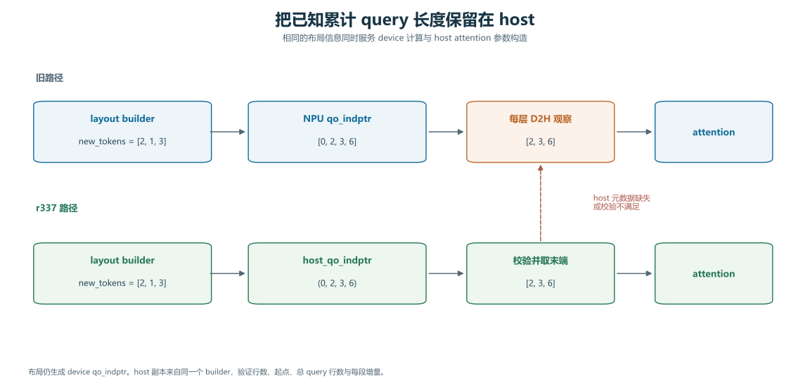
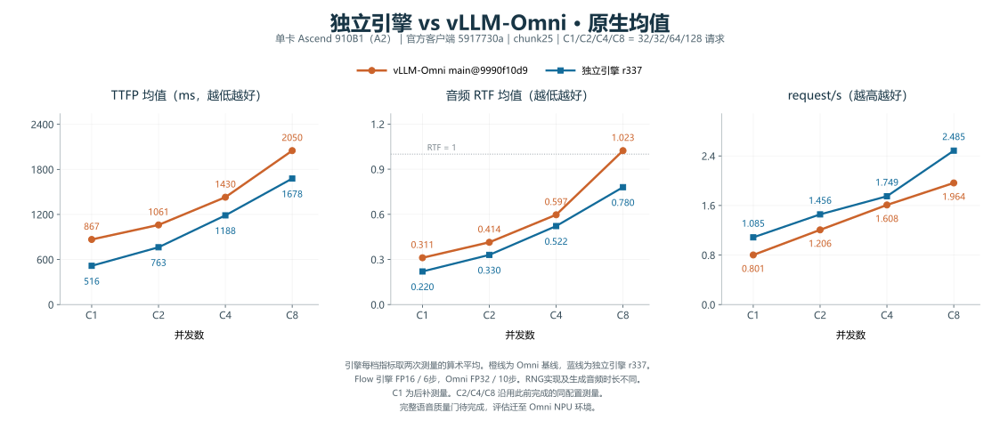

# MiniCPM-o 4.5 NPU 独立引擎的已采用优化详解

方案轮数、未保留探索与诊断流程的问题，另见[方法复盘与探索效率审计](optimization-method-retrospective.zh-CN.md)。

本文按执行机制介绍当前 r337 实验配置中保留的优化，覆盖它解决的开销、实现方式、具体例子、适用条件及收益证据。历史方案的选择过程、失败实验和逐轮结果另见优化历程与实验账本。整理日期为 2026-11-03。[优化历程](optimization-journey.zh-CN.md) · [完整实验账本](optimization-ledger-npu.zh-CN.md)

**本文的“采用”指进入 r337 实验配置并参与性能测量。r337 的完整语音质量门仍为 `NOT_RUN`。** 引擎采用 Flow FP16/6 步与 counter RNG，对照 Omni 采用 Flow FP32/10 步，二者的 codec 输出存在差异。下文将执行优化、数值配方和有条件启用的能力分别说明。[当前配置](../configs/engine/ascend_r337_experimental.json) · [源码与测量绑定](../evidence/20261103-r337/source-manifest.json) · [当前结果](current-results.md)

## 1. 从一条请求看整体执行路径



一条朗读请求携带文本与参考音频。准备线程池提取参考音频条件，Thinker 产生文本及 hidden states，Talker 自回归地产生 codec，Token2Wav 将 codec 窗口转为波形。HTTP 层以 24 kHz、单声道 PCM16 音频响应。当前实现仍使用 Python 前端与调度代码。[后端实现](../engine/runtime/backend_npu.py) · [API 与架构](architecture-npu.md)

独立引擎把三个阶段的状态放在同一 backend 内管理。Thinker/Talker 由主 NPU 执行线程推进，Token2Wav 由独立音频线程及 `t2w_stream` 推进，参考音频准备使用两个 worker 和 `prompt_stream`。权重、请求状态、KV 页和队列有明确所有者，普通发射可通过共享 gate 协调，图捕获及共享 scratch 使用额外保护。[线程与初始化](../engine/runtime/backend_npu.py#L33) · [音频执行循环](../engine/runtime/backend_npu.py#L1182)

这种组织方式允许定制阶段交接和状态生命周期。当前 pinned Omni 采用三阶段服务及共享内存 connector。独立进程数、IPC 和上下文切换的差别存在于部署结构中，但现有实验没有给出这些差别的独立端到端贡献百分比。[Omni 实际部署](../evidence/20261103-r337/campaign/results/omni-final/deploy.yaml)

### 当前启用的能力清单

| 类别 | r337 实际选择 | 主要作用位置 |
|---|---|---|
| KV 管理 | Thinker/Talker 各 128 页，每页 128 token | admission、prefill、decode、请求释放 |
| 参考音频准备 | 2 个 worker，相同字节引用共享准备 future，初始 cache 共享只读张量 | 首包前准备与内存 |
| Thinker | prompt-lookup 最多提议 8 token，原模型验证 | 文本自回归关键路径 |
| Talker | K=10 device block、完整块图、后处理图、counter RNG | codec 自回归与 host 发射 |
| Decoder 图 | 最大 batch 8，选择已有兼容桶 | decode 发射与捕获 |
| Talker attention | 静态容量 256，超出条件走其他路径 | 图内 attention |
| Decoder 算子 | Thinker/Talker 采用 `add-rms` | 残差与 RMSNorm |
| Decoder 重复工作 | 加载时拼接 QKV、gate/up 权重，一次 forward 共用 RoPE 表 | 小矩阵发射与位置编码 |
| Token2Wav | 批处理、Euler 图、HiFT 图、hybrid CFM | codec 到波形 |
| 图初始化 | 真实 worker/stream 上预热 rows 1/2/4/8 及扩展 shape | health 就绪前 |
| 图协调 | writer-aware capture gate、共享 scratch 锁 | 多线程 launch/capture |
| 音频调度 | 最多 10 ms 合批，最少就绪目标 4，首音频优先 | Token2Wav 队列 |
| NPU 资源 | 当前进程 0.5 核比例，本次为 12 Cube/24 Vector | 算子执行与图捕获之前 |
| 主机元数据 | 复用 layout builder 生成的累计 query 长度 | prefill attention 参数 |
| 条件 prefix KV | 最少公共前缀 64 token，最少 live 9 | 达到压力门槛时 |
| 数值配方 | Flow FP16、6 步 | 计算量及数值轨迹 |

配置中的 `t2w_cache_offload` 为关闭，Token2Wav encoder 图开关沿用关闭默认值。线程化音频路径调用同步返回的 `decode(items)`，未启用该接口可选的 `PendingAudio` 返回模式。配置与默认值共同决定实际路径。[r337 配置](../configs/engine/ascend_r337_experimental.json) · [Backend 参数默认值](../engine/runtime/backend_npu.py#L33) · [BatchedToken2Wav](../engine/runtime/token2wav_batch.py#L142)

## 2. Paged KV 与请求生命周期

### 要解决的开销

Thinker 和 Talker 每生成一个 token 都需要保留历史 K/V。若给每个请求分配一整段最大长度 cache，短请求也会占用预留空间。若按 token 扩展并复制 cache，生成过程又会承担分配与搬运成本。

### 当前实现

`NpuPagedKV` 在启动时分配固定页池。每层 K/V 的物理布局为 `(layers, pages, page_size, kv_heads, head_dim)`，请求只维护自己的页号表与逻辑长度。`pages_needed` 计算新增需求，`can_fit` 在执行前检查整组请求，`reserve` 从空闲列表拿页。attention 使用布局中的 block table 与 slot mapping 访问这些页。[页池实现](../engine/runtime/npu_paged.py#L94) · [布局构造](../engine/runtime/npu_paged.py#L168)

用每页 4 token 作示例，实际配置每页为 128 token。

```text
请求 A 长度 6       页表 [P0, P7]       占 2 页
追加 3 token       新长度 9            增加 P3
请求 A 页表        [P0, P7, P3]        原有两页无需整体搬迁
验证后逻辑回退到 7 保留物理页          后续 token 覆盖未采用位置
请求 A 结束        release(A)         归还请求拥有的全部页
```

`truncate` 只修改逻辑长度，`release` 才将物理页归还池中。Thinker 验证失败或 Talker 在块内遇到边界时，可以截断未采用的后缀。请求结束或取消后的释放路径同时回收两套 decoder KV，并清理请求状态。[截断与释放](../engine/runtime/npu_paged.py#L134) · [Backend 释放](../engine/runtime/backend_npu.py#L714)

线程化音频路径还将计算 KV 与音频完成的生命周期分开。Talker 已排入最后一个窗口后，主线程可以释放计算 KV，音频线程继续消费窗口、推进 Flow/HiFT cache 并发送完成事件。这样排队等待波形的请求不会继续占着已经不需要的 decoder 页。[计算 KV 提前释放](../engine/runtime/backend_npu.py#L833)

这套机制提供可控的常驻内存和显式容量检查。它属于运行时基础，现有结果没有独立移除页池的匹配消融，因此不为它分配一个单独的吞吐收益值。

## 3. 相同参考音频的准备合并与初始 cache 共享

### 准备工作只做一次

多个并发请求可能携带相同参考音频，但每个请求需要生成不同文本。`_acquire_prompt` 对参考音频的实际字节计算 SHA256，以该 key 查找正在共享的准备 future。首个请求提交 `_prepare`，其他同时等待的请求增加引用计数并等待同一个结果。[准备 future 与引用管理](../engine/runtime/backend_npu.py#L669)

```text
A(ref=X, text=甲) ─┐
B(ref=X, text=乙) ─┼─ SHA256(X) → 一个准备 future → 三个请求各自建立 stream
C(ref=X, text=丙) ─┘
D(ref=Y, text=丁) ─── SHA256(Y) → 另一个准备 future
```

所有等待者采用结果或释放引用后，共享映射会删除对应条目。共享范围覆盖并发准备与采用期间。之后到来的请求可重新触发准备，因此不能据此假设参考音频会永久驻留。

### 请求 cache 字典独立，初始只读张量共享

`new_stream(..., share_prompt=True)` 为每个请求创建独立的 cache 字典，最初条目指向同一组只读张量。第一个音频窗口执行后，cache 条目被请求自己的结果替换。轻量 prompt 仅保留必要元数据，避免同一请求通过两个对象继续引用大块初始 cache。[初始 cache 的 copy-on-write](../engine/runtime/token2wav_batch.py#L275)

```text
准备完成       A.cache = {att: T0}    B.cache = {att: T0}
A 推进一窗     A.cache = {att: TA}    B.cache = {att: T0}
B 推进一窗     A.cache = {att: TA}    B.cache = {att: TB}
```

这种共享依赖初始张量作为只读输入、每个请求用结果替换条目的约定。它避免为相同参考音频反复克隆大的初始 cache，并保持后续流状态独立。当前配置关闭 cache offload，本文不把 offload 搬运去重计入 r337 的性能来源。该项尚无当前四档的独立收益百分比。[配置](../configs/engine/ascend_r337_experimental.json) · [流状态与批处理](../engine/runtime/token2wav_batch.py)

## 4. Thinker prompt-lookup 与原模型块验证

### 为什么朗读任务存在机会

朗读任务的输入中已经有待读文本，Thinker 输出经常沿用其中的 token 片段。串行 greedy decode 即使将重复内容再输出一次，也通常需要逐 token 推进。prompt-lookup 利用当前请求的已生成后缀，在当前 prompt 中寻找可继续提议的片段。

### 如何提议和验证

实现先尝试最长 4 token、最短 2 token 的已生成后缀，从 prompt 后部向前寻找匹配，提议最多 8 token。提议长度进一步受 Thinker 文本 chunk 边界限制。原 Thinker 在因果 attention 下对 `[最后一个已生成 token, draft...]` 做一次块前向，再逐位置检查目标预测。[提议与验证函数](../engine/runtime/thinker_lookup.py)



例如 prompt 为 `[11,22,33,44,55]`，已生成 `[11,22]`，可提议 `[33,44,55]`。原模型给出 `[33,99,55,77]`。第一个提议 33 被接受，第二处不匹配时保留原模型的 99，当前步采用 `[33,99]`。99 之后依赖错误 draft 的预测被丢弃。全部匹配时可额外采用一个原模型 bonus token。

下面的例子可在仓库根目录用 Python 运行，两项函数只依赖 Python 标准库。

```python
from engine.runtime.thinker_lookup import prompt_draft, verified_count

prompt = [11, 22, 33, 44, 55]
generated = [11, 22]
draft = prompt_draft(prompt, generated, limit=8)
predictions = [33, 99, 55, 77]
accepted = predictions[:verified_count(draft, predictions)]

assert draft == [33, 44, 55]
assert accepted == [33, 99]
```

### KV 为什么要精确回退

假设验证前逻辑 KV 长度为 L，本次输入 `[22,33,44,55]` 会写入四个输入位置。采用两个预测后，逻辑长度保留到 `L+2`，对应输入 22 和 33。新预测 99 在下一步作为尚未缓存的尾 token 输入。只有输入位置与预测位置保持这个对应关系，后续生成才不会重复消费或错误沿用 draft KV。[验证后的状态推进](../engine/runtime/thinker_lookup.py#L68)

无匹配时走普通 decode，KV 容量不足时回退原路径。EOS 和文本 chunk 边界继续参与终止判断。该策略仅使用当前请求 prompt，命中率随任务而变化。块验证与逐步计算的数值轨迹仍需要开发检查及最终质量门覆盖。[普通 Thinker 路径](../engine/runtime/backend_npu.py#L872)

### 测到了多少

在 r305 与当期同配置控制的对照中，这组 prompt-lookup 及验证路径改动具有较明确的服务级收益。

| 并发 | mean TTFP 降低 | mean RTF 降低 | request/s 提高 |
|---|---:|---:|---:|
| C2 | 22.32% | 18.57% | 16.92% |
| C4 | 25.60% | 13.30% | 15.43% |
| C8 | 32.03% | 21.21% | 28.39% |

同阶段 C8 的诊断区间 `prefill → first text` 从 1420.8 ms 缩短到 551.7 ms。该 host 区间包含调度与竞争，服务级收益应以上表为准。r337 B1 的累积计数记录 253 次验证、3102 个 draft token、2215 个匹配 draft token及 2610 个目标输出 token。这些计数覆盖服务已完成的 C2/C4/C8 与 warmup，不能当成 C8 单档结果。[r305 原始汇总](data/ascend-r305-20261102.json) · [r305 分析](rsi-profiling-20261102.zh-CN.md) · [r337 B1 累积计数](../evidence/20261103-r337/campaign/results/r337-finalB1/native/c8-metrics.json)

## 5. Talker K=10 完整设备块与采样后处理图

### 把逐帧控制搬进设备图

Talker 每一帧依赖上一帧 codec。早期路径需要 host 反复准备布局、调用 decoder、处理 logits、采样并更新历史。完整块图把十帧的 embedding、decoder、head、采样和状态更新串在一次 NPUGraph 中，块结束后统一读回 token。[完整块图](../engine/runtime/talker_block_graph.py) · [Backend 块执行](../engine/runtime/backend_npu.py#L1064)



十帧的因果依赖仍然保留。改善来自减少块内 Python 发射、元数据准备和 host 观察。外部 Token2Wav 窗口仍为 chunk25，K=10 表示 Talker 的设备执行块长度。

### 状态如何保持请求独立

每次 replay 绑定当前请求的物理页、位置、slot、长度、随机种子、采样步数、重复惩罚历史及活动状态。counter RNG 由请求 seed 与帧 step 定位随机数，使请求组合的变化不会直接改写同一请求的随机数索引。块内 EOS 后产生 PAD，host 按原请求及帧顺序调用 `_take_frame`，遇到文本交接边界或 EOS 时截断后续 KV。[输入绑定与块体](../engine/runtime/talker_block_graph.py#L43) · [采样实现](../engine/talker_sampler.py) · [块结果消费](../engine/runtime/backend_npu.py#L1122)

当前完整块资格包括 counter RNG、decoder 图开启、静态 attention 可用、`起始 KV 长度 + K ≤ 256`、页池容量充足，以及命中的行数桶。完整块覆盖 rows 1/2/4/5/6/7/8。超过最大 batch 8 时按稳定顺序拆组，例如 11 个请求拆为 7+4，避免尾组 3 无完整块桶。其他情况继续使用逐 lane decoder，可结合独立的采样后处理图。[路由条件](../engine/runtime/backend_npu.py#L1073) · [后处理图](../engine/runtime/talker_post_graph.py)

```text
原先每帧控制   host → decoder → sampler → host 状态推进，连续执行 10 次
完整块         bind → [frame0 → frame1 → ... → frame9] → 一次块 token 读回
11 条就绪      前 7 条执行完整块，再执行后 4 条
长度超限       使用其他 decoder/graph-lane 路径
```

### 收益证据的边界

r337 B1 的累积统计中，完整块在 rows 1/2/4/5/6/7/8 均有 replay，说明执行路径实际命中。早期 K10 与状态重绑、图和数值调整共同演进，当前没有将 K10 单独关闭后完整复测四档的独立百分比。当前 pinned Omni 同样启用了 Talker 多帧执行，其部署为每步 8 帧。比较应落到块体、路由和状态管理的具体差异。[r337 累积统计](../evidence/20261103-r337/campaign/results/r337-finalB1/native/c8-metrics.json) · [Omni 多帧配置](../evidence/20261103-r337/campaign/results/omni-final/deploy.yaml)

## 6. 选择已有 decoder 图与静态 attention 容量

### 复用已有兼容桶

decoder 通常按 2 的幂向上取图桶。生成过程中请求陆续结束，batch 会缩小。`decode_graph_bucket` 优先选择已经捕获、能够容纳当前请求的最小桶，避免为了每个缩小后的 batch 再保留整套图。[图桶选择](../engine/runtime/npu_paged.py#L615)

例如 batch 从 8 降为 5，若 8 行图已存在，就可继续使用该图。额外行分配独立的惰性 KV 页，输出被丢弃，避免 dummy 行的 scatter 写覆盖真实请求。少捕获一套图可以同时减少首次捕获等待和常驻图内存，但 padding 也有设备计算成本。[padding 布局](../engine/runtime/npu_paged.py#L628)

### 静态容量控制 attention 形状

Talker 使用容量 256 的静态 attention 路径，以稳定图内 shape 和工作区，减少动态 attention 参数更新。只有序列长度满足容量条件时才采用该路径。超出容量由其他已支持路径处理，扩大静态容量需要重新验证设备成本与图内存。[静态 attention](../engine/runtime/npu_paged.py#L418) · [容量判断](../engine/runtime/npu_paged.py#L610)

当前没有为图桶复用与静态容量分别给出最终配置下的独立收益值。后续实验中更大的图、更多精确行数桶及 Thinker FIA512 均未形成一致端到端改善，说明覆盖率、padding、工作区和发射成本需要一起衡量。[40 轮结果](../evidence/20261103-r337/campaign/持续优化实验记录.md)

## 7. Decoder 权重打包、RoPE 复用与保守 Add+RMS

### 先把可以复用的准备移出逐层热点

模型加载时，`fuse_weights` 将每层 Q/K/V 权重沿输出维拼接，将 MLP 的 gate/up 权重拼接。NPU runner 直接对拼好的权重调用一次 linear，再以 view/chunk 拆出结果。原始权重值参与计算，打包过程在 backend 初始化时完成。[加载时权重准备](../engine/runtime/backend_npu.py#L143) · [通用张量打包函数](../engine/runtime/paged.py#L135) · [NPU runner 消费](../engine/runtime/npu_paged.py#L827)

```text
QKV            一次 linear(hidden, concat(Wq,Wk,Wv)) → Q / K / V
gate/up        一次 linear(hidden, concat(Wgate,Wup)) → gate / up
MLP 激活       SiLU(gate) * up → down projection
```

同一次 forward 的各层使用相同位置序列。runner 在进入层循环前生成一次 RoPE cos/sin 表，各层复用，避免逐层重算相同位置函数。表按 FP32 计算后转 activation dtype，沿用参考路径的舍入约定。这两项是当前 decoder 的基础实现，缺少最终配置下的独立服务消融。[RoPE 表](../engine/runtime/paged.py#L156) · [层循环前准备](../engine/runtime/npu_paged.py#L827)

### 选择已筛选的 Add+RMS 子集

decoder 中，attention/MLP 分支输出需要与 residual 相加，并为后续计算执行 RMSNorm。`add-rms` 模式调用 NPU 原生 `npu_add_rms_norm`，一次取得归一化结果及更新后的 residual，减少独立加法与归一化之间的中间张量和发射。[native decoder](../engine/runtime/npu_paged.py#L827)

```text
分离路径       residual1 = residual0 + attention_out
               normalized = RMSNorm(residual1)

Add+RMS        normalized, residual1 = NPU_Add_RMS(attention_out, residual0)
```

当前 Thinker 与 Talker 都选择 `add-rms` 子集，独立 RMS 与 SwiGLU 保留原有 HF RMS/SiLU 路径。早期扩大融合范围曾出现质量回退，当前配置因此保留按算子模式选择的边界。[算子模式](../engine/runtime/npu_paged.py#L35) · [早期数值筛选](optimization-journey.zh-CN.md)

r217 相对 r215 的历史 Talker Add+RMS 对照，C1/C4/C8 吞吐分别提高 3.35%/2.47%/1.31%，同时 C8 TTFP 回退 1.90%。这是特定阶段的消融，不能外推成当前两个 decoder 的独立收益或相对最新 Omni 的额外贡献。[r217 记录](optimization-ledger-npu.zh-CN.md)

## 8. Batched Token2Wav、完整 Euler 图与 HiFT 图

### 以兼容窗口为单位合批

音频线程收集多个请求的 codec 窗口，按窗口长度和 final 标志组织兼容组，保留每条请求自己的 Flow/HiFT cache。Flow 先生成 mel，再由 vocoder 生成波形，结果按原 item 索引还原，避免批内重排影响音频所属请求。[批处理入口](../engine/runtime/token2wav_batch.py#L196)

```text
A 的第 1 窗 ─┐
B 的第 3 窗 ─┼→ 兼容 shape 分组 → 批量 Flow → 分回 A/B/C 的 mel → vocoder
C 的第 2 窗 ─┘                      cache 仍按请求独立推进
```

部分短 final 窗口可按实现中的补齐与有效长度约定加入稳态组。Flow microbatch 除了受 FP16 路径的最大 stream 数 16 限制，还受图支持的请求数与 cache bucket 限制。`max_live=32` 因而不代表每次都执行一个 32 请求的 Flow batch。[分组与 microbatch 上限](../engine/runtime/token2wav_batch.py#L196)

### 减少每个音频窗口重复发射

Euler 图覆盖多步 Flow 求解，HiFT 图覆盖支持的 vocoder shape。常见窗口与 cache 长度进入缓存图，未覆盖或不满足条件的 shape 继续由已有路径执行。r337 启用 Euler 和 HiFT 图，Token2Wav encoder 图关闭。外部 chunk25 仍为 25 codec 帧，内部 50 mel 帧属于该编码路径的 shape，二者单位不同。[Euler 求解](../engine/runtime/token2wav_batch.py#L686) · [Euler 图管理](../engine/runtime/dit_graph.py) · [HiFT 路径](../engine/runtime/token2wav_batch.py#L780)

例如一个窗口需要执行 6 步求解，eager 路径会逐步发射 DiT 及状态更新，完整 Euler 图将该固定 shape 的求解步骤收进一次 replay。它降低的是 host 发射与图外调度开销，6 步内部的计算依赖仍存在。步数从 10 改为 6 的计算量变化单独见数值配方一节。

批处理和图属于早期已保留的基础机制，其效果与 chunk、shape 命中、请求 cache 和后续调度共同作用。当前 pinned Omni 也启用了 CFM/HiFT 图、CFM 融合、批处理与图桶，现有端到端差值包含双方实际实现的全部差异。[Omni 实际配置](../evidence/20261103-r337/campaign/results/omni-final/deploy.yaml)

## 9. Hybrid CFM 与按 CFG 行数选择 packed QKV

### 小 batch 的矩阵投影合并

attention 通常分别计算 Q、K、V。packed QKV 将三个权重沿输出维拼接，使用一次较大的投影后再拆分，减少小矩阵投影的发射与部分重复读取。权重准备在执行之外完成。[packed 权重](../engine/runtime/dit_fused_npu.py#L81) · [attention 实现](../engine/runtime/dit_fused_npu.py#L211)

```text
三个投影       Q = X @ Wq    K = X @ Wk    V = X @ Wv
packed         QKV = X @ concat(Wq, Wk, Wv)
               Q, K, V = split(QKV)
```

### 为什么当前采用 hybrid

历史全 packed 路径在局部图 replay 中约快 15.6%，但正式 C8 出现 52/128 请求失败。保留的 hybrid 路径在 `x.shape[0] < 16` 时选择 packed QKV，其他行数选择原三投影 schedule，并关闭该 variant 的 AddLayerNorm 与 im2col-conv 融合。此处行数为 classifier-free guidance 的 CFM 张量行数。[hybrid 路由](../engine/runtime/dit_fused_npu.py#L382)

典型 4 个请求对应 8 个 CFG 行，可走 packed。8 个请求对应 16 个 CFG 行，选择原 schedule。具体由进入算子的实际 shape 决定，条件在静态图捕获时确定。

```text
CFM rows < 16   → packed QKV
CFM rows ≥ 16   → 原三投影 schedule
```

### 固定时间条件与 cache 布局也参与优化

完整 Euler 图在 capture 前计算各步的 timestep embedding，沿用求解器自己的时间递推，replay 直接读取保存的 embedding。DiT schedule 对同一步使用第一行时间条件计算各层 modulation，并广播到 batch。当前资格建立在这些行共享同一求解时间的约定上。[时间 embedding](../engine/runtime/dit_graph.py#L469) · [modulation](../engine/runtime/dit_fused_npu.py#L135)

CFM body 还把卷积历史整理为 frames-major 视图，满足同卷积宽度等条件时，使用分开的 dtype staging 收集两段卷积历史，最后统一写回请求 cache。其他形状继续原 gather 路径。这些布局与调度调整共同构成 hybrid schedule，尚无各子项独立的当前服务收益值。[CFM schedule 与 cache 写回](../engine/runtime/dit_fused_npu.py#L248)

hybrid 完成 1024 次交替运行及 r239 正式三档零请求错误，随后作为稳定基础保留。15.6% 属于早期局部测量，当前没有稳定的端到端消融可以把它直接换算成 r337 服务收益。[融合与稳定性历程](optimization-journey.zh-CN.md) · [r239 记录](optimization-ledger-npu.zh-CN.md)

## 10. 在实际 owner 上完成启动图预热

### 首次请求为什么会慢

一个 shape 即使最终能用图执行，首次遇到时仍可能构造工作区、分配输入缓冲和 capture。若这些动作发生在首个真实音频窗口内，用户的 TTFP 会承担初始化。此前也观察到在其他线程预热后，实际服务线程仍发生首用捕获，因此后续方案将 owner 和 stream 一起纳入初始化设计。[r307–r309 分析](../evidence/20261103-r337/followup/六层profiling继续优化-r307-r309.md)



音频 worker 在自己的 `t2w_stream` 上完成预热，通过 ready 事件通知构造线程。参考音频 setup 对应的 Euler shape 由准备线程池在 `prompt_stream` 上预热，完成后服务才进入 health 就绪。初始化错误沿等待链传播，等待也设有超时。[owner 预热](../engine/runtime/backend_npu.py#L399)

当前预热范围有明确上限。

| 所属执行者 | 预热 shape |
|---|---|
| 音频 worker | rows 1/2/4/8，Euler `(2r,50,512)`，HiFT `(r,50)` |
| 音频扩展范围 | HiFT `(r,58)`，tail Euler `(2,56,512)` |
| 准备线程池 | setup Euler `(2,256,0)`、`(2,512,0)` |

这里形状按实现中的张量维度书写。输入采用固定零值，真实请求在 replay 前绑定自己的条件和 cache。预热同样经过 capture gate 和 scratch 锁，避免损坏服务后续需要的共享缓冲。[预热 shape 与绑定](../engine/runtime/backend_npu.py#L399)

预热将成本前置到启动期，同时增加常驻图内存。r337 B1 记录的音频 worker 媒体图初始化区间约 **6.70 秒**，prompt setup 与其他模型初始化另有成本。历史 r309 单次 C8 吞吐相对 r307 控制提高约 0.88%，另一次重复相对同一初始控制约提高 0.60%，因此该项应按小幅、受复测影响的收益理解。[r337 启动统计](../evidence/20261103-r337/campaign/results/r337-finalB1/native/c8-metrics.json) · [follow-up 原始结果](../evidence/20261103-r337/followup/followup-results.json)

## 11. Writer-aware graph capture gate 与 scratch 保护

### 避免 capture 被持续 launch 饿死

主执行、参考音频准备和音频 worker 都可能向 NPU 发射任务。普通 launch 是共享 reader，capture 是需要其他发射区退出的 writer。如果只等待当前 reader 数归零，新来的 reader 不断进入时，capture 可能长期无法开始。

当前 `GraphLaunchGate` 在已有 capture 等待者时阻止新的顶层 reader 进入。已在同一 owner 内的嵌套调用继续遵循重入规则。capture 升级时暂时扣除调用线程自己的 reader 计数，等其他 reader 排空后独占，退出时恢复计数与发射资格。[gate 实现](../engine/runtime/graph_gate.py)

```text
时刻 0   A 正在 launch，B 准备 capture
时刻 1   B 登记 writer 等待，后来的 C 顶层 launch 等待
时刻 2   A 退出，B 获得独占 capture
时刻 3   B 结束，C 继续 launch
```

gate 协调的是 host 发射/capture 区域。Token2Wav 与 prompt 继承使用共享 scratch 时，还需要 `_t2w_lock` 保护缓冲生命周期。去掉锁需要建立新的独占缓冲及依赖关系，单纯允许更多线程同时进入会破坏现有契约。[prompt 发射保护](../engine/runtime/backend_npu.py#L636) · [音频发射保护](../engine/runtime/backend_npu.py#L1272)

r287 的一次诊断中，capture writer 等待从 14.628 秒下降到 1.426 秒，但 engine reader 等待达到 5.846 秒。该机制改善 capture 饥饿，同时重新分配等待。后续匹配控制中仍有性能回退，现有证据不能给它统一的吞吐增益百分比。[gate 与调度历史](optimization-journey.zh-CN.md)

## 12. 有界合批与首音频优先

### 等待少量时间形成有效 batch

并发请求的 codec 窗口可能相差几毫秒到齐。若一条就绪就马上启动较重的 Token2Wav，其他请求只能等待下一轮。当前音频循环按活跃 stream 数计算 target，再取 `min(target,4)` 为就绪目标，最多等待 10 ms。[合批循环](../engine/runtime/backend_npu.py#L1234)

```text
活跃请求 6，已就绪 2    → wait_target = 4
接下来有 2 条到齐       → 立即执行
10 ms 后仍未凑齐        → 用当前就绪窗口执行
C1 已就绪 1 条          → wait_target = 1，直接执行
```

这种等待只影响需要合批的队列状态，无法保证所有批都足够大。deadline 使其有明确上限，避免长时间为尚未就绪的请求等待。

### 首窗在同批选择中优先

`sample_offset == 0` 表示该请求尚未输出音频。当前对就绪列表做稳定排序，使首音频窗口排在续窗前，同时保留同类别原有顺序。随后弹出每个请求的一窗，按该顺序形成 items 并还原结果。[首音频优先](../engine/runtime/backend_npu.py#L1272)

```text
就绪顺序       A续窗、B首窗、C续窗、D首窗
稳定排序       B首窗、D首窗、A续窗、C续窗
```

该策略改变执行与分组顺序，具体收益受 shape 分组及 microbatch 边界影响。r337 B1 累积统计记录 426 次音频 batch，其中 109 次实际重排。此前首音频优先在部分初测中有利，但匹配复测出现 C8/C32 回退，因此不单独承诺它在所有负载上同时改善三项指标。[累积命中统计](../evidence/20261103-r337/campaign/results/r337-finalB1/native/c8-metrics.json) · [负向复测记录](optimization-journey.zh-CN.md)

## 13. 进程内 12 Cube/24 Vector 核配额

### 限制资源为何可能变快

Thinker、Talker 和音频阶段有不同的计算、访存及发射特征，共享一张卡时可能产生竞争。r337 在模型算子和图捕获前，读取设备/进程当前限额，再通过 `torch.npu.set_device_limit` 设置当前进程的 0.5 比例。本次 24 Cube/48 Vector 被设置为 12 Cube/24 Vector，私有 stream 继承该进程设置。[资源限制实现](../engine/runtime/backend_npu.py#L116)

设备资源上限会影响算子的 tiling、workspace 和执行竞争。当前记录能证明设置生效及对应服务指标变化，尚未将收益根因分解到 tiling、带宽或重叠中的某一项。此前用户提出的多进程并行使用设备资源，给资源实验提供了方向，当前落地机制作用在独立引擎进程内。

### A/B/A 确认结果

核配额确认实验相对前后两个控制的观测范围如下。

| 并发 | mean TTFP 降低 | mean RTF 降低 | request/s 提高 |
|---|---:|---:|---:|
| C2 | 4.52%–6.03% | 10.50%–11.98% | 16.28%–17.14% |
| C4 | 2.45%–3.06% | 3.42%–5.01% | 4.16%–4.24% |
| C8 | 2.57%–5.32% | 5.34%–6.77% | 6.19%–7.58% |

这些是测量范围。首轮筛选曾有 C8 回退，进一步降低到 8/16 核、仅限制音频 stream 以及其他组合也没有成为更好的通用配置，因此当前选择具有硬件与负载范围。[资源确认分析](../evidence/20261103-r337/campaign/core-confirmation-analysis.json) · [40 轮审计](../evidence/20261103-r337/campaign/持续优化实验记录.md)

## 14. 复用 host 累计 query 长度，移除重复 D2H 观察

### 数据在 host 已经存在

layout builder 需要知道每条请求新增多少 token。它用这些数生成累计 `qo_indptr` 并上传 NPU。旧 prefill attention 路径又从设备取回累计长度，为 API 构造 Python 参数，同一小段元数据因而可能在每层触发 host 观察。[layout 构造](../engine/runtime/npu_paged.py#L168)



开启 `decoder_host_qo_lengths` 后，builder 同时保存不可变 host tuple。`_query_ends` 检查请求数、数组长度、起点、末端 query 行数、正整数增量及相邻差值，通过后直接使用该 tuple 的末端列表。元数据缺失或不符合约定时，仍从设备读取。[长度复用与校验](../engine/runtime/npu_paged.py#L694)

```python
new_tokens = [2, 1, 3]
host_qo_indptr = (0, 2, 3, 6)
query_ends = list(host_qo_indptr[1:])
assert query_ends == [2, 3, 6]
```

device `qo_indptr` 继续为设备执行提供输入，host 副本服务于 host 参数构造。该优化减少重复跨设备观察，具体收益还受 prefill 数量和同步位置影响。已有 16 个 host/fallback 开发回归 case。r319 单项实验的端到端表现混合，最终 r337 将它与核配额组合确认，不能把组合的全部收益归给长度复用。[相关回归测试](../tests/engine/test_npu_host_qo_lengths.py) · [最终组合汇总](../evidence/20261103-r337/campaign/final-confirmation-summary.json)

## 15. 压力门控 prefix KV

### 达到压力门槛时复用公共前缀

Thinker 维护可复用前缀的条件路径。r337 配置公共前缀至少 64 token、live 至少 9。达到门槛后，普通文本 prompt 可查找公共前缀，复制已有 KV，再计算后缀。复用长度最多到 `len(prompt)-1`，保留必要的后续预测输入。多模态 embedding 等不满足条件的请求继续原路径。[prefix 路由](../engine/runtime/backend_npu.py#L932)

复制以完整物理页为单位，目标请求拥有自己的页。以实际每页 128 token、公共前缀 160 token 为例，需要复制两页 K/V，目标逻辑长度设为 160。第二页未使用的容量随后可以由该请求的后缀覆盖，源请求及其他请求的 KV 不受影响。[prefix 页复制](../engine/runtime/npu_paged.py#L143)

```text
源请求         P0[0..127] P1[128..159 + 未用容量]
目标请求       Q0[复制P0] Q1[复制P1]，逻辑长度 160
目标追加       写 Q1 后续位置，源 P1 保持原内容
```

低于 9 个 live 请求时走旁路，保持低并发原有 prefill/decode 调度。当前 C1/C2/C4/C8 的前缀命中统计为零，r337 B1 的累积记录为 230 次 bypass。因此这项有条件能力不能解释当前四档结果的性能收益。[当前配置](../configs/engine/ascend_r337_experimental.json) · [命中及旁路计数](../evidence/20261103-r337/campaign/results/r337-finalB1/native/c8-metrics.json)

## 16. 数值配方、精度及质量验收

当前性能结果同时包含执行机制与数值配方的变化。

| 项目 | 独立引擎 r337 | 本次 pinned Omni |
|---|---|---|
| 模型与客户端请求 | 相同冻结模型 revision 与请求集合 | 相同 |
| 外部 codec 窗口 | first/steady chunk25 | chunk25 |
| Flow | FP16、6 步 | FP32、10 步 |
| Talker RNG | counter | 对照部署自身 RNG 路径 |
| 完整当前 speech gate | `NOT_RUN` | 待配对评分 |

6 步相对 10 步减少 40% 的求解步数，但 Flow 内部仍有条件准备、encoder、cache 与 vocoder 等开销，端到端收益需要实测。FP16 改变算子精度及工作区行为，counter RNG 改变随机序列。采样温度、top-p、top-k 等语义的对齐也不能推出两边 codec token 相同。[r337 配置](../configs/engine/ascend_r337_experimental.json) · [当前部署对照](current-results.md)

r337 对引擎控制的 16 条开发比较中，Thinker 文本/token 16/16 一致，codec token 0/16 一致。用户已允许探索 codec 不完全一致的路径，最终仍须在 Omni NPU 评分环境完成冻结 WER、speaker similarity、UTMOS 及比较门槛。开发检查和请求零错误分别覆盖文本/执行问题，完整语音质量尚待验收。[当前精度状态](rsi-r337-20261103.zh-CN.md) · [冻结验收计划](../evidence/20261022-ascend910b1/plan/acceptance.json)

## 17. 哪些收益可以归因到具体改动

### 当前四档产品级对照

Omni server 固定为 main `9990f10d9e898c3d38b1fa640513d55f771b8685`，vLLM 为 0.32.0，官方客户端为 `5917730a4b02aedb44d374173cdc1b10484ccd52`。环境为 Ascend 910B1/A2，Seed-TTS 英文、chunk25、每档 2 次 warmup，C1/C2/C4/C8 分别计时 32/32/64/128 请求。引擎每点取两个 run-level 指标的算术平均，来源运行均为零请求错误。[完整数值和来源](data/ascend-r337-20261103.json)

| 并发 | TTFP mean ms，Omni → 引擎 | 降低 | RTF mean，Omni → 引擎 | 降低 | request/s，Omni → 引擎 | 提高 |
|---|---:|---:|---:|---:|---:|---:|
| C1 | 867.18 → 516.35 | 40.46% | 0.3114 → 0.2202 | 29.28% | 0.8012 → 1.0855 | 35.48% |
| C2 | 1060.66 → 763.15 | 28.05% | 0.4142 → 0.3304 | 20.23% | 1.2062 → 1.4562 | 20.72% |
| C4 | 1429.62 → 1187.96 | 16.90% | 0.5970 → 0.5220 | 12.56% | 1.6083 → 1.7489 | 8.74% |
| C8 | 2049.72 → 1678.15 | 18.13% | 1.0234 → 0.7805 | 23.74% | 1.9637 → 2.4851 | 26.55% |

TTFP 指客户端测得的首音频包时延，RTF 由每请求的端到端时间与输出音频时长形成，request/s 使用整个计时窗口。输出时长变化会影响 RTF，三项指标需联合读取。两边生成音频时长及 P99 原值均随证据保存。[均值/P99 与口径](current-results.md)



### 单项与组合证据分别读取

| 优化 | 可引用的实测证据 | 归因范围 |
|---|---|---|
| prompt-lookup 及验证路径 | r305 对当期控制，C2/C4/C8 TTFP 降低 22.32%/25.60%/32.03%，吞吐提高 16.92%/15.43%/28.39% | 较明确的一组内部改动对照 |
| 历史 Talker Add+RMS | r217 对 r215，C1/C4/C8 吞吐提高 3.35%/2.47%/1.31% | 特定旧阶段，C8 TTFP 有回退 |
| hybrid CFM | 正式三档请求零错误，稳定性筛选后保留 | 局部 packed 的 15.6% 无法直接外推服务 |
| owner 预热 | r309 单次 C8 吞吐约 +0.88%，重复约 +0.60% | 小幅 follow-up，另计启动成本 |
| 12/24 核配额 | A/B/A 三档吞吐约 +4.16%～+17.14% | 同引擎资源实验，范围依并发变化 |
| 核配额 + host 长度的 r337 | 最终四组 paired 控制观测，C2/C4/C8 吞吐约 +1.23%～+15.13% | 组合确认，C4 TTFP 跨越改善与回退 |
| prefix KV | 当前四档零命中 | 当前四档无命中收益可归因 |
| 统一 backend、页池、K10、批处理/图、准备共享、gate/队列 | 有源码、命中或历史联合证据 | 缺少最终配置下各自独立的四档消融百分比 |

最终 r337 组合相对当期控制的观测范围如下，范围由多组对照点形成。[最终组合确认](../evidence/20261103-r337/campaign/final-confirmation-summary.json)

| 并发 | mean TTFP 降低 | mean RTF 降低 | request/s 提高 |
|---|---:|---:|---:|
| C2 | 0.11%–11.54% | 8.94%–11.33% | 11.83%–15.13% |
| C4 | −1.82%–5.43% | 3.23%–9.37% | 1.23%–10.09% |
| C8 | 3.76%–8.27% | 3.61%–7.27% | 3.28%–9.25% |

这些范围与阶段百分比均为观测值，不构成置信区间。各阶段控制、源码及测量日期不同，不能把每项百分比相加成最终相对 Omni 的收益。最终产品对照仍以同一 r337 候选和 pinned Omni 的完整四档为准。现有结果也未完成冻结协议的最终统计与 speech gate 验收。[证据验证说明](../evidence/20261103-r337/README.md)

## 18. 相比当前 Omni，额外定制具体在哪里

| 对比维度 | 本独立引擎 | 本次 Omni 对照中已有能力 | 可以作出的解释 |
|---|---|---|---|
| 阶段组织 | 单 backend、显式请求状态和线程/stream 所有权 | 三阶段进程、共享内存 connector | 交接与调度契约不同，IPC 独立收益待消融 |
| Thinker 提议 | 当前 prompt 提议，原模型块验证，受文本 chunk 约束 | 本次部署未启用 stage0 n-gram speculation | 直接针对朗读重复内容减少串行步骤，有内部控制证据 |
| Talker 多帧 | K10 完整块、请求 counter 状态、特定 cohort 路由 | K8、多帧 decode 图 | 双方均有多帧，差异在块长及执行/状态实现 |
| KV | 自有页池与逻辑截断，压力 prefix 路径 | vLLM KV/调度能力，当前配置关闭 prefix | 自有生命周期便于块验证与边界控制，低并发 prefix 无命中 |
| 音频图 | Euler/HiFT 图、hybrid CFM、owner 预热 | CFM/HiFT/encoder 图、融合、预捕获及 batch buckets | 形状、路由、所有权与数值配方存在差别 |
| 音频队列 | 有界合批、首音频稳定排序、请求 cache 共享 | connector、跨参考音频批处理等 | 需按实际批轨迹比较，当前缺单独百分比 |
| 元数据 | host query 长度复用及回退 | 使用其自身 attention backend | 消除本引擎发现的重复 D2H 观察 |
| 资源限制 | 当前进程 12/24 核 | 本次部署配置未采用同项限制 | 对本引擎有 A/B/A 支持，仍需按负载验证 |
| Flow 数值 | FP16/6 步 | FP32/10 步 | 属于当前产品级收益来源，完整质量待评分 |

Omni 一列依据本次保留的实际部署及测量记录。它描述被比较的配置，后续版本或其他部署需要重新核对。独立引擎的优化也依赖 NPU/CANN/PyTorch 的已有算子与图能力。[Omni 部署快照](../evidence/20261103-r337/campaign/results/omni-final/deploy.yaml) · [服务源码记录](../evidence/20261103-r337/campaign/results/omni-final/source.json)

## 19. RSI 与 6层profiling 诊断如何落到这些实现

早期 RSI 知识迁移为 K-step、图、算子融合和 packed QKV 提供候选机制，实测与数值筛选逐步收敛到保守 Add+RMS 和 hybrid 路由。后续 profiling 追踪首文本、首音频、图捕获及等待区间，形成 prompt-lookup、真实 owner 预热、capture gate 和队列策略等针对性改动。资源配额及 host 元数据复用继续通过新鲜控制确认。[完整历程](optimization-journey.zh-CN.md) · [知识读取记录](../evidence/20261103-r337/campaign/knowledge-readset.json)

**6层profiling 诊断**把请求阶段、图与调度、重复工作与 layout、算子与计数、拷贝与所有权、组件检查串联起来，另以 L0 冻结工作负载身份和计时边界。每一层提供诊断线索，是否保留仍看原生 benchmark、稳定性和质量证据。最后 40 个方案包含未改善、框架拒绝和崩溃的结果，采用清单只保留当前配置实际选择的机制。[6层分析与 r305](rsi-profiling-20261102.zh-CN.md) · [r312–r351 与最终确认](rsi-r337-20261103.zh-CN.md)

## 20. 复现图示与核对入口

五张机制图由普通 matplotlib 生成，可以在不加载模型的机器上重新绘制。需要安装 matplotlib 及 Microsoft YaHei 或 Noto Sans CJK SC 等中文字体。

```bash
python tools/render_adopted_optimizations.py
python tools/verify_r337_evidence.py
python tools/verify_r305_evidence.py
python tools/plot_c8_optimization_journey.py --verify-only
```

机制图中的 token ID、缩小后的页大小和请求字母均为教学例子。性能表来自保留的 NPU 原生运行数据，完整图表、源码哈希、配置、退出码及失败证据均可从仓库继续追溯。[图示生成器](../tools/render_adopted_optimizations.py) · [证据索引](../evidence/20261103-r337/README.md) · [C8 演进曲线](c8-optimization-journey.zh-CN.md)
