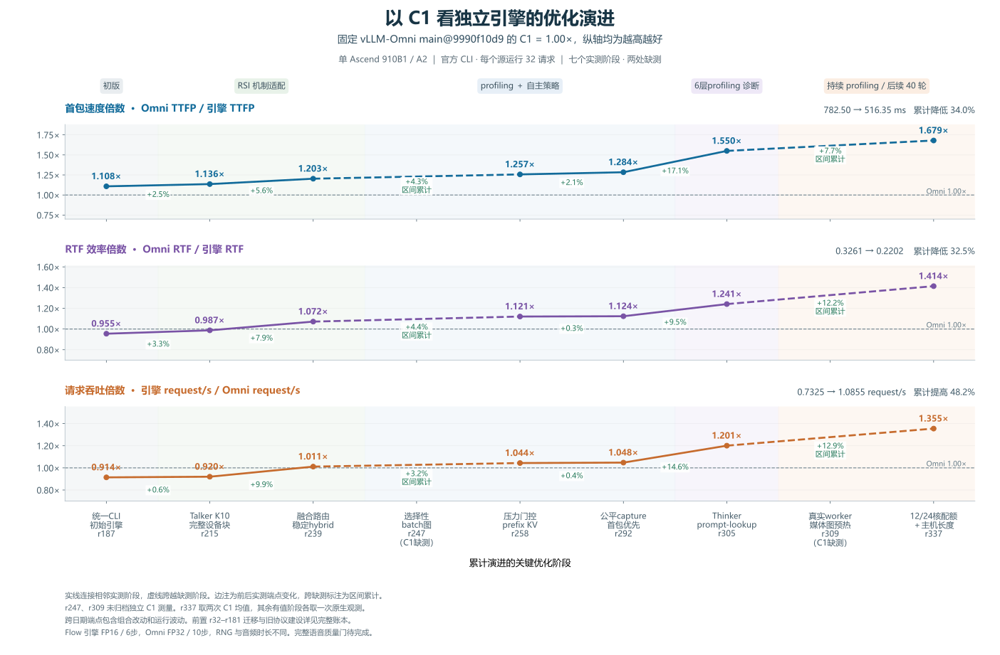

# 以 C1 看优化演进曲线

横轴沿用 C8 图的九个关键版本，包含七个有独立 C1 实测值的阶段。r247、r309 保留缺测位置，虚线连接前后实测端点。每个源运行均为 C1、32 个计时请求、4411 输入 token，观测请求错误为 0。



## 固定对照与读图口径

固定 vLLM-Omni main@9990f10d9 的 C1 为 1.00×。对照值为 mean TTFP 867.18 ms、mean RTF 0.3114、吞吐 0.8012 request/s。TTFP 速度倍数按 Omni TTFP ÷ 引擎 TTFP，RTF 效率倍数按 Omni RTF ÷ 引擎 RTF，吞吐倍数按引擎 request/s ÷ Omni request/s，纵轴均为越高越好。

从 r187 到 r337，历史端点的 mean TTFP 降低 34.01%，mean RTF 降低 32.47%，request/s 提高 48.18%。r337 使用与当前四档产品对比图相同的两次 C1 运行均值，其余有值阶段各取一次原生观测。

## 各阶段实测值

| 版本 | 累计优化阶段 | TTFP mean ms | RTF mean | request/s | TTFP速度倍数 | RTF效率倍数 | 吞吐倍数 |
|---|---|---|---|---|---|---|---|
| r187 | 统一官方CLI与健康检查后的初始NPU引擎 | 782.50 | 0.3261 | 0.7325 | 1.108× | 0.955× | 0.914× |
| r215 | embedding、decoder、head、sampling和状态组成K10设备块 | 763.27 | 0.3153 | 0.7371 | 1.136× | 0.987× | 0.920× |
| r239 | Add+RMS及CFM hybrid路由，小行融合、大行保留回退 | 720.71 | 0.2906 | 0.8103 | 1.203× | 1.072× | 1.011× |
| r247 | 选择性Talker batch图，排除row3并调整分片 | 缺测 | 缺测 | 缺测 | 缺测 | 缺测 | 缺测 |
| r258 | prefix KV复用及min_live=9压力门控 | 689.94 | 0.2778 | 0.8361 | 1.257× | 1.121× | 1.044× |
| r292 | 公平capture gate与首音频窗口优先 | 675.38 | 0.2771 | 0.8393 | 1.284× | 1.124× | 1.048× |
| r305 | 当前请求提供草稿，原Thinker整块验证并截断未接受KV | 559.57 | 0.2509 | 0.9619 | 1.550× | 1.241× | 1.201× |
| r309 | Euler/HiFT通用桶在真实audio worker和prompt stream预热 | 缺测 | 缺测 | 缺测 | 缺测 | 缺测 | 缺测 |
| r337 | 本进程12Cube/24Vector与可信累计query长度复用 | 516.35 | 0.2202 | 1.0855 | 1.679× | 1.414× | 1.355× |

## 前后实测端点的变化

| 区间 | TTFP降低 | RTF降低 | request/s增加 | 记录范围 |
|---|---:|---:|---:|---|
| r187 → r215 | +2.46% | +3.29% | +0.63% | 相邻实测阶段 |
| r215 → r239 | +5.58% | +7.86% | +9.92% | 相邻实测阶段 |
| r239 → r258 | +4.27% | +4.37% | +3.19% | 跨越缺测阶段 |
| r258 → r292 | +2.11% | +0.26% | +0.37% | 相邻实测阶段 |
| r292 → r305 | +17.15% | +9.46% | +14.61% | 相邻实测阶段 |
| r305 → r337 | +7.72% | +12.24% | +12.85% | 跨越缺测阶段 |

阶段变化包含组合改动和跨日期运行波动。r239 → r258 包含选择性 batch 图等区间改动，r305 → r337 包含媒体图预热、核配额和 host 长度复用等区间改动。缺测阶段的单项贡献仍无独立 C1 测量。r258 与 r292 使用 r295 中的匹配复测端点，C1 三项指标均有小幅改善，走势与 C8 不同。r305 有独立 C1 补测，缺少同轮 r292 C1 控制。

Omni Flow 为 FP32/10 步，引擎为 FP16/6 步，RNG 路径与生成音频时长存在差异。完整语音质量门仍为 `NOT_RUN`。核配额固定输入实验还观察到跨配额数值变化，详见[配额验证报告](core-quota-causality.zh-CN.md)。

## 数据与复核

```sh
python tools/plot_c1_optimization_journey.py --verify-only
python tools/plot_c1_optimization_journey.py
```

- [PNG](figures/npu-c1-optimization-journey.png) · [SVG](figures/npu-c1-optimization-journey.svg) · [PDF](figures/npu-c1-optimization-journey.pdf)
- [原始来源、SHA256与聚合口径](data/c1-optimization-journey.json)
- [C8演进曲线](c8-optimization-journey.zh-CN.md) · [完整优化历程](optimization-journey.zh-CN.md)
