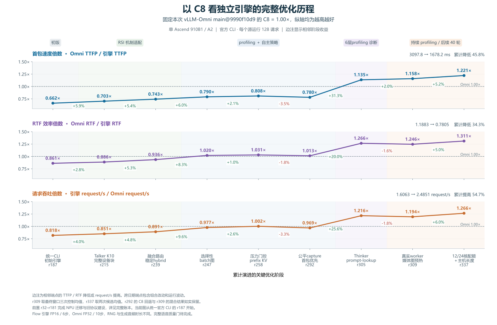

# 以C8看完整优化历程

**历史测量。当前代码已移除 prompt-lookup，移除后的性能待重测。下图 r305/r309/r337 点对应含 lookup 的归档版本。** [移除记录](../evidence/20261103-lookup-removal/README.md)

## 从起点到当前

横轴按九个关键版本累计展示优化内容。当前Omni main9990f10d9的C8固定为1.00×，三项性能倍数均为越高越好。



本图对照固定为TTFP 2049.72ms、RTF 1.0234、吞吐1.9637request/s。TTFP速度倍数按Omni TTFP÷引擎TTFP计算，RTF效率倍数按Omni RTF÷引擎RTF计算，吞吐倍数按引擎request/s÷Omni request/s计算。

从r187到r337，阶段端点的TTFP降低45.83%，RTF降低34.32%，吞吐提高54.71%。当前r337使用与四档产品对比图相同的两次运行均值。

## 每个点做了什么

| 版本 | 累计阶段的优化内容 | TTFP mean ms | RTF mean | request/s | TTFP速度倍数 | RTF效率倍数 | 吞吐倍数 |
|---|---|---|---|---|---|---|---|
| r187 | 统一官方CLI与健康检查后的初始NPU引擎 | 3097.81 | 1.1883 | 1.6063 | 0.662× | 0.861× | 0.818× |
| r215 | embedding、decoder、head、sampling和状态组成K10设备块 | 2916.35 | 1.1545 | 1.6703 | 0.703× | 0.886× | 0.851× |
| r239 | Add+RMS及CFM hybrid路由，小行融合、大行保留回退 | 2758.88 | 1.0938 | 1.7500 | 0.743× | 0.936× | 0.891× |
| r247 | 选择性Talker batch图，排除row3并调整分片 | 2593.65 | 1.0032 | 1.9179 | 0.790× | 1.020× | 0.977× |
| r258 | prefix KV复用及min_live=9压力门控 | 2537.92 | 0.9931 | 1.9679 | 0.808× | 1.031× | 1.002× |
| r292 | 公平capture gate与首音频窗口优先 | 2627.45 | 1.0105 | 1.9020 | 0.780× | 1.013× | 0.969× |
| r305 | 当前请求提供草稿，原Thinker整块验证并截断未接受KV | 1806.22 | 0.8085 | 2.3884 | 1.135× | 1.266× | 1.216× |
| r309 | Euler/HiFT通用桶在真实audio worker和prompt stream预热 | 1770.35 | 0.8212 | 2.3451 | 1.158× | 1.246× | 1.194× |
| r337 | 本进程12Cube/24Vector与可信累计query长度复用 | 1678.15 | 0.7805 | 2.4851 | 1.221× | 1.311× | 1.266× |

## 每段拿到多少变化

表中百分比按相邻阶段的原生指标计算。正值对应TTFP/RTF降低或吞吐增加。跨日期端点包含组合改动和运行波动，单项机制的贡献另看当期匹配对照。

| 相邻阶段 | TTFP降低 | RTF降低 | request/s增加 |
|---|---|---|---|
| r187 → r215 | +5.86% | +2.84% | +3.98% |
| r215 → r239 | +5.40% | +5.26% | +4.77% |
| r239 → r247 | +5.99% | +8.28% | +9.59% |
| r247 → r258 | +2.15% | +1.01% | +2.61% |
| r258 → r292 | -3.53% | -1.75% | -3.35% |
| r292 → r305 | +31.26% | +19.99% | +25.57% |
| r305 → r309 | +1.99% | -1.57% | -1.81% |
| r309 → r337 | +5.21% | +4.96% | +5.97% |

## 如何读这条历史曲线

- r32–r181完成NPU迁移、采样/图/流式状态和旧冻结协议建设。原生官方CLI可直接串联的起点是r187，旧TTFA-p50/frames/s证据保留在历史账本。
- r187–r239阶段包含K10完整设备块、状态所有权修正、Add+RMS与CFM hybrid筛选。r224–r226的质量失败、packed-QKV正式服务可靠性失败均保留在完整记录。
- r247补选择性batch图。r258增加prefix KV与压力门控，主要面向高压力。该版本在C8的点属于复测端点，其差值尚未独立归因到prefix命中。
- r292的C8三指标相对匹配r258均回退，图中保留这段下降。公平capture gate的等待会在不同执行者之间迁移。
- r305通过Thinker prompt-lookup及原模型块验证减少首文本串行等待。主图相邻历史端点的收益与其独立当期控制收益分别记录，完整控制表见六层分析报告。
- r309在真实audio worker和prompt stream预热Euler/HiFT桶。该点取最后匹配确认窗口的三次control309均值。它在历史端点对比中出现RTF/吞吐回退。
- r337结合本进程12Cube/24Vector与可信累计query长度复用。最后40轮还测试了私有Flow、更多图桶、C++派发、RMS/RoPE等方案。候选在40轮上限处保留，其余失败和无一致收益结果也有逐项记录。

各点均来自单Ascend910B1/A2上的C8、128个计时请求、0请求失败、17646输入token。早期阶段取一次原生观测，r309取三次控制均值，r337取两次候选均值。主图统一使用当前固定Omni参考，历史报告中的当期Omni基线也各自保留。

Omni Flow为FP32/10步，引擎为FP16/6步，RNG及生成音频时长存在差异。完整当前语音质量门仍待完成。

## 数据、复算和完整记录

```bash
python tools/plot_c8_optimization_journey.py --verify-only
python tools/plot_c8_optimization_journey.py
```

- [PNG](figures/npu-c8-optimization-journey.png) · [SVG](figures/npu-c8-optimization-journey.svg) · [PDF](figures/npu-c8-optimization-journey.pdf)
- [源数据、逐点SHA与聚合口径](data/c8-optimization-journey.json)
- [早期RSI到6层profiling 诊断的历程](optimization-journey.zh-CN.md)
- [全NPU账本](optimization-ledger-npu.zh-CN.md)
- [r337最新总结](rsi-r337-20261103.zh-CN.md)
- [六层分析与r305匹配控制](rsi-profiling-20261102.zh-CN.md)
- [后续40轮逐项记录](../evidence/20261103-r337/campaign/持续优化实验记录.md)
