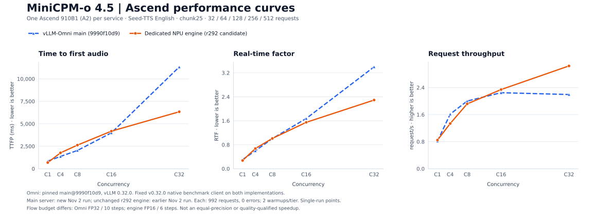
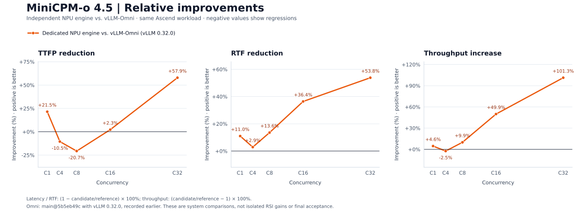

# Latest Omni main comparison — 2026-11-02

The new baseline is upstream `main@9990f10d9e898c3d38b1fa640513d55f771b8685`, fixed after a fresh fetch.
The prior [official v0.32.0 tag report](current-status-2026-11-02.md) and its separate curves remain archived.

## Measurement scope

The main server used its unmodified `minicpmo_4_5.yaml` deployment. The native benchmark client was deliberately
held at official tag `5917730a` for all three implementations/revisions, preserving the request sampler and metric
definitions. Client and server have separate recorded source identities; the server is not the old tag.

The new main run completed 992/992 requests, zero errors. Engine numbers reuse the unchanged r292 candidate's
earlier November 2 run, also 992/992 with zero errors. The engine was not rerun or modified for this comparison.
Each used one Ascend 910B1 (A2), chunk25, C1→C4→C8→C16→C32, 32/64/128/256/512 measured requests and two native
warmups per tier. The A2 CI case lists C1/C4/C8; the two higher tiers follow the generic CI case and requested sweep.

| C | Omni main: TTFP ms / RTF / req/s | Engine: TTFP ms / RTF / req/s | Engine gain: TTFP / RTF / throughput |
|---:|---:|---:|---:|
| 1 | 848.21 / 0.30597 / 0.81585 | 684.39 / 0.27521 / 0.84623 | +19.31% / +10.05% / +3.72% |
| 4 | 1366.22 / 0.59815 / 1.61519 | 1768.02 / 0.67370 / 1.33647 | -29.41% / -12.63% / -17.26% |
| 8 | 2032.28 / 1.00424 / 2.00046 | 2626.48 / 1.01072 / 1.91735 | -29.24% / -0.65% / -4.15% |
| 16 | 3990.16 / 1.67696 / 2.24796 | 4181.12 / 1.54829 / 2.34131 | -4.79% / +7.67% / +4.15% |
| 32 | 11325.17 / 3.39998 / 2.19395 | 6338.58 / 2.29230 / 3.03962 | +44.03% / +32.58% / +38.55% |

Positive percentages mean improvement; negatives mean regression. TTFP and RTF are native mean audio metrics.
Audio durations can differ, so RTF includes an output-duration denominator.

## Latest main versus official v0.32.0 tag

This table compares the new main server with the preceding official-tag server run, using the same native client
and stock FP32/10-step Flow budgets. These differences combine all source/deployment changes, including NPU
cross-reference batching, initialization precapture and other fixes; they are not isolated ablation gains.

| C | Main TTFP reduction vs. tag | Main RTF reduction vs. tag | Main throughput increase vs. tag |
|---:|---:|---:|---:|
| 1 | +21.28% | +22.71% | +29.35% |
| 4 | +35.89% | +28.37% | +37.45% |
| 8 | +36.92% | +29.39% | +39.83% |
| 16 | +31.03% | +29.57% | +40.27% |
| 32 | +26.56% | +28.80% | +40.87% |

## Precision, quality and statistics

Both Omni revisions use stock Flow FP32/10 steps. The existing engine uses FP16/6 steps; all use chunk25.
Engine-versus-Omni performance is a system configuration comparison, not a lossless equal-precision claim.
No final speech gate was run for this main comparison. The earlier 16-row development screen used an older engine
control and did not pass all absolute floors. Zero errors do not demonstrate speech-quality equivalence.

These are single-run points, without a frozen one-sided confidence bound. The r292 benchmark candidate is not
promoted to the released/default source, and its separately recorded long-profiler failure remains unresolved.

## Runtime and evidence

The vLLM runtime is the reused `0.32.0+empty` environment. Installed editable/generated Omni version metadata still
names the earlier development install; execution is identified by the clean main worktree, verified source SHA and
actual module path. No shared packages were rebound or upgraded, and no Omni model/runtime patches were applied.

The C32 client log records a Redis health-check/reconnection warning followed by successful reconnection.
The native client still exited 0 with all 512 measured requests successful; the warning is retained in the full log.

Both this new service and the earlier comparison services exited normally; their reservations were released.
The original checkout/service was untouched. [Native results and harness](../evidence/20261102-omni-main-9990f10d9/)
and [comparison data](data/ascend-main-20261102-comparison.json) retain the evidence and source bindings.

