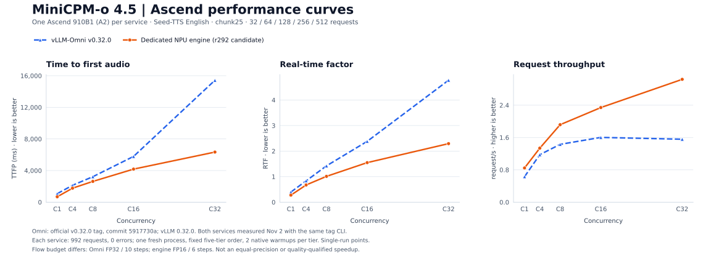
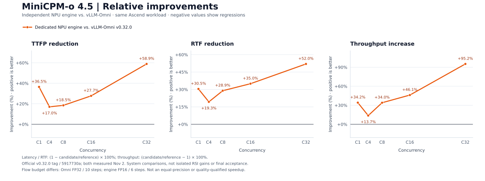

# Official vLLM-Omni v0.32.0 comparison — 2026-11-02

Both implementations were measured on Ascend 910B1 (A2), using the same official-tag native benchmark client.
The baseline is the unmodified official `v0.32.0` tag, commit
`5917730a4b02aedb44d374173cdc1b10484ccd52`, with vLLM runtime `0.32.0+empty`.
It is different from the older `main@5b5eb49c` baseline.

Each service was freshly started, used the C1→C4→C8→C16→C32 tier order, native two warmups per tier,
and 32/64/128/256/512 measured requests: 992 per implementation, 1,984 total, zero request errors.
The engine source/config was unchanged from the r292 candidate. No model/runtime patches were applied to Omni.
The tag's A2-specific CI case lists C1/C4/C8. C16/C32 follow its generic five-tier case and the previously requested
full concurrency sweep; they are additional A2 measurements, not historical A3 CI numbers.

| C | Omni v0.32.0: TTFP ms / RTF / req/s | Dedicated engine: TTFP ms / RTF / req/s | Engine improvement: TTFP / RTF / throughput |
|---:|---:|---:|---:|
| 1 | 1077.51 / 0.39586 / 0.63074 | 684.39 / 0.27521 / 0.84623 | +36.48% / +30.48% / +34.16% |
| 4 | 2131.17 / 0.83511 / 1.17511 | 1768.02 / 0.67370 / 1.33647 | +17.04% / +19.33% / +13.73% |
| 8 | 3221.95 / 1.42215 / 1.43064 | 2626.48 / 1.01072 / 1.91735 | +18.48% / +28.93% / +34.02% |
| 16 | 5785.64 / 2.38115 / 1.60263 | 4181.12 / 1.54829 / 2.34131 | +27.73% / +34.98% / +46.09% |
| 32 | 15420.54 / 4.77496 / 1.55745 | 6338.58 / 2.29230 / 3.03962 | +58.90% / +51.99% / +95.17% |

Positive values mean improvement. TTFP and RTF are native CLI mean audio metrics, not text TTFT or aggregate
makespan divided by audio duration. Output audio lengths can differ; RTF has a duration denominator.

## Precision and compute budget

This is a comparison of the existing system configurations, **not a lossless, equal-precision optimization claim**:

| Setting | Official Omni defaults | Existing r292 engine |
|---|---|---|
| Flow precision | FP32 | FP16 |
| Flow solver steps | 10 | 6 |
| Codec chunk size | 25 | 25 |

Omni's defaults are selected by `Token2wav(..., float16=False, n_timesteps=10)` when the corresponding additional
configuration keys are absent; its tagged deployment does not override those defaults. The engine settings are
recorded in the served config. Performance differences must not be attributed entirely to scheduling or fusion.
Omni v0.32.0 also has NPU graph paths and multi-frame Talker decoding.
The tagged [Flow constructor](https://github.com/vllm-project/vllm-omni/blob/5917730a4b02aedb44d374173cdc1b10484ccd52/vllm_omni/model_executor/models/minicpmo_4_5/minicpmo_4_5_code2wav.py#L1543)
and the preserved deployment YAML provide the default-setting evidence.

## Quality, statistics and stability

Single native runs provide point estimates, not frozen one-sided 95% lower bounds. No final speech gate was run for
this new comparison. The earlier 16-row development screen used the previous standalone engine as its control,
not this official Omni tag; it did not clear all absolute floors. Equal inputs and zero errors do not establish
equal speech quality. The r292 candidate remains unpromoted; its prior long-profiler run also failed separately.

## Version and evidence binding

Execution is bound to the clean Git tag worktree and the recorded module path. The shared editable environment's
generated version/distribution metadata still reports the earlier development version; those strings are preserved
in the [data](data/ascend-v0320-comparison.json). They are not substituted for the verified source Git identity.
The original checkout, its service and shared packages were preserved. Both new services exited and their NPU
reservations were released.

The [earlier main-based data](data/ascend-r295-comparison.json) remains as historical evidence; it is not the current
headline comparator. Raw result/command/source/config/input hashes and job receipts were checked before publication.
The [native result files and rerun harness](../evidence/20261102-omni-v0320/) are preserved for reproduction.

