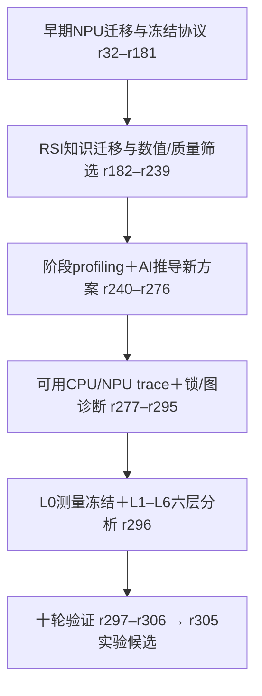
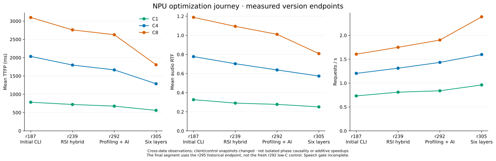

# MiniCPM-o 4.5 NPU 独立引擎：完整优化历程

整理日期：2026-11-02。本文回答的主线是：**先用RSI知识库适配和迭代，再引入profiling与AI发散方案，最后用六层profiling约束优化决策。**
此前介绍偏重最后r297–r306十轮，本版补齐r32起的NPU工作、统一官方benchmark后的每个阶段，以及失败、回退和修正。
完整逐项记录见[NPU全账本](optimization-ledger-npu.zh-CN.md)，不把准备/重跑/诊断编号算成成功算法轮次。

## 先看整条主线

| 阶段 | 当时依靠什么决策 | 找到的问题 | 主要结果 |
|---|---|---|---|
| 前置：NPU迁移与旧冻结协议，r32–r181 | 运行时/采样parity、微型消融、K=10旧验证器 | FIA/graph、counter RNG、postgraph、尾批等待与状态绑定 | r153旧协议性能门通过，但speech未评估；转官方CLI后必须重新建立基线 |
| 第一阶段：RSI知识迁移为主，r182–r239 | 知识库机制＋源码检查＋阶段计时＋真实权重/质量screen | Talker逐帧host循环、条件/KV重绑、融合数值与质量、CFM路径不稳定 | K10完整块、Add+RMS、packed-QKV/hybrid等候选；稳定端点r239仍未全面胜Omni |
| 第二阶段：profiling＋AI发散，r240–r295 | 首包分段、shape/命中计数，再加入可用CPU/NPU trace、Python栈、锁/capture | Talker graph缺row、Thinker共享prefix重复、mixed tick阻塞、零replay误归因、capture饥饿 | 选择性graph、min_live=9 prefix KV；门控/首包排序候选r292，但部分档位/质量/可靠性仍不过 |
| 第三阶段：六层profiling，r296–r306 | L0固定合同、L1–L6逐层证据＋单项验证＋native复测 | 首文本等待是低并发TTFP主要组成，整批交付屏障、首次媒体图capture、D2H所有权 | r305原模型验证prompt-lookup最有价值；其余方案保留负结果，未盲目叠加 |

这些阶段是**证据强度和主导方法的演进**，不是互斥开关。早期也有阶段计时和自主方案；后期也借鉴RSI知识。
没有做过“只用RSI / RSI＋profiling / 六层profiling”三种方法的随机对照优化实验，所以不能给方法本身分配独立提速百分比。

## 每个阶段实际优化了多少

为解释演进，前两段列**阶段端点观测**；第三段沿用本轮同配置控制组与r305确认。正值表示改善。

| 阶段 | 并发 | 端点/对照 | TTFP降低 | RTF降低 | 吞吐提升 |
|---|---|---|---|---|---|
| RSI知识迁移为主 | C1 | r187 → r239 | +7.90% | +10.89% | +10.62% |
| RSI知识迁移为主 | C4 | r187 → r239 | +11.61% | +9.60% | +9.00% |
| RSI知识迁移为主 | C8 | r187 → r239 | +10.94% | +7.95% | +8.94% |
| profiling＋自主策略 | C1 | r239 → r292（r295测量） | +6.29% | +4.62% | +3.58% |
| profiling＋自主策略 | C4 | r239 → r292（r295测量） | +7.34% | +9.26% | +9.26% |
| profiling＋自主策略 | C8 | r239 → r292（r295测量） | +4.76% | +7.62% | +8.68% |
| 六层profiling指导优化 | C2 | r292本轮控制 → r305确认 | +22.32% | +18.57% | +16.92% |
| 六层profiling指导优化 | C4 | r292本轮控制 → r305确认 | +25.60% | +13.30% | +15.43% |
| 六层profiling指导优化 | C8 | r292本轮控制 → r305确认 | +32.03% | +21.21% | +28.39% |

第一段r187→r239：TTFP降低约7.90%–11.61%，RTF降低7.95%–10.89%，吞吐提高8.94%–10.62%。
第二段r239→r292：TTFP降低约4.76%–7.34%，RTF降低4.62%–9.26%，吞吐提高3.58%–9.26%。
第三段r292本轮控制→r305：TTFP降低22.32%–32.03%，RTF降低13.30%–21.21%，吞吐提高15.43%–28.39%。

**前两段跨日期，代表整个阶段端点变化，包含运行波动，不能全部归因于某一种方法或某一个算子。**
第三段也只有单轮点估计与串行确认，不是冻结置信下界。
前两段没有C2，第三段的r292控制也不是r295旧端点那一次，因此不能拼接或相加为一条严格因果收益链。
完整数据与复算入口见[阶段数据](data/optimization-journey.json)。

## 前置阶段：先把NPU引擎和证据协议做正确

早期r32–r181处理的不只是性能：冻结模型/请求/质量门，建立个人身份/环境fingerprint，修正采样RNG、graph语义、KV及流式状态。
这些工作不能统一折成“算法加速多少”，但决定之后测到的是不是同一个模型、请求和正确的输出。

- r84 C16探针320/320失败；r85修复后才恢复有效服务。
- r85→r93尾批/min-ready调整：frames/s从136.90到146.57，RTF从2.8634到2.6715；这是旧小型screen，不是当前原生请求吞吐门。
- r117–r131比较静态FIA、postgraph、RMS/SwiGLU/Add+RMS等；小样本结果只用于选择候选。
- r150–r153将Omni过滤语义、batched counter RNG和Talker postgraph纳入K=10六格验证。
- r153旧协议性能门：C1/C16/C32的TTFA p50加速比point为2.152/2.787/4.398，单侧95%LCB为2.142/2.694/4.105；
  frames/s比point为2.975/3.221/4.820，LCB为2.796/3.044/4.454，错误率0。但报告明确speech_quality_evaluated=false。
- r164/r166旧官方Omni尝试总作业exit134，不能把已写出的局部JSON当完整有效基线；r181因此只是后续源码桥接点。

旧门使用TTFA p50/frames/s；现行使用TTFP mean/RTF/request/s，workload和baseline也换过。
所以旧2–4倍结果单独归档，不拿来宣传当前对最新Omni的增益。

## 第一阶段：RSI提供机制，真实NPU验证决定取舍

### r182–r195：统一benchmark推翻“专有引擎自然更快”

用户指定官方CI Seed-TTS en和C1/32、C4/64、C8/128。新镜像9fd63cd20600/vLLM0.32中，r185建立有效Omni，r187测初始独立引擎。
初始C4/C8的TTFP比Omni慢约34.93%/42.26%，吞吐落后18.09%/7.15%。
RSI第一项恒等gather消融微基准500次59.4→11.0ms，但服务吞吐反而回退，r193被拒绝。
完整profiler r188–r190也失败，不能把这一阶段写成每轮都有完整trace支持。

### r196–r215：Talker完整K-step设备块

RSI graph batching/state ownership启发把embedding、decoder、head、sampling、状态更新组成K=10完整图。
AI根据失败继续拆分metadata、物理页rebind、EOS与cohort条件来源；发现部分所谓graph数值差异其实来自进入Talker前的条件/batch轨迹不同。
r214用完整排序cohort后，5组实际模型token/condition/codec/帧数一致。
r215相对原代码反向控制r194，C1/C4/C8 TTFP改善约3.5%/3.1%/4.8%，吞吐约2.0%/3.7%/4.5%，但仍未全面胜Omni。

### r216–r239：融合知识迁移和“快也不能采用”

明确使用的知识包括固定conditioning复用、graph请求状态所有权、codec固定量与请求cache分离，以及融合的分层证据纪律。

| 尝试 | 结果 | 为什么留下或放弃 |
|---|---|---|
| Talker Add+RMS，r216/r217 | 相对r215吞吐+3.35%/+2.47%/+1.31%；C8 TTFP回退1.90% | 小收益候选，不能称三项全胜 |
| 固定Flow adaLN调制，r218 | 真实权重逐位一致，但局部只快0.48%–1.76% | 没有证明服务收益，不优先推广 |
| causal Conv1d改窗口GEMM，r221 | 数值/cache通过；C8常见shape慢8%–12% | 拒绝 |
| Thinker RMSNorm＋SwiGLU，r224–r226 | 性能有小收益；UTMOS下降0.31545，SIM下降3.31652，超过冻结容差 | 质量否决，不因benchmark更快而纳入 |
| CFM完整融合，r227–r229 | dtype修复后仍有cache数值超界 | 拆分消融，只保留可验证方向 |
| packed QKV，r230–r237 | 图重放局部约快15.6%，小质量screen通过；C8正式服务52/128失败 | 可靠性否决；15.6%不是服务收益 |
| hybrid路由，r238/r239 | rows<16用packed-QKV，大rows回退原路径；1024次交替稳定，正式三档0错误 | 成为下一阶段稳定控制 |

## 第二阶段：profiling与AI推导方案，优化开始针对依赖路径

### r240–r263：从“再换一个算子”转向shape、调度和复用

r240发现C16三指标都差，C32却较有利，说明并发增大并不自动带来收益。
r242首包分段：C16相对C4新增首包等待中，65.56%落在prefill→首文本，20.15%在首文本→首codec，T2W queue仅0.72%。
这个判断只适用于当时版本；后续prefix/graph改变后瓶颈会迁移。

AI推导并验证的方案包括：

- **选择性Talker exact-batch graph**：r243先做真实权重/token/KV/sampler parity。全部batch1–8图化的r245让C4回退，
  r246改成启用1/2/4/5/6/7/8、排除row3、将8+3改为7+4分片。r247 C8改善5.99%/8.28%/9.59%，C16改善21.82%/21.84%/27.10%（TTFP/RTF/吞吐）。
- **Thinker 8+8小图**：小cohort wall14.49→8.11秒看似很好，但r249正式C16三项回退9.37%/8.39%/7.72%；r251预热后仍回退，拒绝。
- **prefix KV复用**：来自RSI固定前缀机制，但必须由AI设计压力门控和失效规则；r254直接开启损害C4，
  r258以live-request min_live=9减少低压力干扰，C16为3867.70ms/RTF1.5112/2.4028req/s。
  latch、preseed、cohort-aware admission、10/50ms额外等待都没有形成全面替代。

### r264–r276：没有命中的优化不能拿来归因

静态FIA多步Thinker block累积数值漂移，被拒绝；dynamic paged-attention block实际权重token/hidden/KV可精确。
但r266/r268/r270/r274等服务窗口replay为0或极少，即使个别点变快也不能计作block收益。
r275才定位到低prefix压力旁路；r276无可用完整服务结果，未把它当已采用方案。

### r277–r295：可用关联trace、Python采样与锁诊断

r277最小探针确认with_stack=True会崩溃；改为无原生栈CPU/NPU事件＋补充Python栈采样，r278/r279才形成可用证据。
采集解析强烈干扰服务，因此profiled结果不进入性能表；使用独立native控制。

- mixed decode/prefill拆分r280/r283：C4约5%首包收益，C16明显回退，没纳入。
- Thinker batch9/10 graph：最初约19%的表观收益因冷/热及失败对照被撤回；固定开关匹配后仅约2.55%–2.87% TTFP改善、吞吐约1%。
- metadata/causal mask复用r282：命中数千次，C16吞吐只+0.07%，没有稳定收益。
- r285/r286真实锁/capture诊断找到writer饥饿；r287公平门控令capture等待14.628→1.426秒，但engine reader等待增到5.846秒，等待会转移。
- r292叠加首包窗口优先，早期screen C16看似TTFP改善10.37%、吞吐+14.50%；最终r295匹配五档只剩小收益，C8/C32回退。

最终r295中r292相对匹配r258：C1 +2.11%/+0.26%/+0.37%；C4 +0.81%/+3.52%/+1.50%；
C8 −3.53%/−1.75%/−3.35%；C16 +1.33%/+2.99%/+1.83%；C32 −1.64%/−0.38%/−6.07%。
小型语音screen相对变化在容差内，但WER/UTMOS绝对floor未全过；20秒候选profiler还出现CANN507000。
所以“加profiling以后”并不等于每次实验都有收益，这批没有全档稳定、质量合格的新默认。

## 第三阶段：六层profiling把候选收敛到首文本生成

r296按L0合同＋L1–L6逐层组织证据：流水线、graph/调度间隙、工作冗余、算子计数器、传输所有权、组件验收。
它与早期只看局部kernel/单个span的区别，是要求同时解释关键路径、真实命中和端到端结果。
实际采到图内节点、shape、CANN计数器，并将native计时、host/capture、逐包播放诊断分开。
没有宣称每轮重采完整msprof，也没有把未覆盖设备区间38.14%直接当可回收收益。

r297–r306再验证十轮：更大Thinker图、小图拆分、分组提前交付、预热、事件等待、EDF、AdaLN常量、prompt-lookup、NPU pending audio。
均值变好但P99更差、数值/API失败或无稳定E2E收益的方案保留为负结果；没有把十项改动叠进最终引擎。

**真正最有价值的是r305：prompt-lookup候选＋原Thinker整块验证＋KV截断。**
它使用本请求prompt和已生成2–4gram提出候选，原模型逐位置验证，保留匹配前缀及原模型不匹配/bonus预测。
不使用数据集ID、预置答案、额外draft模型；相对r292不改精度、步数或chunk。
242次验证提出3121token，匹配接受2223（71.23%，含warmup）；减少串行Thinker解码/主机往返。
诊断C8 prefill→首文本从1420.8降至551.7ms，随后Talker/Flow供给和首次媒体图capture成为更明显残余。

同配置native控制→确认的额外改善就是前表C2/C4/C8：TTFP −22.32%/−25.60%/−32.03%，
RTF −18.57%/−13.30%/−21.21%，吞吐+16.92%/+15.43%/+28.39%。
这是一组profiling指导优化后的观测结果，不是“开启六层profiler即提速”的因果结论。
完整十轮及mean/P99见[六层分析报告](rsi-profiling-20261102.zh-CN.md)。

## 版本的原始均值如何一路变化

下面固定看C1/C4/C8，避免将不同并发混成一条性能曲线。r187/r239/r292/r305为各阶段代表端点，不代表所有阶段都完整通过验收。

| 并发 | 版本/阶段端点 | TTFP mean ms | RTF mean | request/s |
|---|---|---|---|---|
| C1 | r187 初始统一CLI | 782.50 | 0.3261 | 0.7325 |
| C1 | r239 RSI稳定hybrid | 720.71 | 0.2906 | 0.8103 |
| C1 | r292 profiling/AI候选 | 675.38 | 0.2771 | 0.8393 |
| C1 | r305 六层分析后候选 | 559.57 | 0.2509 | 0.9619 |
| C4 | r187 初始统一CLI | 2034.19 | 0.7773 | 1.2040 |
| C4 | r239 RSI稳定hybrid | 1797.96 | 0.7027 | 1.3123 |
| C4 | r292 profiling/AI候选 | 1665.90 | 0.6376 | 1.4339 |
| C4 | r305 六层分析后候选 | 1287.76 | 0.5733 | 1.5984 |
| C8 | r187 初始统一CLI | 3097.81 | 1.1883 | 1.6063 |
| C8 | r239 RSI稳定hybrid | 2758.88 | 1.0938 | 1.7500 |
| C8 | r292 profiling/AI候选 | 2627.45 | 1.0105 | 1.9020 |
| C8 | r305 六层分析后候选 | 1806.22 | 0.8085 | 2.3884 |

这张图是跨日期版本观测，客户端后来从旧main换为官方tag；不能用线段直接认定单项因果增益。
最后一段与本轮r292低并发控制不是同一次起点，解释“六层后额外增加多少”时仍以同配置增量表为准。

## 最终对vLLM-Omni，仍使用当前直接对照

Omni也在演进：旧5b5eb49c基线之后重新测过官方v0.32.0和最新main9990f10d9。
不能拿旧Omni百分比叠加到新Omni上，也不能把r292的旧高并发优势移植给r305。
当前r305对最新已测Omni的mean TTFP降低C1/C2/C4/C8为34.03%/12.47%/6.99%/9.46%，
RTF降低17.99%/8.15%/5.06%/18.25%，吞吐提高17.90%/3.20%/1.13%/16.67%。
C2/C4/C8的TTFP P99仍落后；精度/步数是Omni FP32/10 vs引擎FP16/6；最终语音门仍NOT_RUN。

现在发布的是含r305显式实验配置的代码和证据，不是全档位质量合格、达到性能极限的正式引擎。
[README主对照](../README.md)继续直接比较Omni；本文额外说明为什么引擎是一步步演进到这里的。

## 完整账本和证据

- [r32–r306全部可核验NPU条目](optimization-ledger-npu.zh-CN.md)：保留失败、准备、验证、负收益和重新归因。
- [阶段原始数据](data/optimization-journey.json)及[evidence目录](../evidence/optimization-journey/README.md)：端点native JSON、r295匹配对照、r153旧报告。
- [最新十轮原始数据、补丁、source/config和退出码](../evidence/20261102-r305/README.md)。

未归档编号不补造；旧GPU架构前身只解释来源，不进入这里的NPU百分比。
历史账本的“采用/默认”只表示当时工程链引用，不等于最终冻结speech/statistical验收。
