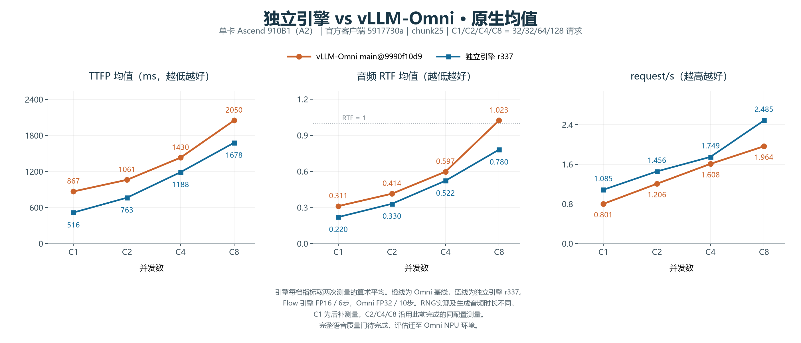
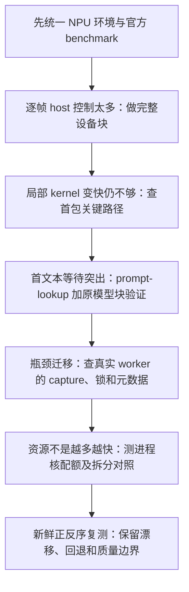

# MiniCPM-o 4.5 NPU 独立引擎：关键优化历程与为什么更快

整理日期：2026-11-03。本文覆盖早期 NPU 迁移、RSI 知识迁移、profiling 与自主方案、六层分析，以及最后 r312–r351 的 40 个方案尝试。它提炼关键决策，不把版本编号当成成功优化次数；逐项失败记录保留在原账本。

## 先说明最后得到的是什么

当前较有希望的**实验候选是 r337**：继承 Thinker prompt-lookup、Talker K=10 完整块、音频批处理/图和真实 worker 预热，再增加进程内 12 Cube/24 Vector 核配额和可信主机长度元数据复用。它完成两次全新服务的正反序原生复测；默认代码没有因此被提升。

相对冻结 vLLM-Omni main `9990f10d9` 的新鲜原生基线，观测到下面的均值差值。范围来自两次 r337 复测，**不是置信区间，也不是每项机制的独立贡献**。

| 并发 | TTFP mean降低 | RTF mean降低 | request/s提高 |
|---|---|---|---|
| C1 | 39.72%～41.19% | 28.29%～30.27% | 35.13%～35.84% |
| C2 | 25.12%～30.98% | 19.17%～21.29% | 18.97%～22.48% |
| C4 | 15.91%～17.90% | 9.70%～15.43% | 4.60%～12.89% |
| C8 | 17.74%～18.52% | 23.64%～23.84% | 25.39%～27.72% |

[均值图SVG](独立引擎vs-vLLM-Omni-均值.svg) · [均值图PDF](独立引擎vs-vLLM-Omni-均值.pdf) · [相对Omni的性能差值曲线](独立引擎vs-vLLM-Omni-性能差值.png) · [P99单独对照](独立引擎vs-vLLM-Omni-P99.png) · [绘图原始数值与来源](独立引擎vs-vLLM-Omni-绘图数据.json)。按用户要求，图中将两次 r337 的每档指标取算术平均，合并为一条蓝色引擎曲线。P99图取两次运行P99的算术平均。表格保留逐次实测及其范围。

两边使用相同模型 revision、官方客户端、请求集合和 chunk25。Omni Flow 为 FP32/10 步，引擎为 FP16/6 步，音频 RNG 实现及生成音频时长也不同。完整语音质量门待完成，评估已按用户指示转到 Omni NPU 环境。当前表格表示这些部署配置下的实测差值。

本轮 40 个方案中，33 个作业退出 0，7 个因配置/框架限制或运行崩溃被拒绝。最终另做了 8 个引擎确认/对照作业和 1 个同版本 Omni 基线复测，并于 11月3日补做 C1 的同版本 Omni 和两次 r337 测量。性能搜索达到 40 方案上限后结束，C1 补测属于覆盖补齐。

## 一条主线：判断如何逐步改变

### 1. 先承认：专用引擎并不会自然胜过成熟框架

早期 r32–r181 先解决 NPU attention/graph、KV、RNG、流式状态与证据协议。r153 曾通过旧协议的性能门，但使用的是 TTFA p50/frames/s，且没有完成语音质量门。这些旧结果不能搬来回答现在的 mean TTFP/RTF/request/s。

转到用户指定的官方 CI Seed-TTS benchmark 后，初始独立引擎 r187 在 C4/C8 的 TTFP 反而比当时 Omni 慢约 34.93%/42.26%，吞吐落后约 18.09%/7.15%。这迫使优化从“代码更专用，所以应当更快”转向真实请求路径。

一个早期教训是恒等 gather 消融：微基准 500 次从 59.4 ms 降至 11.0 ms，服务吞吐却回退。以后判断一项改动，必须同时看它是否位于关键路径、是否实际命中，以及官方原生请求是否变快。

### 2. RSI 给出机制，落地的难点是状态和所有权

r196–r215 借鉴 graph batching/state ownership，把 Talker 的 embedding、decoder、head、sampling 和请求状态更新合成 K=10 完整设备块，减少逐帧 Python 控制和 token 读回。

难点不是简单套 graph：每个请求的 KV 物理页、采样历史、EOS、chunk 边界和未接受状态都必须正确重绑、截断、释放。部分看似 graph 数值不一致的问题，实际来自进入 Talker 前就不同的 condition/cohort 轨迹。r214 使用完整有序 cohort 后，5 组实际模型 token/condition/codec/帧数检查一致。

r215 相对反向控制 r194，C1/C4/C8 TTFP 约改善 3.5%/3.1%/4.8%，吞吐约改善 2.0%/3.7%/4.5%。这是当时同类路径的观测，不能当成当前比 Omni 多帧实现更快多少。

随后测试 Add+RMS、固定 Flow conditioning、packed QKV 与融合卷积。融合知识确实提供了候选，但“少几个算子”不等于更快，也不等于质量保持：

- 全融合 Thinker RMS/SwiGLU 有小性能收益，开发语音 screen 却出现 UTMOS/SIM 超容差，未纳入。
- packed QKV 局部 graph replay 约快 15.6%，正式 C8 却出现 52/128 请求失败，不能把局部收益写成服务收益。
- 因此形成 r239 的保守 hybrid：只让通过验证的小 rows 走 packed 路径，大 rows 保留原实现和 fallback。

### 3. profiling 改变了优化对象：从算子转向等待链

r240 以后开始分解 admission、prefill、首文本、首 codec、首音频队列与解码。r242 当时的 C16 新增首包等待中，65.56% 在 prefill→首文本，20.15% 在首文本→首 codec，T2W queue 仅 0.72%。这一结论只适用于当时版本，但它说明只优化最后的音频解码不一定能改变首包。

这一阶段自主推导了选择性 exact-batch graph、cohort 切分、prefix KV 的压力门控、prefill/decode 拆分和公平 capture gate。也遇到反例：

- 全部 batch1–8 图化不一定好；后续排除 row3，并将尾部 8+3 改为 7+4，保留更合适的图路径。
- 小图 8+8 的局部 wall 看似更好，正式 C16 却回退，预热后也未挽回。
- prefix KV 在高压力下有价值，低并发却可能因维护成本受损，最后增加 `min_live=9`。
- 公平 gate 将 capture writer 等待从 14.628 s 降至 1.426 s，但 engine reader 等待增至 5.846 s。等待转移不能写成全部消除。
- 有些候选窗口 graph replay 为 0；即使单点变快，也撤回“graph 带来收益”的归因。

这个阶段最关键的进步，是开始问“谁在等谁、等待是否转移、路径有没有命中”，而不只是找耗时最长的函数。

### 4. 六层分析最有价值的产出：Thinker prompt-lookup 验证

r296 的 L0 固定测量合同；L1–L6 组织流水线时序、graph/调度间隙、冗余/layout、算子与计数器、传输/所有权、组件验收。它是一套证据组织方法，不是打开六个 profiler 就自动加速，也没有每轮重采完整 msprof。

低并发首包中，等待首个 Thinker 文本块很突出。因此 r305 在 TTS 朗读这类 prompt 与输出重复度较高的请求上，使用**本请求 prompt 提供草稿，再由原 Thinker 整块验证**：匹配部分接受；不匹配位置采用原模型预测；多写的 KV 截断。草稿上限为 8，不引入额外 draft 模型，不按数据集 ID 查答案。

这减少的是串行 Thinker decode/host 往返次数。历史同阶段诊断 C8 的 prefill→首文本从 1420.8 ms 降至 551.7 ms；这些是含等待的诊断区间，不能当成纯 kernel 耗时。

同配置控制到 r305 确认的原生观测：C2/C4/C8 TTFP 改善 22.32%/25.60%/32.03%，RTF 改善 18.57%/13.30%/21.21%，吞吐提高 16.92%/15.43%/28.39%。它描述该轮候选与控制的差值，不能解释成“六层方法独立贡献这么多”，也不能与其他阶段相加。

在当前 r337 复测一结束时，prompt-lookup 累计 253次验证、3102个草稿token中接受2215个（71.41%）。这是截至 C8 的累计计数，包含 C2/C4/C8 三档及 warmup，不是 C8 单档接受率。该策略对朗读负载特别合适，不能直接外推到低重复度开放式对话。

### 5. 首文本加快后，继续查真实 worker 的 capture 和重复主机观察

r307–r309 根据新时序，把通用 Euler/HiFT 桶、续包/尾窗和 prompt-setup 桶预热放到实际 audio worker/prompt stream，并放在 health 就绪前。关键在于预热的 owner、stream 和 arena 与后续真实执行一致；不是用更多数据请求把慢项藏起来。

Omni 也有初始化 precapture，所以优势不能表述成“我们预热，Omni 不预热”。需要比较覆盖哪些真实 shape、在哪个 owner 上预热，以及是否改变 scratch 生命周期。r309 在初筛及反序中 C8 吞吐改善仅约 0.88%/0.72%，也说明去掉 capture 尖峰未必转化成同等幅度的吞吐收益。

随后发现我们的 attention 路径每层读回已经在 layout 构造时知道的累计长度。r319/r337 将相同主机元数据向下传递，校验 batch/cardinality/范围后复用；不可信或缺失时保留原 fallback。这是修复自身冗余，不代表 Omni 也存在相同 D2H 缺陷。

### 6. 用户提出并发资源共享后，发现“用满核数”不是唯一目标

MPS 思路启发了资源使用实验，但没有直接照搬 CUDA。NPU 上实际测的是本进程/stream 的 Cube、Vector 核限制；不是启动 MPS daemon，也没有证明实现了跨进程空间并行。

r320 将本进程的核配额配置从 24 Cube/48 Vector 改为 12/24，记录了 API 读取的前后值。单独一组新鲜 A/B/A 中，C2/C4/C8 RTF 分别降低约 10.50%–11.98%、3.42%–5.01%、5.34%–6.77%，吞吐提高约 16.28%–17.14%、4.16%–4.24%、6.19%–7.58%。原首轮 C8 回退仍保留；这些范围是对两个控制的点差，不是 CI。

r337 在此基础上组合主机长度复用，成为最后较有希望的候选。它的最终正反序结果相对原引擎控制如下：

| 并发 | TTFP mean降低 | RTF mean降低 | request/s提高 |
|---|---|---|---|
| C2 | +0.11%～+11.54% | +8.94%～+11.33% | +11.83%～+15.13% |
| C4 | -1.82%～+5.43% | +3.23%～+9.37% | +1.23%～+10.09% |
| C8 | +3.76%～+8.27% | +3.61%～+7.27% | +3.28%～+9.24% |

RTF/吞吐的观察方向在两次候选与各自前后对照中均为正，**C4 TTFP 仍不一致**。这是组合方案的增量，不能把全部收益单独算给主机长度，也不能再把 r320 的百分比加上去。

为什么少用一些核反而可能变快？可能涉及 kernel tiling、内存带宽和并发 stage 的资源争用。当前证据证明了配置及部分性能方向，不足以给上述解释分配因果百分比。更窄的 8/16 配额没有继续获益；只限制音频 stream 的 r343 初筛有利，C8 新鲜复测却未稳定复现。这些反例限定了结论：不是核数越少越好，也不是所有 stream 都适用相同配额。

## 我们相对本次 Omni 配置，到底额外做了什么

下面比较的是已冻结的实际部署，不代表 vLLM-Omni 框架永远无法启用类似能力。

| 方面 | 冻结 Omni main 的情况 | 独立引擎候选的做法与证据边界 |
|---|---|---|
| 流水线组织 | 实测一张 NPU 上三个 stage 模型进程，使用 shared-memory connector | 同一 backend 统一持有 Thinker/Talker/Token2Wav 状态，用线程/stream 协同；减少跨 stage 调度边界是结构上的潜力，IPC/context 各省多少尚无独立消融 |
| Thinker 生成 | 当前 YAML 的 stage-0 n-gram speculation 关闭 | 请求 prompt-lookup 上限 8，原 Thinker 块验证及 KV 截断；是当前朗读负载上有证据的差异，不是额外答案或数据集缓存 |
| Talker 多帧 | 当前 NPU YAML 为每步 8 帧，并使用 n-gram 配置和停止头 | K=10 完整设备块，并控制 sampler/history/EOS/KV；两边都有多帧能力，不能把差值写成“10帧对逐帧” |
| 图与融合 | 已有静态 attention、CFM Whole-Euler、HiFT/encoder 图、CFM 融合、跨 reference batching | 专用 cohort 路由、graph 桶、hybrid fallback 和真实 owner 预热；差异在覆盖/调度/生命周期，不是我们有图而对方没有 |
| 资源配置 | 本次 NPU deploy 未配置本文的 12/24 进程配额；YAML 的 CUDA MPS 段不由 NPU 读取 | r337 配额 12/24 有实际前后值和新鲜复测；音频单流配额方案未稳定获益，不能宣传为已实现 NPU MPS |
| 主机元数据 | Omni 使用自己的成熟 attention metadata 路径 | 消除我们旧路径的逐层 qo 累计长度 D2H；这是自身补强，未证明该项比 Omni 对应路径更优 |
| KV/prefix 复用 | 有 paged KV；当前 duplex profile 的 Thinker prefix cache 关闭 | 有自身 paged KV 和压力门控 prefix 复用；但 r337 在 C2/C4/C8 的 prefix 命中为 0，不能拿它解释这三档收益 |
| 计算量/精度 | Flow FP32、10步 | Flow FP16、6步，且 counter RNG 实现不同；这是实质计算成本/数值路径差异，语音门未完成，不能包装成无损架构优化 |
| 前端语言 | Python 服务和多进程流水线 | 仍为 Python；没有采用 C++/Rust 前端重写，也没有证据把当前优势归因于语言 |

因此，“为什么目前测得更快”应分三层讲：**专用请求路径和成块执行提供基础；prompt-lookup、图覆盖和资源/元数据策略带来经过测量的候选增量；Flow 精度/步数等差异也影响最终跨产品差值。** 目前没有能把它们拆成可相加贡献百分比的完整消融，质量条件也尚未闭合。

## RSI 知识库和自主推导分别做了什么

RSI 提供可检索的机制、适用前提和失败经验；具体改动仍由本机 profile、模型/状态结构和原生测量决定。最近一轮实际读取的知识条目见[带 SHA 的 readset](knowledge-readset.json)。

| 知识来源 | 提供的方向 | 本机推导和验证 |
|---|---|---|
| `deepinfer.common.llm.speculative_verification_budget` | 草稿长度、接受率与验证成本的平衡 | 使用本请求 prompt 构造草稿，原 Thinker 验证；比较长度4/8/16、普通行与验证行合并；更长草稿未普遍更好 |
| `deepinfer.common.llm.zero_overhead_deferred_scheduling` | 减少重复调度和不必要串行阶段 | mixed tick 分离、合并验证和压力门控；小并发/大并发结果不同，未无条件叠加 |
| `qwen3_tts_engine.ascend.audio.graph_batching_state_ownership` | 图批处理必须有明确请求状态与 scratch 所有者 | 完整 Talker 块、稳定 cohort、EOS/KV 截断、私有 Flow 与 gate 实验；可靠性失败会否决性能候选 |
| `pytorch.cuda.compiler.cudagraph_shapes_and_lifetimes` | shape 覆盖、预热位置和图缓冲生命周期 | 迁移概念到 NPUGraph，按真实 worker/stream 及实际命中桶预热；没有搬用 CUDA 提速数字 |
| `triton.common.kernel.bandwidth_fusion_resource_limits` | 融合、带宽和资源占用存在取舍 | 用户 MPS 启发后设计进程/stream 核配额与分离对照；另测精确保留舍入的 RMS/RoPE，未因少算子就接受 |

单位权重 RMS 后再按原 dtype 缩放、两个 RoPE 乘积分别舍入再相加、主机累计长度传播，以及按真实音频 cohort 扩展桶，是结合源码和测量自主提出/适配的方案。它们也必须过同样的验证，没有因为“自主创新”而降低采用标准。

## 没有纳入的方案，也是结论的一部分

| 方案 | 真实结果 | 留下的经验 |
|---|---|---|
| 更大的 Thinker 图/小图拆分 | 局部或个别并发有利，正式均值/P99或其他并发回退 | 形状覆盖与批效率要共同验收 |
| r315 合并验证 | C8反序仍有改善，C4的RTF/吞吐回退 | 不逐档拼接不同版本当“通用赢家” |
| 独立 prompt Flow arena、扩大 ACLNN cache | C8出现完整服务崩溃 | 少锁/更多缓存不等于可靠；两类 task-group 错误与另一次 kernel-type 错误不强行归为同一已证实根因 |
| HiFT/Euler 精确3/5/6/7行桶 | 实际命中、减少 padding，但无一致端到端收益 | 少算行数不能直接换算为性能提升 |
| TorchScript C++小算子链、单位权重RMS、保留舍入RoPE | 算子检查/Thinker开发检查可通过，原生三档没有一致收益 | 少 Python 派发、数值更接近，都不能替代服务 benchmark |
| r348 Thinker静态FIA512 | 有实际图路径调用，C8回退 | 去掉 host task update 也可能增加设备/调度成本 |
| r343仅音频12/24、r349进程8/16、r351组合 | 未成为比r337更好的通用候选 | 资源配置和优化组合不单调，收益不能相加 |
| TASK_QUEUE_ENABLE=2、部分核数比例 | 框架或算子明确不支持 | 记为真实拒绝/失败，不编造性能数字 |

CPU 诊断也有失败：自定义 cProfile 时钟产生无效耗时；perf 权限不足；Austin 漏掉忙碌的 engine/audio 栈；AustinP 自身崩溃。无效数据全部排除，没有拿来计算“Python 占比”。

有效证据显示 native engine 线程约占单核82.47%，HTTP约2.26%；GIL采样没有显示持续饱和。本容器CPU quota未限额、限流计数0，但内核runqueue统计关闭，仍不能排除CPU/CANN发射端的局部瓶颈。当前没有充分证据优先重写整个C++/Rust前端。[CPU证据与局限](CPU瓶颈与语言选择.md)。

## 如何理解“优化了多少”

历史阶段端点帮助看方向：r187→r239的TTFP观测降低约7.90%–11.61%、RTF约7.95%–10.89%、吞吐提高约8.94%–10.62%；r239→r292的相应范围约4.76%–7.34%、4.62%–9.26%、3.58%–9.26%。这些跨日期、跨阶段端点不能逐项相加或解释成知识库/AI方法本身的因果效果。

r292本轮控制→r305、r305→r309、r309控制→r337，各有自己的当期控制和确认；后段的起点不是前段旧测量的终点。最终对产品的比较仍直接看冻结 Omni 与同一候选的 C1/C2/C4/C8 四档结果，不能把各阶段最好的百分比累加。

当前完整原生数值如下。C2/C4/C8 的两次 r337 使用同一源码/配置的新服务，每次完成32/64/128共224个计时请求、0失败，Omni相同。C1 是 11月3日的同配置补测，Omni及两次候选各32个计时请求、0失败。每条完整四档曲线共256个计时请求。总输出音频秒数如实披露。

| 并发 | 版本 | TTFP mean ms | RTF mean | request/s | 总输出音频秒 |
|---|---|---|---|---|---|
| C1 | Omni 新鲜基线 | 867.18 | 0.3114 | 0.8012 | 130.28 |
| C1 | r337 复测一 | 522.72 | 0.2233 | 1.0826 | 134.88 |
| C1 | r337 复测二 | 509.97 | 0.2171 | 1.0883 | 138.16 |
| C2 | Omni 新鲜基线 | 1060.66 | 0.4142 | 1.2062 | 129.64 |
| C2 | r337 复测一 | 794.18 | 0.3348 | 1.4350 | 136.92 |
| C2 | r337 复测二 | 732.12 | 0.3260 | 1.4773 | 135.20 |
| C4 | Omni 新鲜基线 | 1429.62 | 0.5970 | 1.6083 | 267.80 |
| C4 | r337 复测一 | 1202.20 | 0.5391 | 1.6822 | 288.52 |
| C4 | r337 复测二 | 1173.73 | 0.5049 | 1.8156 | 282.76 |
| C8 | Omni 新鲜基线 | 2049.72 | 1.0234 | 1.9637 | 518.24 |
| C8 | r337 复测一 | 1686.19 | 0.7815 | 2.4622 | 542.92 |
| C8 | r337 复测二 | 1670.11 | 0.7795 | 2.5081 | 535.44 |

最终基线固定为 `vllm-omni main@9990f10d9e898c3d38b1fa640513d55f771b8685`，底层 vLLM 0.32.0。官方客户端为 `5917730a4b02aedb44d374173cdc1b10484ccd52`，硬件为单 Ascend910B1/A2，数据为 Seed-TTS English，C1/32、C2/32、C4/64、C8/128，每档2次warmup、chunk25。C1与其余三档的测量时间分别记录在补测核验文件和各作业日志中，四档候选均为 r337。

原生计时和 profiling 使用不同服务进程；服务初始化与官方 warmup 不进入这张请求性能表。相同客户端的请求构造及采样配置另有[静态核对](benchmark-sampling-audit.json)，Omni能力与参数以[本次实际deploy](results/omni-final/deploy.yaml)为准。

两次候选与前后控制给出的是观测范围；它们没有完成冻结统计LCB或语音验收。RTF mean低于1也不保证每个请求/每个音频块都实时，逐包欠载诊断与原生计时需分别阅读。

## 最后留下的认识与尚未完成的验收

这段历程从“找一个更快的算子”，逐步变成“减少串行依赖、明确状态所有权、覆盖真实执行形状、平衡资源，并用反序测量防止误判”。最有价值的不仅是保留的路径，也包括撤回零命中归因、拒绝质量/可靠性失败，以及承认部分均值收益不能稳定复现。

性能搜索及四档覆盖已完成。接下来在 Omni NPU 环境准备评分依赖与相同身份的评分模型，记录新的 NPU evaluator fingerprint，再完成当前 main 与 r337 的配对语音质量门。原 CUDA 评分 fingerprint 仅保留审计，门槛、样本和评分模型身份沿用既定要求。r337开发样本Thinker文本/token为16/16一致、codec为0/16一致，完整语音验收仍待完成。

## 证据入口

- [早期r32–r306的完整历程](../../../docs/optimization-journey.zh-CN.md)与[完整NPU账本](../../../docs/optimization-ledger-npu.zh-CN.md)。
- [r307–r309及反序确认](../followup/六层profiling继续优化-r307-r309.md)。
- [最后40个方案的逐项来源、结果与失败](持续优化实验记录.md)。
- [正反序、捕获stream拆分与Omni直接对照](正反序确认与Omni对照.md)。
- [40方案原生均值曲线](算法迭代原生均值.png)与[绘图口径](plot-manifest.json)：编号不等于严格执行时间，不代表单调收敛。
- [当前候选配置](config-r337.json)、[源码/工作负载绑定](bindings-audit.json)、[补丁索引](patches/manifest.json)。
- [核配额单独A/B/A](core-confirmation-analysis.json)、[最终配对范围](final-confirmation-summary.json)、[Omni新鲜基线核验](omni-confirmation-verification.json)。
- [本总结的数值来源](关键优化总结数据.json)、[完整收尾状态](finalization.json)、[C1补测核验](c1-completion-verification.json)。
