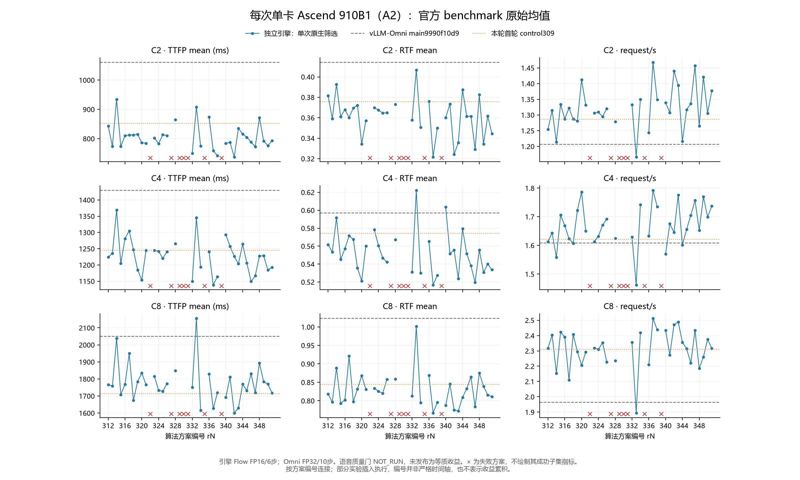

# 六层 profiling 后继续演进：最多40轮

更新：2026-11-03 04:35:58 北京时间。

已实际执行并取回 40 个算法方案，上限40；控制、重复确认、设备profiling与实现修复不计算法轮。

[先读：关键优化历程、为什么更快及相对Omni的额外优化](关键优化历程与Omni对比总结.md)。

## 本轮收尾状态

40个实际方案尝试达到用户上限：33个作业退出0，7个因算子/框架限制或运行崩溃而拒绝，失败均保留。最终8个引擎对照/正反序作业及1个同配置Omni原生补测完成并核验。该40轮活动的推理进程、预约和监控均已结束。后续同配置C1补测三项作业也已完成，各32请求、0失败。

r337是较有希望的性能候选：12Cube/24Vector进程配额加主机累计长度；相对本轮原引擎前后对照，三档RTF/吞吐的观察方向一致，但C4 TTFP范围跨零。r343单独限制音频stream的C8收益未稳定复现。两者完整数值和直接Omni参考均保留，不按并发选择不同版本。

本轮结束是因为40方案上限，不证明全局最优。语音评分已转到Omni NPU环境准备，完整配对语音生成和质量门仍待完成。

[最终正反序与Omni对照](正反序确认与Omni对照.md) · [CPU瓶颈与语言判断](CPU瓶颈与语言选择.md) · [收尾审计](finalization.json)。

## 固定测量与验收

单Ascend910B1/A2，原device-group wrapper→dyy-v032-r182/UID1033:GID1000→npu run；保留他人进程和原55449服务。原生客户端5917730a，C2/32、C4/64、C8/128请求，每档两个warmup。模型、数据、采样、chunk25、Flow FP16/6步固定；native与diagnostic分服务。

主要看TTFP mean ms、RTF mean、request/s；小样本P99只作为异常定位。单轮均值也会波动，初筛结果不能替代反序确认。输出文本/token须先通过16条开发样本精确对照。音频仍需原speech gate；NOT_RUN不等于通过。

## 每轮方案与状态

| 轮次 | 机制 | parent | 当前状态 |
|---|---|---|---|
| r312 | thinker-init | control309 | no_consistent_gain_or_inconclusive |
| r313 | split-three | control309 | no_consistent_gain_or_inconclusive |
| r314 | draft4 | control309 | no_consistent_gain_or_inconclusive |
| r315 | unified-lookup | control309 | promising_needs_reverse_confirmation |
| r316 | batch-embedding | control309 | no_consistent_gain_or_inconclusive |
| r317 | bind-uploads | control309 | no_consistent_gain_or_inconclusive |
| r318 | tail-coverage | r312 | no_consistent_gain_or_inconclusive |
| r319 | host-lengths | control309 | no_consistent_gain_or_inconclusive |
| r320 | cores50 | control309 | no_consistent_gain_or_inconclusive |
| r321 | mask-cache | control309 | no_consistent_gain_or_inconclusive |
| r322 | cores75 | control309 | rejected_operator_resource_limit |
| r323 | draft16 | control309 | no_consistent_gain_or_inconclusive |
| r324 | unified-min5 | control309 | no_consistent_gain_or_inconclusive |
| r325 | page-id-cache | control309 | no_consistent_gain_or_inconclusive |
| r326 | hift-static-weightnorm | control309 | no_consistent_gain_or_inconclusive |
| r327 | private-prompt-flow | control309 | rejected_native_crash |
| r328 | packed-rotary | control309 | no_consistent_gain_or_inconclusive |
| r329 | cube50 | control309 | rejected_operator_resource_limit |
| r330 | vector50 | control309 | rejected_operator_resource_limit |
| r331 | taskqueue2 | control309 | rejected_framework_graph_compatibility |
| r332 | paged-suffix | r319 | no_consistent_gain_or_inconclusive |
| r333 | taskqueue0 | control309 | no_consistent_gain_or_inconclusive |
| r334 | low-pressure-split | control309 | promising_needs_reverse_confirmation |
| r335 | aclnn-cache100k | control309 | rejected_native_crash |
| r336 | pinned-pcm | control309 | no_consistent_gain_or_inconclusive |
| r337 | host-lengths | r320 | promising_needs_reverse_confirmation |
| r338 | mask-cache | r332 | no_consistent_gain_or_inconclusive |
| r339 | rope-invariant | control309 | rejected_diagnostic_crash |
| r340 | hift-exact-rows | control309 | no_consistent_gain_or_inconclusive |
| r341 | script-elementwise | control309 | no_consistent_gain_or_inconclusive |
| r342 | low-pressure-split | r320 | no_consistent_gain_or_inconclusive |
| r343 | audio-stream-cores | control309 | promising_needs_reverse_confirmation |
| r344 | euler-exact-rows | control309 | no_consistent_gain_or_inconclusive |
| r345 | rounding-native-rms | control309 | no_consistent_gain_or_inconclusive |
| r346 | native-rotary | control309 | no_consistent_gain_or_inconclusive |
| r347 | mask-cache | r337 | no_consistent_gain_or_inconclusive |
| r348 | thinker-static-fia | control309 | no_consistent_gain_or_inconclusive |
| r349 | cores-third | r337 | no_consistent_gain_or_inconclusive |
| r350 | rounded-native-rotary | r346 | no_consistent_gain_or_inconclusive |
| r351 | host-lengths | r343 | no_consistent_gain_or_inconclusive |

## 原生点估计

百分比相对本轮明确parent；正值为改善，既不是置信区间，也不能相加。

| 轮次 | 并发 | TTFP mean ms | RTF mean | request/s | TTFP降低 | RTF降低 | 吞吐提高 |
|---|---|---|---|---|---|---|---|
| r312 | C2 | 843.02 | 0.3817 | 1.2539 | +1.13% | -1.58% | -2.51% |
| r312 | C4 | 1224.14 | 0.5618 | 1.6135 | +1.65% | +2.16% | -0.50% |
| r312 | C8 | 1766.77 | 0.8186 | 2.3171 | -3.13% | +3.05% | +0.34% |
| r313 | C2 | 773.49 | 0.3590 | 1.3149 | +9.29% | +4.45% | +2.23% |
| r313 | C4 | 1235.39 | 0.5534 | 1.6432 | +0.74% | +3.61% | +1.34% |
| r313 | C8 | 1757.75 | 0.7965 | 2.4033 | -2.60% | +5.67% | +4.07% |
| r314 | C2 | 934.65 | 0.3927 | 1.2144 | -9.61% | -4.50% | -5.58% |
| r314 | C4 | 1368.85 | 0.5917 | 1.5579 | -9.98% | -3.05% | -3.93% |
| r314 | C8 | 2038.19 | 0.8889 | 2.1539 | -18.97% | -5.28% | -6.72% |
| r315 | C2 | 773.37 | 0.3610 | 1.3336 | +9.30% | +3.92% | +3.69% |
| r315 | C4 | 1204.70 | 0.5452 | 1.7055 | +3.21% | +5.04% | +5.18% |
| r315 | C8 | 1708.35 | 0.7933 | 2.4228 | +0.28% | +6.04% | +4.92% |
| r316 | C2 | 810.19 | 0.3680 | 1.2875 | +4.98% | +2.06% | +0.11% |
| r316 | C4 | 1281.27 | 0.5571 | 1.6691 | -2.94% | +2.98% | +2.93% |
| r316 | C8 | 1768.44 | 0.8022 | 2.3893 | -3.22% | +5.00% | +3.47% |
| r317 | C2 | 812.52 | 0.3602 | 1.3220 | +4.71% | +4.15% | +2.79% |
| r317 | C4 | 1304.91 | 0.5715 | 1.6238 | -4.84% | +0.47% | +0.14% |
| r317 | C8 | 1949.80 | 0.9208 | 2.1102 | -13.81% | -9.05% | -8.62% |
| r318 | C2 | 812.89 | 0.3695 | 1.2866 | +3.57% | +3.20% | +2.61% |
| r318 | C4 | 1246.53 | 0.5676 | 1.6074 | -1.83% | -1.04% | -0.38% |
| r318 | C8 | 1673.78 | 0.7977 | 2.4076 | +5.26% | +2.56% | +3.90% |
| r319 | C2 | 814.40 | 0.3722 | 1.2812 | +4.49% | +0.94% | -0.39% |
| r319 | C4 | 1184.74 | 0.5355 | 1.7226 | +4.81% | +6.74% | +6.23% |
| r319 | C8 | 1784.33 | 0.8315 | 2.2944 | -4.15% | +1.52% | -0.64% |
| r320 | C2 | 785.95 | 0.3344 | 1.4121 | +7.83% | +11.00% | +9.79% |
| r320 | C4 | 1153.51 | 0.5213 | 1.7860 | +7.32% | +9.22% | +10.14% |
| r320 | C8 | 1834.83 | 0.8679 | 2.2058 | -7.10% | -2.79% | -4.48% |
| r321 | C2 | 784.11 | 0.3573 | 1.3316 | +8.04% | +4.92% | +3.54% |
| r321 | C4 | 1244.99 | 0.5603 | 1.6497 | -0.03% | +2.42% | +1.74% |
| r321 | C8 | 1766.05 | 0.8312 | 2.2933 | -3.08% | +1.56% | -0.69% |
| r323 | C2 | 802.36 | 0.3699 | 1.3063 | +5.90% | +1.55% | +1.57% |
| r323 | C4 | 1244.57 | 0.5783 | 1.6132 | +0.01% | -0.72% | -0.52% |
| r323 | C8 | 1814.46 | 0.8340 | 2.3192 | -5.91% | +1.22% | +0.43% |
| r324 | C2 | 782.82 | 0.3674 | 1.3091 | +8.19% | +2.22% | +1.78% |
| r324 | C4 | 1241.70 | 0.5605 | 1.6317 | +0.24% | +2.39% | +0.63% |
| r324 | C8 | 1734.16 | 0.8254 | 2.3089 | -1.22% | +2.24% | -0.01% |
| r325 | C2 | 813.28 | 0.3646 | 1.2944 | +4.62% | +2.97% | +0.64% |
| r325 | C4 | 1220.31 | 0.5469 | 1.6709 | +1.95% | +4.75% | +3.04% |
| r325 | C8 | 1727.47 | 0.8202 | 2.3543 | -0.83% | +2.86% | +1.95% |
| r326 | C2 | 810.14 | 0.3649 | 1.3204 | +4.99% | +2.89% | +2.66% |
| r326 | C4 | 1240.88 | 0.5421 | 1.6922 | +0.30% | +5.58% | +4.36% |
| r326 | C8 | 1773.01 | 0.8577 | 2.2280 | -3.49% | -1.58% | -3.52% |
| r328 | C2 | 865.27 | 0.3732 | 1.2786 | -1.48% | +0.69% | -0.59% |
| r328 | C4 | 1265.95 | 0.5672 | 1.6245 | -1.71% | +1.22% | +0.18% |
| r328 | C8 | 1848.85 | 0.8593 | 2.2368 | -7.92% | -1.77% | -3.14% |
| r332 | C2 | 750.11 | 0.3578 | 1.3328 | +7.90% | +3.89% | +4.03% |
| r332 | C4 | 1149.69 | 0.5312 | 1.6295 | +2.96% | +0.79% | -5.41% |
| r332 | C8 | 1751.13 | 0.8127 | 2.3549 | +1.86% | +2.27% | +2.64% |
| r333 | C2 | 908.29 | 0.4068 | 1.1664 | -6.52% | -8.27% | -9.31% |
| r333 | C4 | 1345.16 | 0.6223 | 1.4621 | -8.08% | -8.37% | -9.83% |
| r333 | C8 | 2155.91 | 1.0019 | 1.8947 | -25.84% | -18.66% | -17.95% |
| r334 | C2 | 774.48 | 0.3508 | 1.3496 | +9.17% | +6.65% | +4.93% |
| r334 | C4 | 1193.25 | 0.5300 | 1.7418 | +4.13% | +7.70% | +7.42% |
| r334 | C8 | 1615.58 | 0.7946 | 2.4186 | +5.70% | +5.89% | +4.74% |
| r336 | C2 | 873.52 | 0.3760 | 1.2432 | -2.44% | -0.07% | -3.34% |
| r336 | C4 | 1240.84 | 0.5655 | 1.6328 | +0.31% | +1.51% | +0.70% |
| r336 | C8 | 1829.02 | 0.8691 | 2.2092 | -6.76% | -2.93% | -4.33% |
| r337 | C2 | 759.05 | 0.3217 | 1.4676 | +3.42% | +3.81% | +3.93% |
| r337 | C4 | 1138.59 | 0.5168 | 1.7922 | +1.29% | +0.86% | +0.35% |
| r337 | C8 | 1626.73 | 0.7671 | 2.5127 | +11.34% | +11.61% | +13.91% |
| r338 | C2 | 741.72 | 0.3499 | 1.3488 | +1.12% | +2.19% | +1.20% |
| r338 | C4 | 1164.19 | 0.5273 | 1.7347 | -1.26% | +0.75% | +6.46% |
| r338 | C8 | 1718.65 | 0.7957 | 2.4373 | +1.85% | +2.09% | +3.50% |
| r340 | C2 | 784.52 | 0.3601 | 1.3390 | +7.99% | +4.18% | +4.11% |
| r340 | C4 | 1292.97 | 0.6036 | 1.5701 | -3.88% | -5.13% | -3.17% |
| r340 | C8 | 1692.25 | 0.7873 | 2.4339 | +1.22% | +6.76% | +5.40% |
| r341 | C2 | 787.14 | 0.3735 | 1.3078 | +7.69% | +0.59% | +1.69% |
| r341 | C4 | 1257.47 | 0.5517 | 1.6757 | -1.03% | +3.91% | +3.34% |
| r341 | C8 | 1810.71 | 0.8452 | 2.2724 | -5.69% | -0.10% | -1.60% |
| r342 | C2 | 737.58 | 0.3242 | 1.4396 | +6.15% | +3.06% | +1.95% |
| r342 | C4 | 1226.47 | 0.5556 | 1.6452 | -6.32% | -6.59% | -7.89% |
| r342 | C8 | 1600.99 | 0.7751 | 2.4713 | +12.74% | +10.69% | +12.04% |
| r343 | C2 | 835.16 | 0.3356 | 1.3947 | +2.06% | +10.69% | +8.44% |
| r343 | C4 | 1203.39 | 0.5237 | 1.7759 | +3.31% | +8.78% | +9.52% |
| r343 | C8 | 1629.36 | 0.7725 | 2.4889 | +4.89% | +8.51% | +7.78% |
| r344 | C2 | 816.07 | 0.3876 | 1.2159 | +4.29% | -3.15% | -5.46% |
| r344 | C4 | 1263.92 | 0.5795 | 1.6017 | -1.55% | -0.92% | -1.22% |
| r344 | C8 | 1770.28 | 0.8092 | 2.3558 | -3.33% | +4.16% | +2.02% |
| r345 | C2 | 804.82 | 0.3615 | 1.3168 | +5.61% | +3.79% | +2.38% |
| r345 | C4 | 1206.25 | 0.5515 | 1.6558 | +3.08% | +3.95% | +2.11% |
| r345 | C8 | 1731.53 | 0.8327 | 2.3138 | -1.07% | +1.38% | +0.20% |
| r346 | C2 | 788.40 | 0.3615 | 1.3357 | +7.54% | +3.80% | +3.86% |
| r346 | C4 | 1149.17 | 0.5381 | 1.7051 | +7.67% | +6.29% | +5.16% |
| r346 | C8 | 1830.54 | 0.8642 | 2.2196 | -6.85% | -2.35% | -3.88% |
| r347 | C2 | 772.35 | 0.3290 | 1.4575 | -1.75% | -2.29% | -0.69% |
| r347 | C4 | 1166.63 | 0.5198 | 1.7572 | -2.46% | -0.58% | -1.96% |
| r347 | C8 | 1718.96 | 0.7840 | 2.4343 | -5.67% | -2.20% | -3.12% |
| r348 | C2 | 872.07 | 0.3825 | 1.2648 | -2.27% | -1.80% | -1.66% |
| r348 | C4 | 1227.59 | 0.5557 | 1.6530 | +1.37% | +3.22% | +1.94% |
| r348 | C8 | 1893.91 | 0.8755 | 2.1847 | -10.55% | -3.69% | -5.39% |
| r349 | C2 | 791.77 | 0.3342 | 1.4208 | -4.31% | -3.89% | -3.19% |
| r349 | C4 | 1228.46 | 0.5306 | 1.7696 | -7.89% | -2.68% | -1.26% |
| r349 | C8 | 1783.31 | 0.8392 | 2.2601 | -9.63% | -9.39% | -10.06% |
| r350 | C2 | 776.17 | 0.3618 | 1.3057 | +1.55% | -0.09% | -2.25% |
| r350 | C4 | 1184.44 | 0.5401 | 1.6991 | -3.07% | -0.37% | -0.35% |
| r350 | C8 | 1769.84 | 0.8159 | 2.3750 | +3.32% | +5.59% | +7.00% |
| r351 | C2 | 792.64 | 0.3443 | 1.3772 | +5.09% | -2.58% | -1.26% |
| r351 | C4 | 1193.08 | 0.5336 | 1.7370 | +0.86% | -1.88% | -2.19% |
| r351 | C8 | 1718.27 | 0.8107 | 2.3162 | -5.46% | -4.94% | -6.94% |

## r312：thinker-init

在最终执行线程预热Thinker常见batch图，验证首轮捕获是否拖慢请求。

策略来源：知识库图形状/生命周期原则；本机捕获记录。

[冻结spec](r312.json)，source SHA256 `36a84e43d0d45decfc7b85c90a306df7bd4570f709920ef50202451ff22e455b`。

16条开发样本：文本16/16、Thinker token16/16、codec8/16精确。speech gate NOT_RUN，尚未采用。

[完整日志](results/minicpmo-r312-20261102/receipt.log) · [作业状态](results/r312/status.json)

## r313：split-three

将尚未资格化的Talker三行cohort按2+1使用已有完整K-block图，测量图启动与多余padding之间的取舍。

策略来源：知识库图形状原则；本机自拟拆分。

[冻结spec](r313.json)，source SHA256 `bc81b7577bb14370738683cd0a4251159bb20731f5dbab89f8d3a412b81d3148`。

16条开发样本：文本16/16、Thinker token16/16、codec9/16精确。speech gate NOT_RUN，尚未采用。

[完整日志](results/minicpmo-r313-20261102/receipt.log) · [作业状态](results/r313/status.json)

## r314：draft4

将精确目标验证的prompt-lookup草稿上限降至4，测量验证次数和拒绝计算的变化。

策略来源：speculative-verification-budget知识条目。

[冻结spec](r314.json)，source SHA256 `2c76122486ba3b21d80c161825e22667948d8a8cf20508634bbc7d0d34a4f486`。

16条开发样本：文本16/16、Thinker token16/16、codec1/16精确。speech gate NOT_RUN，尚未采用。

[完整日志](results/minicpmo-r314-20261102/receipt.log) · [作业状态](results/r314/status.json)

## r315：unified-lookup

将可投机行与普通行放入一次目标验证，减少重复forward；输出仍由目标模型逐token验证。

策略来源：投机验证预算及deferred-scheduling知识条目；本机组合方案。

[冻结spec](r315.json)，source SHA256 `363c3269d4e425f9b7067792a52d49f5e5dba016986a368bb848d3b8c50c624f`。

16条开发样本：文本16/16、Thinker token16/16、codec8/16精确。speech gate NOT_RUN，尚未采用。

[完整日志](results/minicpmo-r315-20261102/receipt.log) · [作业状态](results/r315/status.json)

## r316：batch-embedding

合并小块embedding准备/上传，检验主机调用及小拷贝开销。

策略来源：本机调用路径审计后自拟。

[冻结spec](r316.json)，source SHA256 `07aecdc717baa09c0b21da0053b8bccf56d9c4ffc866e3435c8c45aa86de8554`。

16条开发样本：文本16/16、Thinker token16/16、codec8/16精确。speech gate NOT_RUN，尚未采用。

[完整日志](results/minicpmo-r316-20261102/receipt.log) · [作业状态](results/r316/status.json)

## r317：bind-uploads

将Talker完整块的slot、length、block-table元数据合并成一次int32上传，保持图输入缓冲区不变。

策略来源：本机元数据调用审计后自拟。

[冻结spec](r317.json)，source SHA256 `6327c214be8b15286c4015724ca937ae241d5c72f4b6ebe31ddaeafb283a6a39`。

16条开发样本：文本16/16、Thinker token16/16、codec8/16精确。speech gate NOT_RUN，尚未采用。

[完整日志](results/minicpmo-r317-20261102/receipt.log) · [作业状态](results/r317/status.json)

## r318：tail-coverage

扩展Euler末尾窗口的启动图覆盖，检查先前预热是否只把捕获停顿挪到了其他形状。

策略来源：知识库图覆盖原则；实测尾部捕获。

[冻结spec](r318.json)，source SHA256 `f95b71ea6f5dcb95237c8d366fd4ce260dc1ba5cca772f4da145d909c422c233`。

16条开发样本：文本16/16、Thinker token16/16、codec9/16精确。speech gate NOT_RUN，尚未采用。

[完整日志](results/minicpmo-r318-20261102/receipt.log) · [作业状态](results/r318/status.json)

## r319：host-lengths

复用layout构造时已知的主机累计长度，逐项校验后避免每层从NPU读回同一份元数据；保留保守fallback。

策略来源：设备空洞分析技能；实际D2H与同步证据。

[冻结spec](r319.json)，source SHA256 `5c23808b5971e7c3f137098b89a816ea05ce2b87a1f88a637b3949d471faa581`。

16条开发样本：文本16/16、Thinker token16/16、codec9/16精确。speech gate NOT_RUN，尚未采用。

[完整日志](results/minicpmo-r319-20261102/receipt.log) · [作业状态](results/r319/status.json)

## r320：cores50

将本进程Cube/Vector同时限制为12/24，检验较窄kernel资源占用能否改善独立stream调度。

策略来源：用户MPS启发；资源限制知识原则；自拟A2实验。

[冻结spec](r320.json)，source SHA256 `842af75958017cd767a5cd8841f162ded0aa59085c3f86db0dc52308d670b44a`。

16条开发样本：文本16/16、Thinker token16/16、codec0/16精确。speech gate NOT_RUN，尚未采用。

[完整日志](results/minicpmo-r320-20261102/receipt.log) · [作业状态](results/r320/status.json)

## r321：mask-cache

缓存同设备/宽度的不可变因果mask，避免每层重建2048²张量。

策略来源：实际算子/分配路径；自拟不变量缓存。

[冻结spec](r321.json)，source SHA256 `97c8b9d44247ef27a914d8dd406be90e179367486c8c15c05d64261fcc450ee3`。

16条开发样本：文本16/16、Thinker token16/16、codec8/16精确。speech gate NOT_RUN，尚未采用。

[完整日志](results/minicpmo-r321-20261102/receipt.log) · [作业状态](results/r321/status.json)

## r322：cores75

测试75%进程核配额；实测STFT拒绝36个Vector核，作为失败保留。

策略来源：r320后的资源配置对照。

[冻结spec](r322.json)，source SHA256 `842af75958017cd767a5cd8841f162ded0aa59085c3f86db0dc52308d670b44a`。

退出码 1；状态 `{'phase': 'failed', 'utc': '2026-11-02T14:13:42Z', 'error': 'AssertionError(1)'}`。保留失败，不从成功子集计算收益。

实际错误：HiFT STFT tiling rejects aivCoreNum36 under75% Vector quota; no native benchmark result。

[完整日志](results/minicpmo-r322-20261102/receipt.log) · [作业状态](results/r322/status.json)

## r323：draft16

增加prompt-lookup草稿上限至16，检验更少forward是否抵消更长验证的拒绝计算。

策略来源：speculative-verification-budget知识条目。

[冻结spec](r323.json)，source SHA256 `2c76122486ba3b21d80c161825e22667948d8a8cf20508634bbc7d0d34a4f486`。

16条开发样本：文本16/16、Thinker token16/16、codec6/16精确。speech gate NOT_RUN，尚未采用。

[完整日志](results/minicpmo-r323-20261102/receipt.log) · [作业状态](results/r323/status.json)

## r324：unified-min5

根据r315复测的C4退化，只在实际cohort至少5行时合并验证；按工作行数判断。

策略来源：r315正反结果后自拟通用切换条件。

[冻结spec](r324.json)，source SHA256 `0be03a72d22e4193a09824d1035b11231df96f5d6a26fe123b6e27faa14a1e42`。

16条开发样本：文本16/16、Thinker token16/16、codec8/16精确。speech gate NOT_RUN，尚未采用。

[完整日志](results/minicpmo-r324-20261102/receipt.log) · [作业状态](results/r324/status.json)

## r325：page-id-cache

在一次layout生命周期内复用页面索引张量，减少每层重复创建相同NPU索引。

策略来源：CPU/原生调用及dense_layer源码审计。

[冻结spec](r325.json)，source SHA256 `b53e4b7b9069500a175c478b93b368edc9b4cf9deb73536b66e4baf174b0a3b6`。

16条开发样本：文本16/16、Thinker token16/16、codec9/16精确。speech gate NOT_RUN，尚未采用。

[完整日志](results/minicpmo-r325-20261102/receipt.log) · [作业状态](results/r325/status.json)

## r326：hift-static-weightnorm

在推理启动时物化HiFT静态weight_norm，逐权重验证完全一致，减少eager尾部参数化访问。

策略来源：GIL/HiFT参数访问样本；自拟。

[冻结spec](r326.json)，source SHA256 `c9482b60701e81164c95cec809cd9c6ad2f80fde85fae5aaa6a1a70a2e8ea64b`。

16条开发样本：文本16/16、Thinker token16/16、codec8/16精确。speech gate NOT_RUN，尚未采用。

[完整日志](results/minicpmo-r326-20261102/receipt.log) · [作业状态](results/r326/status.json)

## r327：private-prompt-flow

为prompt setup复制私有Flow及图arena，避免与音频解码共用可变scratch；保留额外内存和崩溃审计。

策略来源：实测共享锁等待；图状态所有权知识原则。

[冻结spec](r327.json)，source SHA256 `0ef10fe12070e7d52ca10f436820aa366b004844357d4a7f322eef6d339f5372`。

退出码 1；状态 `{'phase': 'failed', 'utc': '2026-11-02T14:59:11Z', 'error': 'AssertionError()'}`。保留失败，不从成功子集计算收益。

实际错误：C8 native crash with CANN507000 OpExecCache task-group size/index mismatch; actual low-level symptom, exact trigger unresolved. Preserve all runs; no successful-subset performance claim。

原始部分结果如下。整体变体失败；失败请求非零的行仅覆盖成功子集，**不能作为有效性能/收益**，不计算百分比。

| 模式 | 并发 | 成功 | 失败 | 原始TTFP ms | 原始RTF | 原始request/s |
|---|---|---|---|---|---|---|
| native | C2 | 32 | 0 | 797.54 | 0.3417 | 1.3834 |
| native | C4 | 64 | 0 | 1180.70 | 0.5240 | 1.7522 |
| native | C8 | 73 | 55 | 1816.46 | 0.8019 | 1.4865 |

[完整日志](results/minicpmo-r327-20261102/receipt.log) · [作业状态](results/r327/status.json)

## r328：packed-rotary

将Q/K的同精度RoPE打包，保留BF16中间舍入，检验少量派发与额外concat/copy的净效果。

策略来源：直接GIL的RoPE热点；本机自拟。

[冻结spec](r328.json)，source SHA256 `2e92b872b2934851fdfb3b464a8e9633edb0abd8084519dde621527bc7d1e357`。

16条开发样本：文本16/16、Thinker token16/16、codec8/16精确。speech gate NOT_RUN，尚未采用。

[完整日志](results/minicpmo-r328-20261102/receipt.log) · [作业状态](results/r328/status.json)

## r329：cube50

只缩Cube、不缩Vector，尝试分离两类核配额作用；FIA不支持1:4比例，未获得性能结果。

策略来源：r320因果拆分对照。

[冻结spec](r329.json)，source SHA256 `f65f73e764e82169beaa385cbb2c762da30947baac0050f5d4e7200ae2d87785`。

退出码 1；状态 `{'phase': 'failed', 'utc': '2026-11-02T15:32:45Z', 'error': "<HTTPError 500: 'Internal Server Error'>"}`。保留失败，不从成功子集计算收益。

实际错误：FIA rejects Cube12/Vector48 ratio; only1:1 or1:2 supported; no native benchmark result。

[完整日志](results/minicpmo-r329-20261102/receipt.log) · [作业状态](results/r329/status.json)

## r330：vector50

只缩Vector、不缩Cube；本模型GQA不满足FIA的1:1 MLA限定，未获得性能结果。

策略来源：r320因果拆分对照。

[冻结spec](r330.json)，source SHA256 `f65f73e764e82169beaa385cbb2c762da30947baac0050f5d4e7200ae2d87785`。

退出码 1；状态 `{'phase': 'failed', 'utc': '2026-11-02T15:34:03Z', 'error': "<HTTPError 500: 'Internal Server Error'>"}`。保留失败，不从成功子集计算收益。

实际错误：FIA Cube24/Vector24 is1:1, supported only for MLA nonquantization, not this GQA model; no native result。

[完整日志](results/minicpmo-r330-20261102/receipt.log) · [作业状态](results/r330/status.json)

## r331：taskqueue2

测试CANN两级异步任务队列；当前torch_npu明确禁止它用于NPUGraph，未绕过兼容性检查。

策略来源：恢复的workspace主机开销；官方环境变量文档。

[冻结spec](r331.json)，source SHA256 `2c76122486ba3b21d80c161825e22667948d8a8cf20508634bbc7d0d34a4f486`。

退出码 1；状态 `{'phase': 'failed', 'utc': '2026-11-02T14:34:39Z', 'error': 'AssertionError(1)'}`。保留失败，不从成功子集计算收益。

实际错误：Installed torch_npu explicitly rejects TASK_QUEUE_ENABLE2 during NPUGraph capture; no benchmark result, keep graphs and queue1。

[完整日志](results/minicpmo-r331-20261102/receipt.log) · [作业状态](results/r331/status.json)

## r332：paged-suffix

在合格短suffix上直接使用分页TND FIA，避免每层展开/拼接整个KV；保留原稠密fallback。

策略来源：本机KV gather热点；vLLM-Ascend源码；独立算子边界测试。

[冻结spec](r332.json)，source SHA256 `da50bbee726fc5b6d8c42129d63322cdc5999d74161804a325873db95f92c9d5`。

16条开发样本：文本16/16、Thinker token16/16、codec8/16精确。speech gate NOT_RUN，尚未采用。

[完整日志](results/minicpmo-r332-20261102/receipt.log) · [作业状态](results/r332/status.json)

## r333：taskqueue0

关闭异步任务队列以隔离queue-hop成本，检验直接提交的净效果；实测明显退化。

策略来源：r331不兼容后按框架允许0/1进行因果对照。

[冻结spec](r333.json)，source SHA256 `2c76122486ba3b21d80c161825e22667948d8a8cf20508634bbc7d0d34a4f486`。

16条开发样本：文本16/16、Thinker token16/16、codec9/16精确。speech gate NOT_RUN，尚未采用。

[完整日志](results/minicpmo-r333-20261102/receipt.log) · [作业状态](results/r333/status.json)

## r334：low-pressure-split

在通用低压力epoch中分离prefill与decode，优先已有decode；重新验证旧r280/r283思路在当前基线上的效果。

策略来源：旧实验C4收益/C16退化；新trace混合调度热点。

[冻结spec](r334.json)，source SHA256 `5410ba7dc44fb4eb8a47361f19c139d261740f688d9bc3e970abacb456884614`。

16条开发样本：文本16/16、Thinker token16/16、codec8/16精确。speech gate NOT_RUN，尚未采用。

[完整日志](results/minicpmo-r334-20261102/receipt.log) · [作业状态](results/r334/status.json)

## r335：aclnn-cache100k

扩大服务进程ACLNN缓存至100k，检查workspace/executor/tiling重复工作及内存；没有事先假定缓存未命中。

策略来源：官方CANN缓存文档；恢复的workspace API证据。

[冻结spec](r335.json)，source SHA256 `2c76122486ba3b21d80c161825e22667948d8a8cf20508634bbc7d0d34a4f486`。

退出码 1；状态 `{'phase': 'failed', 'utc': '2026-11-02T15:59:28Z', 'error': 'AssertionError()'}`。保留失败，不从成功子集计算收益。

实际错误：C8 native crash with CANN507000 OpExecCache task-group size/index mismatch; actual low-level symptom, exact trigger unresolved. Preserve all runs; no successful-subset performance claim。

原始部分结果如下。整体变体失败；失败请求非零的行仅覆盖成功子集，**不能作为有效性能/收益**，不计算百分比。

| 模式 | 并发 | 成功 | 失败 | 原始TTFP ms | 原始RTF | 原始request/s |
|---|---|---|---|---|---|---|
| native | C2 | 32 | 0 | 815.00 | 0.3559 | 1.3279 |
| native | C4 | 64 | 0 | 1262.26 | 0.5563 | 1.6718 |
| native | C8 | 71 | 57 | 1817.47 | 0.8635 | 1.4844 |

[完整日志](results/minicpmo-r335-20261102/receipt.log) · [作业状态](results/r335/status.json)

## r336：pinned-pcm

用固定内存及NPU event传回PCM，保留源张量和两把保护锁直到设备完成；先验证狭义拷贝方案。

策略来源：音频同步trace；自拟传输实验。

[冻结spec](r336.json)，source SHA256 `edc3a7c510abd33193e8b01b4b4543cc62a62311d54ba8ba333b453a41dde847`。

16条开发样本：文本16/16、Thinker token16/16、codec16/16精确。speech gate NOT_RUN，尚未采用。

[完整日志](results/minicpmo-r336-20261102/receipt.log) · [作业状态](results/r336/status.json)

## r337：host-lengths

复用layout构造时已知的主机累计长度，逐项校验后避免每层从NPU读回同一份元数据；保留保守fallback。

策略来源：设备空洞分析技能；实际D2H与同步证据。

[冻结spec](r337.json)，source SHA256 `250c2fde99f7f8117e1c250852f9af49f5f6033ac142e05b38241f3b72bdea31`。

16条开发样本：文本16/16、Thinker token16/16、codec0/16精确。speech gate NOT_RUN，尚未采用。

[完整日志](results/minicpmo-r337-20261102/receipt.log) · [作业状态](results/r337/status.json)

## r338：mask-cache

缓存同设备/宽度的不可变因果mask，避免每层重建2048²张量。

策略来源：实际算子/分配路径；自拟不变量缓存。

[冻结spec](r338.json)，source SHA256 `cd72a2f3494ff950fd6b7fcc982dac24ddf8b56bd06d665a9d1c8c16c01c2dfe`。

16条开发样本：文本16/16、Thinker token16/16、codec9/16精确。speech gate NOT_RUN，尚未采用。

[完整日志](results/minicpmo-r338-20261102/receipt.log) · [作业状态](results/r338/status.json)

## r339：rope-invariant

仅缓存设备上的FP32 RoPE逆频率向量，位置及sin/cos仍动态计算，保留原操作顺序。

策略来源：恢复的算子派发证据；自拟不变量提升。

[冻结spec](r339.json)，source SHA256 `ce61f85f50297cc007e5801dd4c5fc91dbda0be837cf6cc8ca3a442e4e0fb2af`。

退出码 1；状态 `{'phase': 'failed', 'utc': '2026-11-02T16:51:03Z', 'error': 'AssertionError()'}`。保留失败，不从成功子集计算收益。

实际错误：C8 diagnostic crash with CANN507000 OpExecCache kernel type error; actual low-level symptom, exact trigger unresolved. Preserve all runs; no successful-subset performance claim。

原始部分结果如下。整体变体失败；失败请求非零的行仅覆盖成功子集，**不能作为有效性能/收益**，不计算百分比。

| 模式 | 并发 | 成功 | 失败 | 原始TTFP ms | 原始RTF | 原始request/s |
|---|---|---|---|---|---|---|
| native | C2 | 32 | 0 | 818.09 | 0.3652 | 1.2944 |
| native | C4 | 64 | 0 | 1242.46 | 0.5734 | 1.6320 |
| native | C8 | 128 | 0 | 1920.99 | 0.9126 | 2.1153 |
| diagnostic | C2 | 32 | 0 | 841.39 | 0.3779 | 1.2767 |
| diagnostic | C4 | 64 | 0 | 1310.59 | 0.5851 | 1.5609 |
| diagnostic | C8 | 119 | 9 | 1875.53 | 0.8990 | 1.6940 |

[完整日志](results/minicpmo-r339-20261102/receipt.log) · [作业状态](results/r339/status.json)

## r340：hift-exact-rows

增加3/5/6/7行的稳态HiFT图，避免向4/8行padding；在最终音频owner上预热并记录实际行数。

策略来源：实际cohort直方图；图形状/生命周期知识原则。

[冻结spec](r340.json)，source SHA256 `4490ee0fd96b38b9256abe764ffc095a414b423b7d191546373037699007bea7`。

16条开发样本：文本16/16、Thinker token16/16、codec9/16精确。speech gate NOT_RUN，尚未采用。

[完整日志](results/minicpmo-r340-20261102/receipt.log) · [作业状态](results/r340/status.json)

## r341：script-elementwise

让TorchScript C++执行器运行原样Thinker RMSNorm/RoPE/SiLU小段，检验Python派发成本；先做独立精确算子检查。

策略来源：用户语言方向；GIL/CPU/算子trace；自拟局部实现。

[冻结spec](r341.json)，source SHA256 `c14d15d5adf8a603495056d9c02481f9dca1e528707f8ccf833a3b0ef3bd1585`。

16条开发样本：文本16/16、Thinker token16/16、codec9/16精确。speech gate NOT_RUN，尚未采用。

[完整日志](results/minicpmo-r341-20261102/receipt.log) · [作业状态](results/r341/status.json)

## r342：low-pressure-split

在通用低压力epoch中分离prefill与decode，优先已有decode；重新验证旧r280/r283思路在当前基线上的效果。

策略来源：旧实验C4收益/C16退化；新trace混合调度热点。

[冻结spec](r342.json)，source SHA256 `8b4bd89ad83318aeec07ad71b61fb73c079a49c68b04be3d71a838871a53cc59`。

16条开发样本：文本16/16、Thinker token16/16、codec0/16精确。speech gate NOT_RUN，尚未采用。

[完整日志](results/minicpmo-r342-20261102/receipt.log) · [作业状态](results/r342/status.json)

## r343：audio-stream-cores

只限制音频stream为12Cube/24Vector，保留主模型和prompt完整核数；显式在owner stream捕获Euler/HiFT图。

策略来源：用户MPS方向；实际set_stream_limit实现；自拟分lane资源策略。

[冻结spec](r343.json)，source SHA256 `1af1507d58f86c8f92c9cb9f30a7da470151d65fbae4bc83d462e397dad835a2`。

16条开发样本：文本16/16、Thinker token16/16、codec8/16精确。speech gate NOT_RUN，尚未采用。

[完整日志](results/minicpmo-r343-20261102/receipt.log) · [作业状态](results/r343/status.json)

## r344：euler-exact-rows

为3/5/6/7个音频请求增加CFG行数6/10/12/14的整Euler图，减少六步Flow的padding。

策略来源：实际cohort直方图；自拟Flow图形状策略。

[冻结spec](r344.json)，source SHA256 `9a47e222aa63683f484e6c4606fee6d40c9c3356fa3b170f349048bb812ad222`。

16条开发样本：文本16/16、Thinker token16/16、codec8/16精确。speech gate NOT_RUN，尚未采用。

[完整日志](results/minicpmo-r344-20261102/receipt.log) · [作业状态](results/r344/status.json)

## r345：rounding-native-rms

先用单位权重执行原生RMS并舍入到激活dtype，再乘原权重，保留参考cast/scale边界；归约差异仍须验收。

策略来源：恢复的RMS小算子热点；自拟兼顾舍入边界的融合。

[冻结spec](r345.json)，source SHA256 `8160b7770319acff2938b43065e57526185bbe13649024ed0109dc68823b2c18`。

16条开发样本：文本16/16、Thinker token16/16、codec16/16精确。speech gate NOT_RUN，尚未采用。

[完整日志](results/minicpmo-r345-20261102/receipt.log) · [作业状态](results/r345/status.json)

## r346：native-rotary

对照Ascend Qwen2路径，单独测试Thinker的npu_rotary_mul，替代多个mul/rotate/add派发；保留eager fallback并报告数值差异。

策略来源：vLLM-Ascend Qwen2/rotary源码；本机RoPE派发热点。

[冻结spec](r346.json)，source SHA256 `b91fe9aa03716141138fc0ebb123025c3d5c74dbd3e12dee6e1794e82e07cf81`。

16条开发样本：文本16/16、Thinker token16/16、codec0/16精确。speech gate NOT_RUN，尚未采用。

[完整日志](results/minicpmo-r346-20261102/receipt.log) · [作业状态](results/r346/status.json)

## r347：mask-cache

缓存同设备/宽度的不可变因果mask，避免每层重建2048²张量。

策略来源：实际算子/分配路径；自拟不变量缓存。

[冻结spec](r347.json)，source SHA256 `708f79441274b3c2a13699a8e2161f712b00d8a41d96e97010987983fe651353`。

16条开发样本：文本16/16、Thinker token16/16、codec0/16精确。speech gate NOT_RUN，尚未采用。

[完整日志](results/minicpmo-r347-20261102/receipt.log) · [作业状态](results/r347/status.json)

## r348：thinker-static-fia

将现有Talker设备mask静态FIA路径用于Thinker容量512，覆盖上下文时消除主机PA task更新事务；较长上下文保留原fallback并记录实际图命中。

策略来源：三次完整服务缓存/更新错误；既有静态FIA实现；自拟跨组件适配。

[冻结spec](r348.json)，source SHA256 `e91a05501905fec2ed656098a214f05e03d846722e2753e0334a99d70adbfb92`。

16条开发样本：文本16/16、Thinker token16/16、codec0/16精确。speech gate NOT_RUN，尚未采用。

[完整日志](results/minicpmo-r348-20261102/receipt.log) · [作业状态](results/r348/status.json)

## r349：cores-third

在r337主机长度基础上将进程核配额继续降至8Cube/16Vector，检验更窄资源是否仍有净收益，保留STFT/注意力兼容性结果。

策略来源：核配额正反对照；自拟比例实验。

[冻结spec](r349.json)，source SHA256 `250c2fde99f7f8117e1c250852f9af49f5f6033ac142e05b38241f3b72bdea31`。

16条开发样本：文本16/16、Thinker token16/16、codec0/16精确。speech gate NOT_RUN，尚未采用。

[完整日志](results/minicpmo-r349-20261102/receipt.log) · [作业状态](results/r349/status.json)

## r350：rounded-native-rotary

把RoPE两个乘积分别交给原生算子，再按原dtype相加，保留参考中间舍入；先做独立严格精确probe，再跑模型。

策略来源：r346原生融合的舍入风险；自拟保留精度边界的分解。

[冻结spec](r350.json)，source SHA256 `c8f628a428b35d8e60dd5038c55c6ba797ccbdcd7868c151bbea406dfe1c5b47`。

16条开发样本：文本16/16、Thinker token16/16、codec9/16精确。speech gate NOT_RUN，尚未采用。

[完整日志](results/minicpmo-r350-20261102/receipt.log) · [作业状态](results/r350/status.json)

## r351：host-lengths

复用layout构造时已知的主机累计长度，逐项校验后避免每层从NPU读回同一份元数据；保留保守fallback。

策略来源：设备空洞分析技能；实际D2H与同步证据。

[冻结spec](r351.json)，source SHA256 `a02a733195cf90ea9a9a46dba91cc33e3bdc113dc06ffd30bb9698f7c755a5ca`。

16条开发样本：文本16/16、Thinker token16/16、codec15/16精确。speech gate NOT_RUN，尚未采用。

[完整日志](results/minicpmo-r351-20261102/receipt.log) · [作业状态](results/r351/status.json)

## r320核配额的相邻A/B/A对照

对照A1→候选B→对照A2均由调度器分配NPU2。每次都是全新原生服务；B使用原r320精确源码与配置，进程配额24Cube/48Vector→12Cube/24Vector；不是MPS守护进程或共享设备分区。原r320在NPU7的C8回退保留在原生表中，不因复测较好而删除。

下列百分比范围是分别相对前后两个对照的点估计，**不是置信区间**。这组对照三档方向一致；原始首轮C8方向相反说明环境/批次轨迹仍可能影响。16条Thinker精确门通过，完整speech gate仍NOT_RUN，尚未采用。

| 并发 | TTFP mean ms | RTF mean | request/s | TTFP降低 | RTF降低 | 吞吐增加 |
|---|---|---|---|---|---|---|
| C2 | 805.73 | 0.3299 | 1.4832 | 4.52%～6.03% | 10.50%～11.98% | 16.28%～17.14% |
| C4 | 1199.52 | 0.5322 | 1.7270 | 2.45%～3.06% | 3.42%～5.01% | 4.16%～4.24% |
| C8 | 1694.90 | 0.7761 | 2.4803 | 2.57%～5.32% | 5.34%～6.77% | 6.19%～7.58% |

[完整A/B/A数值与输出时长](core-confirmation-analysis.json)。

## 性能候选直接对比vLLM-Omni

参考为同日固定main9990f10d9、原生官方客户端5917730a，C2/32、C4/64、C8/128。Omni使用原Flow FP32/10步，独立引擎FP16/6步，chunk25相同。**尚非同精度或已验证同质量的性能结论**；原speech gate未完成，不能拿本表发布等质收益。P99只是这些请求的样本分位数。

| 并发 | 版本 | TTFP mean ms | TTFP P99 ms | RTF mean | RTF P99 | request/s |
|---|---|---|---|---|---|---|
| C2 | vLLM-Omni main9990f10d9 | 1035.28 | 1475.77 | 0.4229 | 0.4988 | 1.1730 |
| C2 | r320性能候选复测 | 805.73 | 963.98 | 0.3299 | 0.4793 | 1.4832 |
| C4 | vLLM-Omni main9990f10d9 | 1384.52 | 1879.73 | 0.6038 | 0.7634 | 1.5805 |
| C4 | r320性能候选复测 | 1199.52 | 1729.87 | 0.5322 | 0.8813 | 1.7270 |
| C8 | vLLM-Omni main9990f10d9 | 1994.96 | 2689.68 | 0.9890 | 1.3309 | 2.0471 |
| C8 | r320性能候选复测 | 1694.90 | 2361.82 | 0.7761 | 1.1448 | 2.4803 |

## 设备 trace 与剩余未知

profile309/b 原生torch profiler失败（包括with_stack崩溃），保留非零退出码。profile309d完成128条诊断请求，自动导出超时；另一个仅CPU导出作业exit0恢复CANN原始trace。它是恢复的诊断证据，不是成功的原生性能作业。

12,050.629ms设备事件窗口中，选定计算/拷贝事件忙碌并集7,310.516ms（60.665%）；未覆盖4,740.113ms不等于可全部消除。多stream工作重叠15.215%，AI_CORE/MIX_AIC重叠1.979%；这不是占用率/MFU或MPS已生效的证明。143,996个CANN→设备关联匹配，API结束到设备开始的中位lead133.5µs；Python→CANN队列桥接仍不完整。

诊断定位到每层重复读取已知qo累计长度：fresh228次、suffix431次，主机观察区间并集约257.6ms，包含同步等待，不可当作纯拷贝耗时或保证可移除的E2E收益。r319验证主机元数据传递，r325验证layout生命周期的页面索引缓存。

## 原生CPU证据与语言选择

cpu309无tensor wrapper、无Python栈采样、无NPU profiler。外部/proc采样19.91s、133个观测点：npu-engine平均82.47%单核，滚动1s最高91.55%；npu-token2wav35.76%，HTTP主线程2.26%；全服务约295.18%单核（约2.95核）。引擎线程观察到futex和eventfd等待。

仅凭CPU%不能排除CPU发射端瓶颈，也不能断言GIL饱和。CPU时钟包含Python、PyTorch、CANN及可能的runtime轮询，仍缺少原生调用栈。后续另补直接GIL采样，见下文。先减少重复调度/元数据和同步，不因Python标签而直接重写HTTP前端。

[原生CPU分析](native-cpu-analysis.json) · [恢复设备trace分析](current-profile-analysis.json)。

后续cpu309profile作业exit0，但自定义thread_time的cProfile出现负数/超出窗口的函数耗时；分析校验判为INVALID_TIMER_ATTRIBUTION，拒绝计算Python/C调用占比。原始pstats与JSON保留。不能使用未校验的自动求和结果。

gil309使用任务目录的py-spy0.4.1外部采样，未安装到共享环境。20s、100Hz名义2000机会，记录620条GIL持有样本，errors0；约31%名义机会有GIL持有者，其中引擎330（16.5%）、音频187（9.35%）、HTTP50（2.5%）、准备49（2.45%）。这次诊断没有显示持续GIL饱和；不能据此断言CPU完全不是瓶颈。

GIL持有样本包含未释放GIL的C扩展，不等于纯Python时间；外部采样短暂停顿使该轮RTF/吞吐变慢，所以该轮计时不参与性能验收。后续先减少eager模型路径的API发射、metadata传输/构造与共享scratch等待；暂不整套重写HTTP前端。RoPE/rotate叶帧44/2000次为r328提出打包同精度Q/K运算的依据，额外concat/copy也可能造成回退。

[直接GIL样本分析](gil-probe-analysis.json) · [无效CPU函数计时审计](cpu-clock-profile-analysis.json)。

## r315反序确认

有效顺序为r315-confirm1→control309-after1；control309-mid1因本任务tar/gzip重叠而排除，保留污染审计。C8再次改善：TTFP降低4.51%、RTF降低2.56%、吞吐增加4.09%；C4的RTF/吞吐却退化3.00%/3.33%。不能无条件叠加，也不能只选首次较好结果。r324据此只在实际工作cohort≥5时合并验证，须重新验收。

[确认对照](confirmation1-analysis.json) · [污染审计](confirmation-overlap-audit.json)。

## 停止条件

达到40个实际算法方案，或多种不同机制出现连续局部平台，经新profiling及反序原生测量确认没有新增可操作收益。任何停止只表示本轮有界搜索的结果，不证明全局最优。

[机器可读结果](campaign-results.json) · [冻结搜索计划](campaign.json)。

## 恢复的 CPU→任务队列→CANN→设备证据

profile309e原作业退出137（导出超时）；原始trace完整恢复并校验，不能改记为成功性能作业。with_stack=False，有实际RSI组件标记、CPU算子与队列关联，仍没有完整原生C++调用栈。

7,636.636ms设备事件窗口，选定计算/拷贝忙碌并集5,867.640ms（76.835%），未覆盖1,768.996ms。与前一轮不同诊断窗口，不能把两轮忙碌比例差当作优化收益。104,950个enqueue/dequeue匹配，排队中位2.61µs、P95 167.8µs；73,058个设备事件匹配Torch算子，另有graph内部事件只能部分关联。

时间关系筛查：约755.57ms空隙之后的下一次host enqueue在空隙中才开始；约286.10ms已有enqueue但runtime尚未完成；约622.49ms下一算子runtime早已提交。隐藏的跨stream依赖仍存在，这不是可直接消除的CPU耗时分解。大多数空隙很短（20–100µs累计811.63ms，100–1000µs累计744.12ms）。因此既不能说完全没有主机侧限制，也不能把所有空隙归咎于Python。

音频25次SynchronizeStream观察区间并集约2,215.41ms，包含等待设备执行；不能当作纯CPU工作或直接相加为收益。先用r336检验固定内存PCM传输、r337检验较窄核配额下的长度元数据、r338检验分页suffix注意力上的不可变mask缓存、r339检验RoPE频率常量缓存。

r341把原样RMSNorm/RoPE/SiLU表达式交给TorchScript C++解释执行器，作为局部语言实验，保留算子和舍入顺序。12种BF16/FP16/FP32与非连续视图case、四次重复逐元素probe通过，16条Thinker精确门通过，但三档原生性能没有一致改善。没有据此重写整个HTTP前端。

[完整桥接分析](profilee-bridge-analysis.json) · [原始归档校验](profilee-transfer-audit.json)。

## 任务更新稳定性与修复实验

r327（独立prompt Flow）C8成功73/失败55；r335（仅扩大ACLNN缓存至100k）C8成功71/失败57。二者同为CANN507000 task-group当前index1但容量1，伴随OpExecCache失败。完整日志、失败退出码和plog均保留；不能从成功子集计算性能，也不能证明仅独立Flow副本是根因。

r327-repair1只在PA begin/op/end/event提交事务期间升级已有graph gate为排他，阻止其他线程在事务中插入host提交；不调用全设备同步，不永久禁用stream重叠。它检验提交交错假设，尚不能声称已修复。实现修复不另算算法轮次，原始失败仍计入并保留。

r340使用实际音频3/5/6/7-row cohort提出精确HiFT行数graph，避免向4/8补齐。只扩展稳态HiFT图，启动在音频owner预热，不扩大请求集/步数；speech gate仍必须通过。额外预热代码重用了started局部计时变量，因此本轮startup_stats.duration_s不用于结论；原生客户端计时不受该字段影响。

## PA捕获长度假设：独立实验未复现

16种组合（batch1/2/4/8 × 捕获长度1/6144 × cache10k/100k）中，16/16子进程成功；完成224个长度更新检查，224个输出完全一致。子进程的全日志、退出码和逐长度结果均保存。

因此，捕获长度/workspace sizing差异本身尚不足以解释完整服务中的task-group溢出。没有据此盲目修改捕获参数。它没有排除完整图/并发/缓存交互；后续r327-repair1继续检验提交交错。父作业末尾有Redis heartbeat context-canceled/reconnect日志，原算子子进程均已结束，下一预约已正常取得；不把这些调度日志当作算子失败。

[完整算子结果](results/pacapacity309/operator-results.json)。

## 历史质量失败与新融合的边界

旧r222/r225的Thinker full融合组合曾由r226开发质量筛选拒绝：C1 UTMOS、C4 SIM未满足比较要求（4条唯一样本/一个seed的开发筛选，不是最终speech gate）。该失败保留，不重命名成成功。r345只隔离单位权重RMS后再按原dtype缩放的边界；r346只隔离RoPE。两者都不假定已经修复旧质量问题。

r337等核配额方案虽通过16条Thinker文本/token检查，codec token可以与基线全部不同；例如r320/r337为0/16 codec精确。用户已允许这种探索，以语音质量门为准，故语音门尚未运行就不能发布为等质收益。

[旧r226拒绝审计](../earlier/r226-quality-screen-receipt.json)。

## 本轮预筛后未提交的想法

曾考虑给Thinker矩阵预转置以减少Matmul内部Transpose。恢复trace进一步按来源关联后，直接归属的Matmul_Transpose主要是audio/prepare；直接归属Thinker的Transpose主要出现在InplaceCopy/Cat。graph内部关联仍不完整，因此目前证据不足以归因到Thinker权重布局，没有把该想法算作已执行算法轮。

这类预筛与实际NPU实验分开计数。新r347是r337较窄核配额+主机长度基础上的mask缓存组合，仍须重新实测；各轮收益不能相加。

评分入口再次检查：按技能配置root入口再su dyy直连仍Connection closed；经NPU主机ProxyJump访问同一端口返回Connection refused。未启动任何评分进程、未改SSH配置或评分门槛。

[连接路由检查](quality-scorer-route-check-20261103.json) · [全部冻结源码/请求范围审计](bindings-audit.json)。

## r327实现修复的实际结果

r327-repair1退出0，16条Thinker精确检查通过，原生与独立诊断服务的C8各128成功/0失败。两套新服务未复现崩溃只是初步支持提交交错假设，未证明长期稳定。原生C2/C4时延退化，没有作为性能方案纳入。修复不另计算法轮，旧r327失败保留。

| 模式 | 并发 | TTFP mean ms | RTF mean | request/s |
|---|---|---|---|---|
| native | C2 | 1030.25 | 0.4046 | 1.1823 |
| native | C4 | 1354.94 | 0.5769 | 1.6103 |
| native | C8 | 1854.70 | 0.8317 | 2.2863 |
| diagnostic | C2 | 952.25 | 0.3992 | 1.2112 |
| diagnostic | C4 | 1339.70 | 0.5511 | 1.7187 |
| diagnostic | C8 | 1909.24 | 0.8730 | 2.1931 |

[源码绑定与完整结果](private-flow-retry-analysis.json)。

## 计数口径审计

各档结束时server metrics为累计计数，不能直接当作单档。r336固定内存PCM累计107/245/404次，对应C2/C4/C8阶段新增107/138/159次，包含各档warmup；官方性能计时仍排除warmup。先前把404次描述成单独C8计数已纠正。

r340在C8阶段实际执行455个HiFT行；将该候选观察到的同一组cohort按旧power-of-two策略映射为529行，差74行。这是同cohort的padding反事实，不是实测基线计算量或14%性能收益。C4端到端反而退化，说明少算一些行仍可能受kernel形状/调度影响。C2没有新增3/5/6/7行的实际命中，相关差异不作为机制收益。

[阶段差分与反事实行数](row-counter-analysis.json)。

## 全部原生均值曲线

蓝线按方案编号连接独立单次筛选，不表示累积收益或单调收敛。部分实验曾插入执行，编号并非严格时间顺序，实际时间以完整日志UTC为准。灰线直接参考固定vLLM-Omni main（参考轮次见绘图口径）；二者Flow精度/步数不同且语音门未完成。失败变体只标叉，不画成功子集指标。

[可缩放SVG](算法迭代原生均值.svg) · [绘图口径](plot-manifest.json)。

## CPU归因审计与语言选择

原生perf_event_open返回EPERM，未修改系统权限；任务目录Austin在模型中遗漏有CPU活动的engine/audio栈，不能用其表面ORT占比；AustinP/libunwind采样器自身SIGSEGV，仅有头部，无有效调用栈。三个诊断工具的失败均保留，不伪造Python/CANN耗时百分比。

[CPU瓶颈与语言选择](CPU瓶颈与语言选择.md) · [原生采样器校验](native-profiler-validation.json)。

补充r351独立C8诊断的20.035秒scheduler运行时：引擎73.85%单核、音频26.26%、准备23.09%、HTTP2.02%。机器实际为cgroup v1；按真实挂载核对，容器CPU quota=-1、有效CPU0–191、nr_throttled与throttled_time均0。未见本容器自身CFS限流；不等于排除宿主机争抢或单线程发射限制。kernel.sched_schedstats=0，runqueue等待不可用，未修改内核/配额/亲和性。

[调度CPU原始分析](scheduler-cpu-analysis.json) · [v1配额检查](cgroup-v1-quota-snapshot.json)。

## 舍入边界的独立算子检查

单位权重RMS后原dtype缩放：8/8种BF16/FP16、128/4096维、非连续输入case完全一致；普通直接带权融合的差异仍保留。这只是这些算子case，不是全部模型/音频精度证明。

[RMS原始结果](results/normprobe309/operator-results.json)。

直接npu_rotary_mul的6种case均与参考有数值差异：BF16最大绝对差0.0078125，FP16为0.0009765625。r346模型16条Thinker检查可通过，但codec不等价，完整语音门不能省略。

[原生RoPE差异](results/rotaryprobe309/operator-results.json)。

r350分别计算并舍入两个乘积后相加：12种dtype/行数/连续性case，72/72次Q/K重复比较精确。实际probe退出码及后续模型结果仍分别验收，不把算子检查当成性能/语音门。

[保留舍入的RoPE检查](results/roundedrope350/operator-results.json)。

## 最终正反序复测

[全部原生点估计、相邻对照和直接Omni参考](正反序确认与Omni对照.md)。完整speech gate尚未通过时，仍不作为等质发布。
